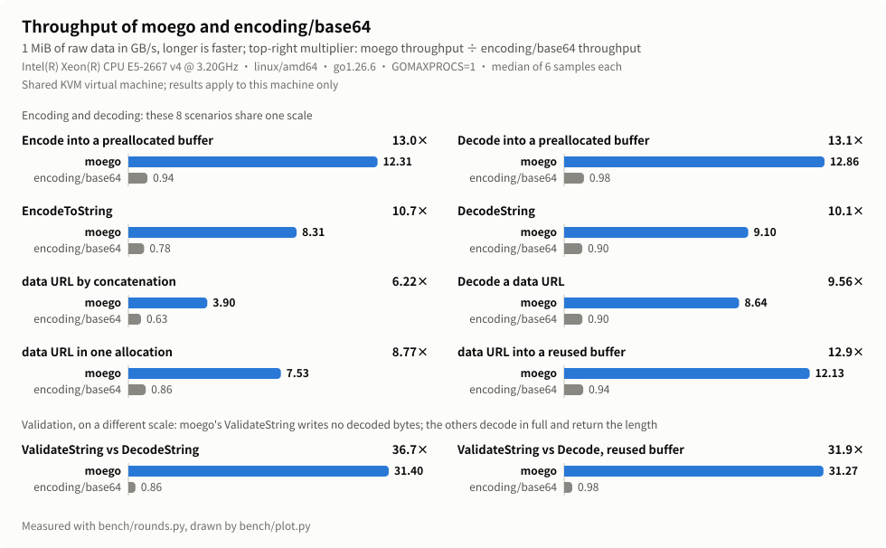
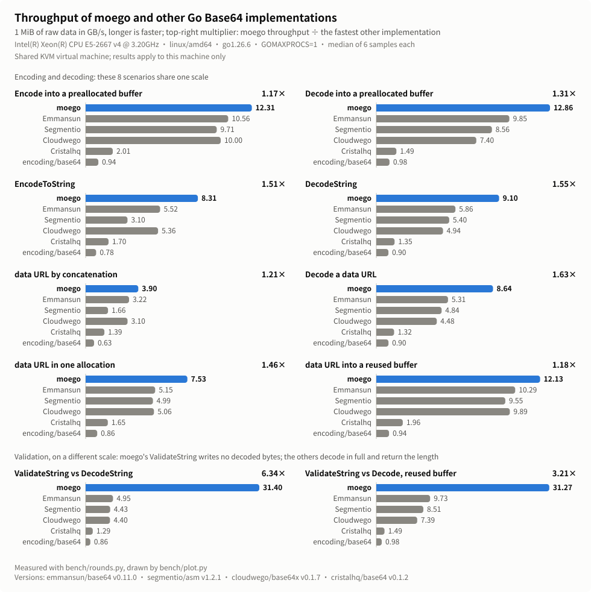

<div align="center">

<h1></h1>

SIMD Base64 for Go, with the same API as `encoding/base64`.

<p align="center">
  <a href="./README.zh_CN.md">简体中文</a> |
  <strong>English</strong>
</p>

</div>

moego encodes and decodes Base64 with AVX2 on amd64 and NEON on arm64,
builds data URLs, and checks Base64 input without decoding it. It was written
for the image, audio and file payloads that
[new-api](https://github.com/QuantumNous/new-api) forwards.

On an Intel Xeon E5-2667 v4, encoding and decoding 1 MiB into a preallocated
buffer run about 13 times as fast as `encoding/base64`, and 1.17 and 1.31
times as fast as the fastest other Go package measured.

## Performance

<p align="center">
  
</p>

<p align="center">
  
</p>

Throughput in GB/s on 1 MiB of binary data (the size before encoding):

| | moego | encoding/base64 | emmansun/base64 | vs encoding/base64 | vs emmansun/base64 |
|---|--:|--:|--:|--:|--:|
| Encode into a preallocated buffer | 12.31 | 0.94 | 10.56 | 13.0× | 1.17× |
| Decode into a preallocated buffer | 12.86 | 0.98 | 9.85 | 13.1× | 1.31× |
| `EncodeToString` | 8.31 | 0.78 | 5.52 | 10.7× | 1.51× |
| `DecodeString` | 9.10 | 0.90 | 5.86 | 10.1× | 1.55× |
| `EncodeDataURL` ¹ | 7.53 | 0.86 | 5.15 | 8.77× | 1.46× |
| `ValidateString` ² | 31.27 | 0.98 | 9.73 | 31.9× | 3.21× |

¹ The other packages build the same data URL in one allocation with their
own `Encode`.
² moego checks the input and returns its decoded length without writing the
decoded bytes. The other packages decode into a reused buffer. That is more
work, so this row does not compare decoding speed.

[emmansun/base64](https://github.com/emmansun/base64) v0.11.0 was the
fastest of the other packages in every row.
[segmentio/asm](https://github.com/segmentio/asm) v1.2.1,
[cloudwego/base64x](https://github.com/cloudwego/base64x) v0.1.7 and
[cristalhq/base64](https://github.com/cristalhq/base64) v0.1.2 were measured
too.

The test machine is a shared KVM virtual machine: Intel Xeon E5-2667 v4
(AVX2, no AVX-512), linux/amd64, Go 1.26.6, `GOMAXPROCS=1`. Other CPUs may
give different results. emmansun/base64, for example, has an AVX-512 path
that this CPU cannot run. Results for every size from 1 KiB to 4 MiB are in
[docs/benchmark-results-linux-amd64.md](docs/benchmark-results-linux-amd64.md)
(in Chinese).

## Features

### Same API as encoding/base64

`Encoding` has the methods of `encoding/base64`: `Encode`, `Decode`,
`AppendEncode`, `AppendDecode`, `EncodeToString`, `DecodeString`,
`EncodedLen`, `DecodedLen`, `Strict` and `WithPadding`. `StdEncoding`,
`URLEncoding`, `RawStdEncoding`, `RawURLEncoding`, `NewEncoding`,
`NewEncoder`, `NewDecoder`, `StdPadding` and `NoPadding` are there too.
Output, errors, error offsets and the partial output on corrupt input match
the standard library, and `CorruptInputError` is the standard library's own
type. Switching usually means changing the import path.

### SIMD on amd64 and arm64

On amd64, moego uses AVX2 when the CPU and the operating system support it.
On arm64 it uses NEON. Standard and URL alphabets, padded or raw, take the
SIMD path. Everything else uses `encoding/base64`: custom alphabets, very
short inputs, amd64 CPUs without AVX2, other architectures, and builds with
`-tags purego`.

### Data URLs

`EncodeDataURL("image/png", data)` returns `data:image/png;base64,...` in a
single allocation. `AppendDataURL` appends the same text to a buffer you
reuse. The media type is written as given, so pass a valid MIME type.

### Validation without decoding

`ValidateString` returns the length and error that `DecodeString` would
return, without keeping the decoded bytes. For standard and URL input
without line breaks, the SIMD path checks the input without producing the
decoded bytes. Other input may be decoded into a temporary buffer. Use it
when you need to know that input is valid and how many bytes it holds, but
not the bytes themselves.

### Result buffers are not zeroed first

On amd64 and arm64, `EncodeToString`, `DecodeString` and `EncodeDataURL`
allocate their result without zeroing it first, because every byte is
written before the result is returned. This saves a pass over the memory. It
uses the Go runtime's internal `runtime.mallocgc` through `//go:linkname`.
Go keeps that function available because widely used packages depend on it
([go.dev/issue/67401](https://go.dev/issue/67401)), but the compiler does
not check its signature, so run your tests after upgrading Go. Build with
`-tags moego_zeroalloc` to use ordinary zeroed allocation instead. Those
three functions are then slower, and nothing else changes.

## Quick start

```sh
go get github.com/MoeForge/moego
```

moego needs Go 1.23 or later and depends only on the standard library.

```go
package main

import (
	"fmt"

	"github.com/MoeForge/moego/base64"
)

func main() {
	data := []byte("hello, moego")

	s := base64.StdEncoding.EncodeToString(data)
	fmt.Println(s) // aGVsbG8sIG1vZWdv

	decoded, err := base64.StdEncoding.DecodeString(s)
	if err != nil {
		panic(err)
	}
	fmt.Println(string(decoded)) // hello, moego

	// Reuse one buffer across calls.
	var buf []byte
	buf = base64.URLEncoding.AppendEncode(buf[:0], data)
	fmt.Println(string(buf)) // aGVsbG8sIG1vZWdv

	// Check the input and get its decoded length.
	n, err := base64.StdEncoding.ValidateString(s)
	fmt.Println(n, err) // 12 <nil>

	fmt.Println(base64.EncodeDataURL("text/plain", data))
	// data:text/plain;base64,aGVsbG8sIG1vZWdv
}
```

## Limitations

- `NewEncoder` and `NewDecoder` return the standard library's streaming
  encoder and decoder, which do not use SIMD.
- `Encode` and `Decode` need separate source and destination buffers.
  Decoding in place is not supported.
- The speed of the arm64 NEON path has not been measured for this release.

## Testing

```sh
# Unit tests, and differential tests against encoding/base64.
go test ./...

# Fuzz the codec against encoding/base64.
go test -run '^$' -fuzz FuzzCodecDifferential ./base64

# Benchmarks against other Go Base64 packages. bench/ is a separate Go
# module, so those packages are dependencies of bench/ only. It needs
# Go 1.26.
cd bench && go test ./... && go test -run '^$' -bench . -benchmem -cpu=1
```

How the benchmarks work is described in [bench/README.md](bench/README.md)
(in Chinese).

## License

moego is licensed under the [MIT License](LICENSE).
