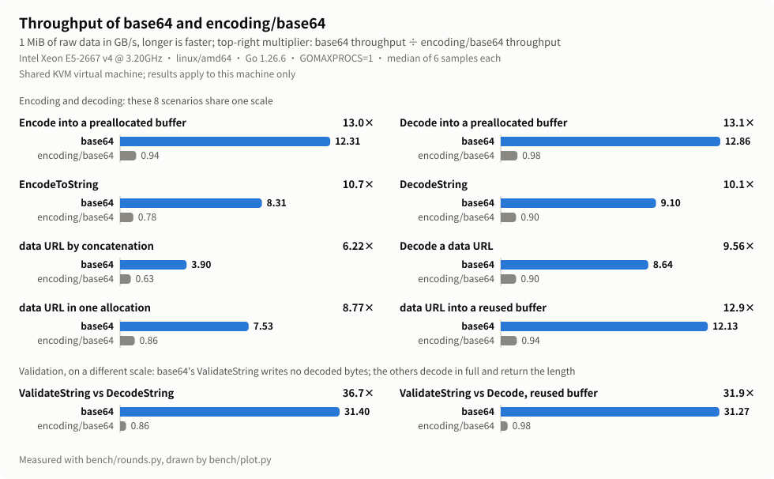

<div align="center">

<h1></h1>

Fast Base64 and order-preserving JSON for Go, built for agent gateways:
drop-in replacements for `encoding/base64`, `gjson` and `sjson`.

<p align="center">
  <a href="./README.zh_CN.md">简体中文</a> |
  <strong>English</strong>
</p>

</div>

moego is built for products such as agent gateways, which read, rewrite and
forward large request bodies: JSON that often embeds images, audio and files
as Base64. [new-api](https://github.com/QuantumNous/new-api) is the
best-practice example of moego in use.

moego has two packages:

- [`base64`](#base64) encodes and decodes Base64 with AVX2 on amd64 and NEON
  on arm64, builds data URLs, and checks Base64 input without decoding it.
  It has the API of [`encoding/base64`](https://pkg.go.dev/encoding/base64)
  and returns the same results.
- [`ojson`](#ojson) reads and edits JSON without reordering it. It has the
  API of [`gjson`](https://github.com/tidwall/gjson) v1.19.0 and
  [`sjson`](https://github.com/tidwall/sjson) v1.2.5 and returns the same
  results on valid JSON.

On an Intel Xeon E5-2667 v4, `base64` encodes and decodes 1 MiB into a
preallocated buffer about 13 times as fast as `encoding/base64`, and 1.17
and 1.31 times as fast as the fastest other Go package measured. On a 1 MiB
chat request, `ojson` applies 20 parameter overrides 2.78 times as fast as
the fastest order-preserving alternative, and reads six fields 16.5 times
as fast.

Both packages need Go 1.23 or later and depend only on the standard library:

```sh
go get github.com/MoeForge/moego
```

## base64

`github.com/MoeForge/moego/base64` encodes and decodes Base64 in place of
`encoding/base64`. Standard and URL alphabets are processed with SIMD, and
output and errors match the standard library, so switching usually means
changing the import path.

### Performance

<p align="center">
  
</p>

<p align="center">
  
</p>

The charts show the throughput of every scenario on 1 MiB of data. The
table picks a few of them, in GB/s of binary data (the size before
encoding):

| | base64 | encoding/base64 | emmansun/base64 | vs encoding/base64 | vs emmansun/base64 |
|---|--:|--:|--:|--:|--:|
| Encode into a preallocated buffer | 12.31 | 0.94 | 10.56 | 13.0× | 1.17× |
| Decode into a preallocated buffer | 12.86 | 0.98 | 9.85 | 13.1× | 1.31× |
| `EncodeToString` | 8.31 | 0.78 | 5.52 | 10.7× | 1.51× |
| `DecodeString` | 9.10 | 0.90 | 5.86 | 10.1× | 1.55× |
| `EncodeDataURL` ¹ | 7.53 | 0.86 | 5.15 | 8.77× | 1.46× |
| `ValidateString` ² | 31.27 | 0.98 | 9.73 | 31.9× | 3.21× |

¹ The other packages build the same data URL in one allocation with their
own `Encode`.
² `base64` checks the input and returns its decoded length without writing
the decoded bytes. The other packages decode into a reused buffer. That is
more work, so this row does not compare decoding speed.

The other packages measured are
[`emmansun/base64`](https://github.com/emmansun/base64) v0.11.0,
[`segmentio/asm`](https://github.com/segmentio/asm) v1.2.1,
[`cloudwego/base64x`](https://github.com/cloudwego/base64x) v0.1.7 and
[`cristalhq/base64`](https://github.com/cristalhq/base64) v0.1.2.
`emmansun/base64` was the fastest of them in every scenario.

The test machine is a shared KVM virtual machine: Intel Xeon E5-2667 v4
(AVX2, no AVX-512), linux/amd64, Go 1.26.6, `GOMAXPROCS=1`. Other CPUs may
give different results. `emmansun/base64`, for example, has an AVX-512 path
that this CPU cannot run. Every size from 1 KiB to 4 MiB and the method are
in the [base64 benchmark results](docs/benchmark-results-linux-amd64.md).

### Features

#### Same API as encoding/base64

`Encoding` has the methods of `encoding/base64`: `Encode`, `Decode`,
`AppendEncode`, `AppendDecode`, `EncodeToString`, `DecodeString`,
`EncodedLen`, `DecodedLen`, `Strict` and `WithPadding`. `StdEncoding`,
`URLEncoding`, `RawStdEncoding`, `RawURLEncoding`, `NewEncoding`,
`NewEncoder`, `NewDecoder`, `StdPadding` and `NoPadding` are there too.

#### SIMD on amd64 and arm64

On amd64, `base64` uses AVX2 when the CPU and the operating system support
it. On arm64 it uses NEON. Standard and URL alphabets, padded or raw, take
the SIMD path. Everything else uses `encoding/base64`: custom alphabets,
very short inputs, amd64 CPUs without AVX2, other architectures, and builds
with `-tags purego`.

#### Data URLs

`EncodeDataURL("image/png", data)` returns `data:image/png;base64,...` in a
single allocation. `AppendDataURL` appends the same text to a buffer you
reuse. The media type is written as given, so pass a valid MIME type.

#### Validation without decoding

`ValidateString` returns the length and error that `DecodeString` would
return, without keeping the decoded bytes. For standard and URL input
without line breaks, the SIMD path checks the input without producing the
decoded bytes. Other input may be decoded into a temporary buffer. Use it
when you need to know that input is valid and how many bytes it holds, but
not the bytes themselves.

### Usage

```go
package main

import (
	"fmt"

	"github.com/MoeForge/moego/base64"
)

func main() {
	data := []byte("hello, moego")

	s := base64.StdEncoding.EncodeToString(data)
	fmt.Println(s) // aGVsbG8sIG1vZWdv

	decoded, err := base64.StdEncoding.DecodeString(s)
	if err != nil {
		panic(err)
	}
	fmt.Println(string(decoded)) // hello, moego

	// Reuse one buffer across calls.
	var buf []byte
	buf = base64.URLEncoding.AppendEncode(buf[:0], data)
	fmt.Println(string(buf)) // aGVsbG8sIG1vZWdv

	// Check the input and get its decoded length.
	n, err := base64.StdEncoding.ValidateString(s)
	fmt.Println(n, err) // 12 <nil>

	fmt.Println(base64.EncodeDataURL("text/plain", data))
	// data:text/plain;base64,aGVsbG8sIG1vZWdv
}
```

### Compatibility

On every input, `base64` returns what `encoding/base64` returns: output,
errors, error offsets and the partial output on corrupt input all match,
and `CorruptInputError` is the standard library's own type. Differential
and fuzz tests compare the two.

### Limitations

- `NewEncoder` and `NewDecoder` return the standard library's streaming
  encoder and decoder, which do not use SIMD.
- `Encode` and `Decode` need separate source and destination buffers.
  Decoding in place is not supported.
- The speed of the arm64 NEON path has not been measured.
- On amd64 and arm64, the result buffers of `EncodeToString`,
  `DecodeString` and `EncodeDataURL` are not zeroed first; see
  [Result buffers are not zeroed first](#result-buffers-are-not-zeroed-first).

## ojson

`github.com/MoeForge/moego/ojson` reads and edits JSON in place of `gjson`
and `sjson`. Edits keep the order of members and every byte they do not
touch, so an agent gateway can override a few parameters in a large request
without re-encoding it. Paths, modifiers, queries and write semantics match
`gjson` and `sjson`, so switching usually means changing the import path.

### Performance

<p align="center">
  
</p>

The chart shows the time and the bytes allocated per call for every
scenario on a 1 MiB chat request with an embedded image. The table picks a
few of them, as the median time per call:

| | ojson | gjson / sjson | sonic | vs the fastest order-preserving alternative |
|---|--:|--:|--:|--:|
| Read `model` and `group` | 465 ns | 807 ns | 527 ns | 1.13× |
| Read six fields, most absent | 44.9 µs | 1.72 ms | 743 µs | 16.5× |
| Query `messages.#(role=="user")…detail` | 96.5 µs | 4.64 ms | — | 48.1× |
| 1 override, new body | 239 µs ¹ | 281 µs | 547 µs | 1.18× |
| 20 overrides, new body | 310 µs ¹ | 11.3 ms | 966 µs | 2.78× |
| 20 overrides into a reused buffer | 132 µs ² | 11.3 ms | 966 µs | 8.26× |
| Set through a query | 118 µs | 355 µs | — | 3.00× |

¹ `Doc` with `Bytes`. `sjson` calls `SetBytes` once per override; `sonic`
edits an `ast.Node` and marshals it.
² `Doc.AppendTo` into a buffer kept across calls.

The other packages measured are `gjson` v1.19.0, `sjson` v1.2.5 and
[`sonic`](https://github.com/bytedance/sonic) v1.15.5. `sonic` reads with
one `sonic.Get` per path and edits with `sonic/ast`.

The test machine is a shared KVM virtual machine: Intel Xeon E5-2667 v4
(AVX2, no AVX-512), linux/amd64, Go 1.26.6, `GOMAXPROCS=1` on one pinned
CPU, with other users' load on it. Every size from 1 KiB to 8 MiB and the
method, as well as memory, complex paths, modifiers and `Result` methods,
are in the [ojson benchmark results](docs/ojson-benchmark-results-linux-amd64.md).

The margin depends on the workload. It is largest on big documents and on
keys that are absent. It is smallest on reads that stop near the top of the
body and on small documents: `model` and `group` at every size, one deep
path in 1 KiB and the 177-byte SSE chunk are 1.07–1.41 times as fast as the
fastest alternative. A single edit that returns a new slice is bound by
copying the body: at 1 MiB and 8 MiB, `SetBytes` takes as long as
`bytes.Clone` of the body, and its speed relative to `sjson` (1.02× and
0.92×) is within the variation of copying that much memory on this machine.
Reading several paths into the `[]Result` of `gjson` allocates more than
`sonic.Get`, which returns nodes that point into the input; the `NoCopy`
variants allocate nothing.

### Features

#### Same API as gjson and sjson

Every exported function, type, method and variable of `gjson` v1.19.0 and
`sjson` v1.2.5 is there with the same signature: `Get`, `GetBytes`,
`GetMany`, `GetManyBytes`, `Parse`, `Valid`, `ForEachLine`, `AddModifier`,
`Result` and its methods, `Set`, `SetBytes`, `SetRaw`, `Delete`, `Options`,
and the rest. The path syntax is that of `gjson`: wildcards, `#` for counts
and array mapping, `#(...)` and `#(...)#` queries, `|` pipes, `{...}` and
`[...]` multi-paths, literals, and all the built-in modifiers.

#### SIMD on amd64 and arm64

On amd64, `ojson` scans and validates JSON with AVX2 when the CPU and the
operating system support it. On arm64 it uses NEON. Everything else uses
portable Go code: amd64 CPUs without AVX2, other architectures, and builds
with `-tags purego`.

#### Order and untouched bytes

`Set` and `Delete` splice the new text into the input: whitespace,
formatting, number spelling and member order of everything else stay as
they were.

#### Several edits with Doc

A `Doc` collects edits in memory and writes the result once. The first edit
costs what `SetBytes` costs; later edits touch only the members they walk
through. `Set` and `Delete` on a `Doc` give the same bytes as `SetBytes` and
`DeleteBytes` called in sequence, and `Doc.Get` reads the current document.
Write the result out with one of:

- `Bytes` returns a new slice: one allocation and one copy of the body.
- `AppendTo` appends to a buffer you pass in. Reuse the buffer across
  requests and the body is copied without a new allocation.
- `WriteTo` writes to an `io.Writer`. Long runs of the input go to the
  writer directly, so the body is not copied.

#### Reads without copies

`GetBytes` and `GetManyBytes` copy each result out of the input, as `gjson`
does. `GetBytesNoCopy` and `GetManyBytesNoCopy` return results that point
into the input, and `GetManyBytesNoCopy` can reuse the `[]Result` you pass
in, so a read allocates nothing. With string input, `Get` and `GetMany`
always share memory with it.

#### Safety on malformed input

On input that `Valid` rejects, results may differ from those of `gjson`. No
call panics, overflows the stack or uses unbounded memory there: scanning
is iterative, `Valid` keeps its own stack, and modifier output is bounded.

### Usage

```go
package main

import (
	"fmt"
	"os"

	"github.com/MoeForge/moego/ojson"
)

func main() {
	body := []byte(`{"model":"gpt-4o","stream":true,"messages":[{"role":"user","content":"hi"}]}`)

	// Reads, as with gjson. The result does not share memory with body.
	fmt.Println(ojson.GetBytes(body, "model").String())           // gpt-4o
	fmt.Println(ojson.GetBytes(body, "messages.#.role").String()) // ["user"]

	// One edit, as with sjson. body is not modified.
	out, err := ojson.SetBytes(body, "temperature", 0.2)
	if err != nil {
		panic(err)
	}
	fmt.Println(string(out))
	// {"model":"gpt-4o","stream":true,"messages":[{"role":"user","content":"hi"}],"temperature":0.2}

	// Reads without copies. The results point into body.
	var buf []ojson.Result
	buf = ojson.GetManyBytesNoCopy(buf[:0], body, "model", "stream")
	fmt.Println(buf[0].String(), buf[1].Bool()) // gpt-4o true

	// Several edits, written once.
	doc := ojson.NewDoc(body)
	doc.Set("model", "gpt-4o-mini")
	doc.Set("messages.0.content", "hello")
	doc.Delete("stream")
	doc.WriteTo(os.Stdout)
	// {"model":"gpt-4o-mini","messages":[{"role":"user","content":"hello"}]}
}
```

#### Input lifetime

`ojson` avoids copies by letting results and a `Doc` point into the input.
Keep that input unchanged while they are in use:

- Results of `Get`, `GetMany`, `GetBytesNoCopy` and `GetManyBytesNoCopy`,
  and of `Result.Get` on them, are valid only while the input is not
  modified. Results of `GetBytes` and `GetManyBytes` are copies.
- `NewDoc` does not copy the input. Do not modify it until you are done with
  the `Doc` and with the results of `Doc.Get`.
- `SetBytesOptions` and `SetRawBytesOptions` with `Optimistic` and
  `ReplaceInPlace` may write the result into the input. Use only the
  returned slice afterwards.

The other edit functions never modify their input.

### Compatibility

On valid JSON, `ojson` returns what `gjson` and `sjson` return, except
where those libraries fail:

- An array index more than 16,777,216 past the end returns an error.
  `sjson` pads the array with nulls until memory runs out.
- `Valid` does not overflow the goroutine stack on deep nesting.
- With `Optimistic` and `ReplaceInPlace`, a string value that needs escaping
  is set. `sjson` leaves the document unchanged.
- `Set`, `SetRaw` and `Delete` never turn a valid document into invalid
  JSON. On a query path, `sjson` writes the value at the offsets of
  whatever `Get` finds, including modifier output and counts. `ojson` sets
  only values of the document and otherwise leaves it unchanged, without an
  error. Where a plain path runs into a string, `sjson` edits the text
  inside the string; `ojson` replaces the string.
- `Set` and `SetRaw` never add a second member with a key the object
  already has. `sjson` misses members whose key starts with `[`, `{` or `!`
  and adds another; `ojson` replaces the existing one.
- `@pretty`, `@dig` and `@group` return an empty value when their output
  would exceed 64 MiB plus 16 times the size of their input.

On malformed JSON the results may differ from those of `gjson` and `sjson`;
see [Safety on malformed input](#safety-on-malformed-input). Unlike in
`gjson`, `AddModifier` is safe to call while other goroutines read. The
package documentation lists every case. A differential test suite compares
the two on every exported identifier, on generated documents and paths, and
on a corpus of retained cases.

### Limitations

- A `Doc` holds the whole document in memory. Reading from an `io.ReaderAt`
  or a file without loading it is not supported.
- The speed of the arm64 NEON path and of builds with `-tags purego`, which
  use portable Go code, has not been measured.
- Values come back through the `Result` type of `gjson`, so a read of
  several paths allocates the `[]Result` (80 B per path on amd64) unless you
  use `GetManyBytesNoCopy` with a reused slice.
- On amd64 and arm64, the bytes that `GetBytes` and `GetManyBytes` copy,
  and the output of `SetBytes`, `Doc.Bytes` and other edits that return a
  new slice, are not zeroed first; see
  [Result buffers are not zeroed first](#result-buffers-are-not-zeroed-first).

## Result buffers are not zeroed first

On amd64 and arm64, these functions allocate their result without zeroing
it first, because every byte is written before the result is returned. This
saves a pass over the memory.

- `base64`: `EncodeToString`, `DecodeString` and `EncodeDataURL`.
- `ojson`: the bytes that `GetBytes` and `GetManyBytes` copy, and the
  output of `SetBytes`, `Doc.Bytes` and other edits that return a new
  slice.

They use the Go runtime's internal `runtime.mallocgc` through
`//go:linkname`. Go keeps that function available because widely used
packages depend on it ([go.dev/issue/67401](https://go.dev/issue/67401)),
but the compiler does not check its signature, so run your tests after
upgrading Go. Build with `-tags moego_zeroalloc` to switch both packages to
ordinary zeroed allocation. These functions are then slower; nothing else
changes.

## Testing

Unit tests of both packages, and differential tests of `base64` against
`encoding/base64`:

```sh
go test ./...
```

Fuzzing and benchmarks of `base64`. The benchmarks are in `bench/`, a
separate Go module, so the packages they compare with are dependencies of
`bench/` only. It needs Go 1.26:

```sh
# Fuzz the codec against encoding/base64.
go test -run '^$' -fuzz FuzzCodecDifferential ./base64

# Benchmarks against other Go Base64 packages.
cd bench && go test ./... && go test -run '^$' -bench . -benchmem -cpu=1
```

Differential tests, fuzzing and benchmarks of `ojson` are in `bench/json/`,
another separate Go module, so the packages they compare with are
dependencies of `bench/json/` only. It needs Go 1.26:

```sh
cd bench/json

# Every exported identifier, the differential and regression tests, and
# the output checks of the benchmarked engines.
go test ./...

# Fuzz Get and Set against gjson and sjson.
go test -run '^$' -fuzz FuzzGet2 ./diff
go test -run '^$' -fuzz FuzzSet2 ./diff
```

How the `base64` benchmarks work is described in
[bench/README.md](bench/README.md) (in Chinese), and how to run the `ojson`
benchmarks in the
[ojson benchmark results](docs/ojson-benchmark-results-linux-amd64.md#reproducing).

## License

moego is licensed under the [MIT License](LICENSE).
