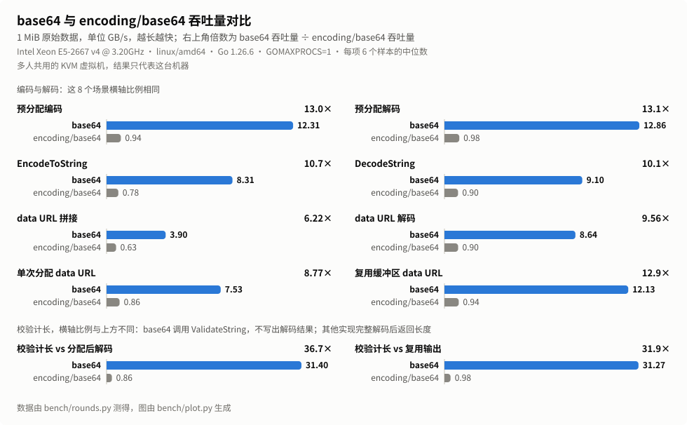

<div align="center">

<h1></h1>

为 Agent 网关打造的 Go 高速 Base64 与保序 JSON 库，可以直接替换 `encoding/base64`、`gjson` 和 `sjson`。

<p align="center">
  <strong>简体中文</strong> |
  <a href="./README.md">English</a>
</p>

</div>

moego 为 Agent 网关这类产品而写。这类网关要读取、改写和转发大量请求体：JSON 里常常嵌着 Base64 编码的图片、音频和文件。[new-api](https://github.com/QuantumNous/new-api) 是 moego 的最佳实践。

moego 有两个包：

- [`base64`](#base64)：编解码 Base64，在 amd64 上用 AVX2、在 arm64 上用 NEON，还能生成 data URL，也能不解码就校验输入。API 和 [`encoding/base64`](https://pkg.go.dev/encoding/base64) 相同，结果也相同。
- [`ojson`](#ojson)：读取和修改 JSON，不打乱成员顺序。API 和 [`gjson`](https://github.com/tidwall/gjson) v1.19.0、[`sjson`](https://github.com/tidwall/sjson) v1.2.5 相同，在合法 JSON 上结果也相同。

在 Intel Xeon E5-2667 v4 上，`base64` 把 1 MiB 数据编码或解码到预先分配的缓冲区，速度约为 `encoding/base64` 的 13 倍；和测过的其他 Go 实现里最快的一个相比，编码是它的 1.17 倍，解码是 1.31 倍。在 1 MiB 的聊天请求上，`ojson` 做 20 次参数覆盖的速度是最快的保序方案的 2.78 倍，读取六个字段是 16.5 倍。

两个包都需要 Go 1.23 或更高版本，只依赖标准库：

```sh
go get github.com/MoeForge/moego
```

## base64

`github.com/MoeForge/moego/base64` 用来替代 `encoding/base64` 编解码 Base64。标准字母表和 URL 字母表的数据用 SIMD 处理，输出和错误都和标准库相同，换用通常只需要改 import 路径。

### 性能

<p align="center">
  
</p>

<p align="center">
  
</p>

两张图是 1 MiB 数据上各个场景的吞吐量。下表摘出其中几项，单位是 GB/s，按编码前的二进制数据量计算：

| | base64 | encoding/base64 | emmansun/base64 | 相比 encoding/base64 | 相比 emmansun/base64 |
|---|--:|--:|--:|--:|--:|
| 编码到预先分配的缓冲区 | 12.31 | 0.94 | 10.56 | 13.0× | 1.17× |
| 解码到预先分配的缓冲区 | 12.86 | 0.98 | 9.85 | 13.1× | 1.31× |
| `EncodeToString` | 8.31 | 0.78 | 5.52 | 10.7× | 1.51× |
| `DecodeString` | 9.10 | 0.90 | 5.86 | 10.1× | 1.55× |
| `EncodeDataURL` ¹ | 7.53 | 0.86 | 5.15 | 8.77× | 1.46× |
| `ValidateString` ² | 31.27 | 0.98 | 9.73 | 31.9× | 3.21× |

¹ 其他实现用各自的 `Encode`，在一次分配里拼出同样的 data URL。
² `base64` 只检查输入并返回解码后的长度，不写出解码结果；其他实现把数据解码到复用的缓冲区里。解码的工作量更大，所以这一行比较的不是解码速度。

对比的实现是 [`emmansun/base64`](https://github.com/emmansun/base64) v0.11.0、[`segmentio/asm`](https://github.com/segmentio/asm) v1.2.1、[`cloudwego/base64x`](https://github.com/cloudwego/base64x) v0.1.7 和 [`cristalhq/base64`](https://github.com/cristalhq/base64) v0.1.2，其中 `emmansun/base64` 在每个场景里都最快。

测试机是多人共用的 KVM 虚拟机：Intel Xeon E5-2667 v4（AVX2，没有 AVX-512），linux/amd64，Go 1.26.6，`GOMAXPROCS=1`。换成别的 CPU，结果可能不同，比如 `emmansun/base64` 有 AVX-512 路径，这台机器跑不了。1 KiB 到 4 MiB 各个大小的结果和测量方法见 [base64 的性能测试结果](docs/benchmark-results-linux-amd64.zh_CN.md)。

### 功能

#### 和 encoding/base64 相同的 API

`Encoding` 有 `encoding/base64` 的全部方法：`Encode`、`Decode`、`AppendEncode`、`AppendDecode`、`EncodeToString`、`DecodeString`、`EncodedLen`、`DecodedLen`、`Strict` 和 `WithPadding`。`StdEncoding`、`URLEncoding`、`RawStdEncoding`、`RawURLEncoding`、`NewEncoding`、`NewEncoder`、`NewDecoder`、`StdPadding` 和 `NoPadding` 也都有。

#### amd64 和 arm64 上的 SIMD

在 amd64 上，CPU 和操作系统都支持 AVX2 时，`base64` 用 AVX2；在 arm64 上用 NEON。标准字母表和 URL 字母表，带不带填充都走 SIMD 路径。其余情况交给 `encoding/base64`：自定义字母表、很短的输入、不支持 AVX2 的 amd64 CPU、其他架构，以及用 `-tags purego` 编译的程序。

#### data URL

`EncodeDataURL("image/png", data)` 用一次分配返回 `data:image/png;base64,...`。`AppendDataURL` 把同样的内容追加到你复用的缓冲区里。媒体类型按原样写入，所以要传合法的 MIME 类型。

#### 不解码的校验

`ValidateString` 返回 `DecodeString` 会返回的长度和错误，但不保留解码结果。对不含换行的标准或 URL 输入，SIMD 路径只检查输入，不产出解码后的字节。其他输入可能会先解码到临时缓冲区。只需要知道输入是否合法、能解出多少字节，而不需要字节本身时，可以用它。

### 用法

```go
package main

import (
	"fmt"

	"github.com/MoeForge/moego/base64"
)

func main() {
	data := []byte("hello, moego")

	s := base64.StdEncoding.EncodeToString(data)
	fmt.Println(s) // aGVsbG8sIG1vZWdv

	decoded, err := base64.StdEncoding.DecodeString(s)
	if err != nil {
		panic(err)
	}
	fmt.Println(string(decoded)) // hello, moego

	// 多次调用复用同一个缓冲区。
	var buf []byte
	buf = base64.URLEncoding.AppendEncode(buf[:0], data)
	fmt.Println(string(buf)) // aGVsbG8sIG1vZWdv

	// 检查输入，并得到解码后的长度。
	n, err := base64.StdEncoding.ValidateString(s)
	fmt.Println(n, err) // 12 <nil>

	fmt.Println(base64.EncodeDataURL("text/plain", data))
	// data:text/plain;base64,aGVsbG8sIG1vZWdv
}
```

### 兼容性

`base64` 在所有输入上都返回 `encoding/base64` 返回的结果：输出、错误、错误位置，以及输入损坏时已经解出的部分都相同，`CorruptInputError` 就是标准库自己的类型。差分测试和模糊测试对比两边的结果。

### 限制

- `NewEncoder` 和 `NewDecoder` 返回标准库的流式编码器和解码器，不使用 SIMD。
- `Encode` 和 `Decode` 的源缓冲区和目标缓冲区必须分开，不支持原地解码。
- arm64 NEON 路径的速度还没有测过。
- 在 amd64 和 arm64 上，`EncodeToString`、`DecodeString` 和 `EncodeDataURL` 的结果缓冲区不预先清零，见[结果缓冲区不预先清零](#结果缓冲区不预先清零)。

## ojson

`github.com/MoeForge/moego/ojson` 用来替代 `gjson` 和 `sjson` 读取和修改 JSON。修改时保留成员顺序和所有没改动的字节，Agent 网关在大请求里覆盖几个参数，不需要重新编码整个请求体。路径、modifier、查询和写入语义都和 `gjson`、`sjson` 相同，换用通常只需要改 import 路径。

### 性能

<p align="center">
  
</p>

图是 1 MiB 带图聊天请求上各个场景的每次耗时和分配字节数。下表摘出其中几项，数值是每次调用的中位耗时：

| | ojson | gjson / sjson | sonic | 相比最快的保序方案 |
|---|--:|--:|--:|--:|
| 读取 `model` 和 `group` | 465 ns | 807 ns | 527 ns | 1.13× |
| 读取六个字段，大多不存在 | 44.9 µs | 1.72 ms | 743 µs | 16.5× |
| 查询 `messages.#(role=="user")…detail` | 96.5 µs | 4.64 ms | — | 48.1× |
| 1 次覆盖，输出新请求体 | 239 µs ¹ | 281 µs | 547 µs | 1.18× |
| 20 次覆盖，输出新请求体 | 310 µs ¹ | 11.3 ms | 966 µs | 2.78× |
| 20 次覆盖，写进复用的缓冲区 | 132 µs ² | 11.3 ms | 966 µs | 8.26× |
| 按查询路径 Set | 118 µs | 355 µs | — | 3.00× |

¹ `Doc` 加 `Bytes`。`sjson` 每次覆盖调用一次 `SetBytes`；`sonic` 修改 `ast.Node` 后再序列化。
² `Doc.AppendTo` 追加到多次调用之间复用的缓冲区。

对比的实现是 `gjson` v1.19.0、`sjson` v1.2.5 和 [`sonic`](https://github.com/bytedance/sonic) v1.15.5。`sonic` 读取时每个路径调用一次 `sonic.Get`，修改用 `sonic/ast`。

测试机是多人共用的 KVM 虚拟机：Intel Xeon E5-2667 v4（AVX2，没有 AVX-512），linux/amd64，Go 1.26.6，`GOMAXPROCS=1`，固定在一个 CPU 上，测量时有其他用户的负载。1 KiB 到 8 MiB 各个大小的结果和测量方法，以及内存、复杂路径、modifier 和 `Result` 方法的结果，见 [ojson 的性能测试结果](docs/ojson-benchmark-results-linux-amd64.zh_CN.md)。

领先幅度因场景而异。在大文档和不存在的键上差距最大；在只读到请求体开头就结束的读取和小文档上差距最小：各个大小上读取 `model` 和 `group`、在 1 KiB 上读取一个深层路径、读取 177 字节的 SSE 分片，是最快对手的 1.07–1.41 倍。返回新切片的单次修改受拷贝请求体的成本限制：在 1 MiB 和 8 MiB 上，`SetBytes` 的耗时和对请求体做一次 `bytes.Clone` 相同，相对 `sjson` 的速度（1.02× 和 0.92×）在这台机器上拷贝这么多内存的波动范围以内。读取多个路径时，`gjson` 的 `[]Result` 比 `sonic.Get` 返回的、指向输入的节点占用更多内存；`NoCopy` 版本不分配。

### 功能

#### 和 gjson、sjson 相同的 API

`gjson` v1.19.0 和 `sjson` v1.2.5 导出的每个函数、类型、方法和变量都有，签名相同：`Get`、`GetBytes`、`GetMany`、`GetManyBytes`、`Parse`、`Valid`、`ForEachLine`、`AddModifier`、`Result` 及其方法、`Set`、`SetBytes`、`SetRaw`、`Delete`、`Options` 等。路径语法是 `gjson` 的：通配符、`#` 计数和数组映射、`#(...)` 与 `#(...)#` 查询、`|` 管道、`{...}` 和 `[...]` 多路径、字面量，以及全部内置 modifier。

#### amd64 和 arm64 上的 SIMD

在 amd64 上，CPU 和操作系统都支持 AVX2 时，`ojson` 用 AVX2 扫描和校验 JSON；在 arm64 上用 NEON。其余情况用可移植的 Go 代码：不支持 AVX2 的 amd64 CPU、其他架构，以及用 `-tags purego` 编译的程序。

#### 保留顺序和未改动的字节

`Set` 和 `Delete` 把新文本拼进输入，其余部分的空白、排版、数字写法和成员顺序都不变。

#### 用 Doc 做多次修改

`Doc` 在内存里累积修改，最后一次写出结果。第一次修改的成本和 `SetBytes` 相同；之后的修改只涉及路径经过的成员。`Doc` 上的 `Set` 和 `Delete` 与依次调用 `SetBytes`、`DeleteBytes` 得到的字节完全相同，`Doc.Get` 读取当前文档。写出结果有三种方式：

- `Bytes` 返回新切片：一次分配，拷贝一遍请求体。
- `AppendTo` 追加到你传入的缓冲区。在多个请求之间复用这个缓冲区，就只拷贝请求体，不再分配。
- `WriteTo` 写给 `io.Writer`。输入中较长的连续部分直接交给 writer，请求体不拷贝。

#### 不拷贝的读取

`GetBytes` 和 `GetManyBytes` 像 `gjson` 一样把每个结果从输入中拷出来。`GetBytesNoCopy` 和 `GetManyBytesNoCopy` 返回指向输入的结果，`GetManyBytesNoCopy` 还能复用你传入的 `[]Result`，读取不分配内存。输入是 string 时，`Get` 和 `GetMany` 的结果总是和输入共用内存。

#### 非法输入上的安全性

在 `Valid` 判为非法的输入上，结果可能和 `gjson` 不同，但不会 panic、栈溢出或无限占用内存：扫描是迭代的，`Valid` 用自己的栈，modifier 的输出有上限。

### 用法

```go
package main

import (
	"fmt"
	"os"

	"github.com/MoeForge/moego/ojson"
)

func main() {
	body := []byte(`{"model":"gpt-4o","stream":true,"messages":[{"role":"user","content":"hi"}]}`)

	// 和 gjson 一样读取。结果不和 body 共用内存。
	fmt.Println(ojson.GetBytes(body, "model").String())           // gpt-4o
	fmt.Println(ojson.GetBytes(body, "messages.#.role").String()) // ["user"]

	// 和 sjson 一样做一次修改。body 不会被改动。
	out, err := ojson.SetBytes(body, "temperature", 0.2)
	if err != nil {
		panic(err)
	}
	fmt.Println(string(out))
	// {"model":"gpt-4o","stream":true,"messages":[{"role":"user","content":"hi"}],"temperature":0.2}

	// 不拷贝的读取。结果指向 body。
	var buf []ojson.Result
	buf = ojson.GetManyBytesNoCopy(buf[:0], body, "model", "stream")
	fmt.Println(buf[0].String(), buf[1].Bool()) // gpt-4o true

	// 多次修改，最后一次写出。
	doc := ojson.NewDoc(body)
	doc.Set("model", "gpt-4o-mini")
	doc.Set("messages.0.content", "hello")
	doc.Delete("stream")
	doc.WriteTo(os.Stdout)
	// {"model":"gpt-4o-mini","messages":[{"role":"user","content":"hello"}]}
}
```

#### 输入的生命周期

`ojson` 让结果和 `Doc` 直接指向输入，以省掉拷贝。它们在用的时候，输入不能改：

- `Get`、`GetMany`、`GetBytesNoCopy`、`GetManyBytesNoCopy` 的结果，以及在这些结果上调用 `Result.Get` 得到的结果，只在输入没被修改时有效。`GetBytes` 和 `GetManyBytes` 的结果是拷贝。
- `NewDoc` 不拷贝输入。用完 `Doc` 和 `Doc.Get` 的结果之前，不要修改输入。
- `SetBytesOptions` 和 `SetRawBytesOptions` 同时设置 `Optimistic` 和 `ReplaceInPlace` 时，可能把结果写进输入的内存。之后只用返回的切片。

其他修改函数都不会改动输入。

### 兼容性

在合法 JSON 上，`ojson` 返回 `gjson` 和 `sjson` 返回的结果，只有下面这些 `gjson`、`sjson` 出错的情况例外：

- 数组下标超出末尾 16,777,216 以上时返回错误。`sjson` 会一直用 null 填充数组，直到内存耗尽。
- `Valid` 在深层嵌套上不会让 goroutine 栈溢出。
- 设置 `Optimistic` 和 `ReplaceInPlace` 时，需要转义的字符串值也能写入。`sjson` 会保持文档不变。
- `Set`、`SetRaw` 和 `Delete` 不会把合法文档变成非法 JSON。在查询路径上，`sjson` 会把值写到 `Get` 找到的任何位置，包括 modifier 的输出和计数；`ojson` 只写文档里实际存在的值，否则保持文档不变，也不返回错误。普通路径遇到字符串时，`sjson` 改写字符串内部的文本；`ojson` 替换整个字符串。
- `Set` 和 `SetRaw` 不会给对象再加一个已经存在的键。`sjson` 找不到以 `[`、`{` 或 `!` 开头的键，会再加一个成员；`ojson` 替换已有的成员。
- `@pretty`、`@dig` 和 `@group` 的输出超过 64 MiB 加输入大小的 16 倍时，返回空值。

在非法 JSON 上，结果可能和 `gjson`、`sjson` 不同，见[非法输入上的安全性](#非法输入上的安全性)。和 `gjson` 不同，`AddModifier` 可以在其他 goroutine 读取时安全调用。完整的情况列表见包文档。差分测试逐个对比全部导出标识符，并在生成的文档与路径、以及保留下来的用例集上比较两边的结果。

### 限制

- `Doc` 把整个文档放在内存里，还不支持从 `io.ReaderAt` 或文件直接读取。
- arm64 NEON 路径，以及用可移植的 Go 代码的 `-tags purego` 构建，速度还没有测过。
- 结果通过 `gjson` 的 `Result` 类型返回，所以读取多个路径时要分配 `[]Result`（amd64 上每个路径 80 B），除非用 `GetManyBytesNoCopy` 并复用切片。
- 在 amd64 和 arm64 上，`GetBytes`、`GetManyBytes` 拷出的字节，以及 `SetBytes`、`Doc.Bytes` 等返回新切片的修改的输出，结果缓冲区不预先清零，见[结果缓冲区不预先清零](#结果缓冲区不预先清零)。

## 结果缓冲区不预先清零

在 amd64 和 arm64 上，下面这些函数分配结果时不先清零，因为返回之前每个字节都会写入，这样能省掉一遍内存写入：

- `base64`：`EncodeToString`、`DecodeString` 和 `EncodeDataURL`。
- `ojson`：`GetBytes`、`GetManyBytes` 拷出的字节，以及 `SetBytes`、`Doc.Bytes` 等返回新切片的修改的输出。

它们通过 `//go:linkname` 调用 Go 运行时的内部函数 `runtime.mallocgc`。被广泛使用的包依赖这个函数，所以 Go 会保留它（[go.dev/issue/67401](https://go.dev/issue/67401)），但编译器不检查它的签名，升级 Go 之后请跑一遍你的测试。用 `-tags moego_zeroalloc` 编译可以让两个包都改用普通的清零分配，这些函数会变慢，其他部分不受影响。

## 测试

两个包的单元测试，以及 `base64` 和 `encoding/base64` 的差分测试：

```sh
go test ./...
```

`base64` 的模糊测试和基准测试。基准测试在单独的 Go module `bench/` 里，对比的包只出现在它的依赖中，需要 Go 1.26：

```sh
# 模糊测试：编解码结果和 encoding/base64 对比。
go test -run '^$' -fuzz FuzzCodecDifferential ./base64

# 和其他 Go Base64 包对比的基准测试。
cd bench && go test ./... && go test -run '^$' -bench . -benchmem -cpu=1
```

`ojson` 的差分测试、模糊测试和基准测试在单独的 Go module `bench/json/` 里，对比的包只出现在它的依赖中，需要 Go 1.26：

```sh
cd bench/json

# 全部导出标识符的一致性检查、差分测试、回归测试，以及各个被测实现的输出核对。
go test ./...

# 模糊测试：Get 和 Set 的结果与 gjson、sjson 对比。
go test -run '^$' -fuzz FuzzGet2 ./diff
go test -run '^$' -fuzz FuzzSet2 ./diff
```

`base64` 基准测试的做法见 [bench/README.md](bench/README.md)，`ojson` 基准测试的做法见 [ojson 的性能测试结果](docs/ojson-benchmark-results-linux-amd64.zh_CN.md#复现)。

## 许可证

moego 使用 [MIT 许可证](LICENSE)。
