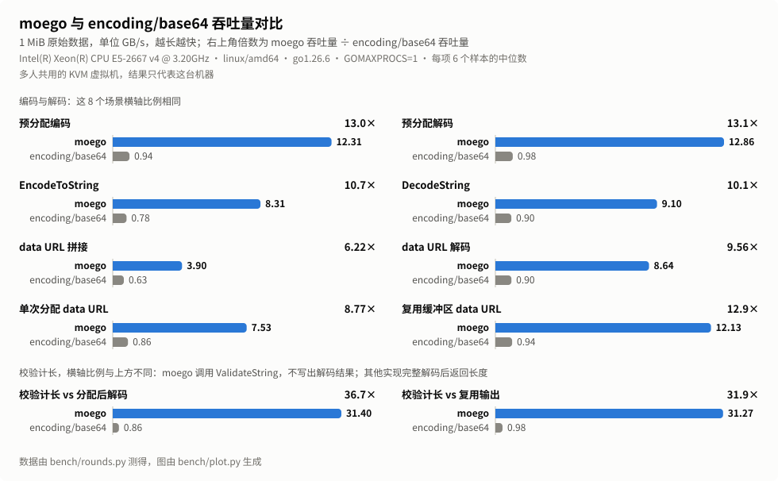
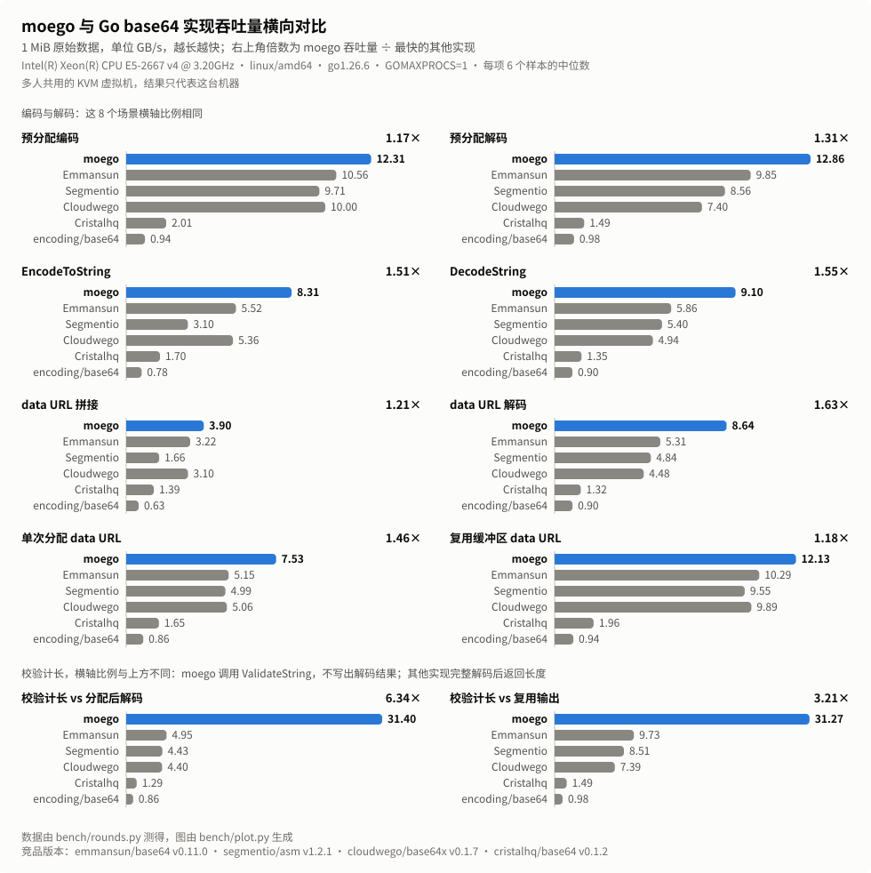

<div align="center">

<h1></h1>

Go 的 SIMD Base64 库，API 和 `encoding/base64` 相同。

<p align="center">
  <strong>简体中文</strong> |
  <a href="./README.md">English</a>
</p>

</div>

moego 在 amd64 上用 AVX2、在 arm64 上用 NEON 编解码 Base64，还能生成 data URL，也能在不解码的情况下校验 Base64 输入。它是为 [new-api](https://github.com/QuantumNous/new-api) 转发的图片、音频和文件写的。

在 Intel Xeon E5-2667 v4 上，把 1 MiB 数据编码或解码到预先分配的缓冲区，速度约为 `encoding/base64` 的 13 倍；和测过的其他 Go 实现里最快的一个相比，编码速度是它的 1.17 倍，解码是 1.31 倍。

## 性能

<p align="center">
  
</p>

<p align="center">
  
</p>

两张图是 1 MiB 数据上各个场景的吞吐量。下表摘出其中几项，单位是 GB/s，按编码前的二进制数据量计算：

| | moego | encoding/base64 | emmansun/base64 | 相比 encoding/base64 | 相比 emmansun/base64 |
|---|--:|--:|--:|--:|--:|
| 编码到预先分配的缓冲区 | 12.31 | 0.94 | 10.56 | 13.0× | 1.17× |
| 解码到预先分配的缓冲区 | 12.86 | 0.98 | 9.85 | 13.1× | 1.31× |
| `EncodeToString` | 8.31 | 0.78 | 5.52 | 10.7× | 1.51× |
| `DecodeString` | 9.10 | 0.90 | 5.86 | 10.1× | 1.55× |
| `EncodeDataURL` ¹ | 7.53 | 0.86 | 5.15 | 8.77× | 1.46× |
| `ValidateString` ² | 31.27 | 0.98 | 9.73 | 31.9× | 3.21× |

¹ 其他实现用各自的 `Encode`，在一次分配里拼出同样的 data URL。
² moego 只检查输入并返回解码后的长度，不写出解码结果；其他实现把数据解码到复用的缓冲区里。解码的工作量更大，所以这一行比较的不是解码速度。

其他实现中，[emmansun/base64](https://github.com/emmansun/base64) v0.11.0 在每个场景里都最快。[segmentio/asm](https://github.com/segmentio/asm) v1.2.1、[cloudwego/base64x](https://github.com/cloudwego/base64x) v0.1.7 和 [cristalhq/base64](https://github.com/cristalhq/base64) v0.1.2 也一起测了。

测试机是多人共用的 KVM 虚拟机：Intel Xeon E5-2667 v4（AVX2，没有 AVX-512），linux/amd64，Go 1.26.6，`GOMAXPROCS=1`。换成别的 CPU，结果可能不同，比如 emmansun/base64 有 AVX-512 路径，这台机器跑不了。1 KiB 到 4 MiB 各个大小的结果见 [docs/benchmark-results-linux-amd64.md](docs/benchmark-results-linux-amd64.md)。

## 功能

### 和 encoding/base64 相同的 API

`Encoding` 有 `encoding/base64` 的全部方法：`Encode`、`Decode`、`AppendEncode`、`AppendDecode`、`EncodeToString`、`DecodeString`、`EncodedLen`、`DecodedLen`、`Strict` 和 `WithPadding`。`StdEncoding`、`URLEncoding`、`RawStdEncoding`、`RawURLEncoding`、`NewEncoding`、`NewEncoder`、`NewDecoder`、`StdPadding` 和 `NoPadding` 也都有。输出、错误、错误位置，以及输入损坏时已经解出的部分，都和标准库一致，`CorruptInputError` 就是标准库自己的类型。换用 moego 通常只需要改 import 路径。

### amd64 和 arm64 上的 SIMD

在 amd64 上，CPU 和操作系统都支持 AVX2 时，moego 用 AVX2；在 arm64 上用 NEON。标准字母表和 URL 字母表，带不带填充都走 SIMD 路径。其余情况交给 `encoding/base64`：自定义字母表、很短的输入、不支持 AVX2 的 amd64 CPU、其他架构，以及用 `-tags purego` 编译的程序。

### data URL

`EncodeDataURL("image/png", data)` 用一次分配返回 `data:image/png;base64,...`。`AppendDataURL` 把同样的内容追加到你复用的缓冲区里。媒体类型按原样写入，所以要传合法的 MIME 类型。

### 不解码的校验

`ValidateString` 返回 `DecodeString` 会返回的长度和错误，但不保留解码结果。对不含换行的标准或 URL 输入，SIMD 路径只检查输入，不产出解码后的字节。其他输入可能会先解码到临时缓冲区。只需要知道输入是否合法、能解出多少字节，而不需要字节本身时，可以用它。

### 结果缓冲区不预先清零

在 amd64 和 arm64 上，`EncodeToString`、`DecodeString` 和 `EncodeDataURL` 分配结果时不先清零，因为返回之前每个字节都会写入。这样能省掉一遍内存写入。它通过 `//go:linkname` 调用 Go 运行时的内部函数 `runtime.mallocgc`。被广泛使用的包依赖这个函数，所以 Go 会保留它（[go.dev/issue/67401](https://go.dev/issue/67401)），但编译器不检查它的签名，升级 Go 之后请跑一遍你的测试。用 `-tags moego_zeroalloc` 编译可以改用普通的清零分配，这三个函数会变慢，其他部分不受影响。

## 快速上手

```sh
go get github.com/MoeForge/moego
```

moego 需要 Go 1.23 或更高版本，只依赖标准库。

```go
package main

import (
	"fmt"

	"github.com/MoeForge/moego/base64"
)

func main() {
	data := []byte("hello, moego")

	s := base64.StdEncoding.EncodeToString(data)
	fmt.Println(s) // aGVsbG8sIG1vZWdv

	decoded, err := base64.StdEncoding.DecodeString(s)
	if err != nil {
		panic(err)
	}
	fmt.Println(string(decoded)) // hello, moego

	// 多次调用复用同一个缓冲区。
	var buf []byte
	buf = base64.URLEncoding.AppendEncode(buf[:0], data)
	fmt.Println(string(buf)) // aGVsbG8sIG1vZWdv

	// 检查输入，并得到解码后的长度。
	n, err := base64.StdEncoding.ValidateString(s)
	fmt.Println(n, err) // 12 <nil>

	fmt.Println(base64.EncodeDataURL("text/plain", data))
	// data:text/plain;base64,aGVsbG8sIG1vZWdv
}
```

## 限制

- `NewEncoder` 和 `NewDecoder` 返回标准库的流式编码器和解码器，不使用 SIMD。
- `Encode` 和 `Decode` 的源缓冲区和目标缓冲区必须分开，不支持原地解码。
- 这个版本还没有测过 arm64 NEON 路径的速度。

## 测试

```sh
# 单元测试，以及和 encoding/base64 的差分测试。
go test ./...

# 模糊测试：编解码结果和 encoding/base64 对比。
go test -run '^$' -fuzz FuzzCodecDifferential ./base64

# 和其他 Go Base64 包对比的基准测试。bench/ 是单独的 Go module，
# 这些包只出现在它的依赖里。它需要 Go 1.26。
cd bench && go test ./... && go test -run '^$' -bench . -benchmem -cpu=1
```

基准测试的做法见 [bench/README.md](bench/README.md)。

## 许可证

moego 使用 [MIT 许可证](LICENSE)。
