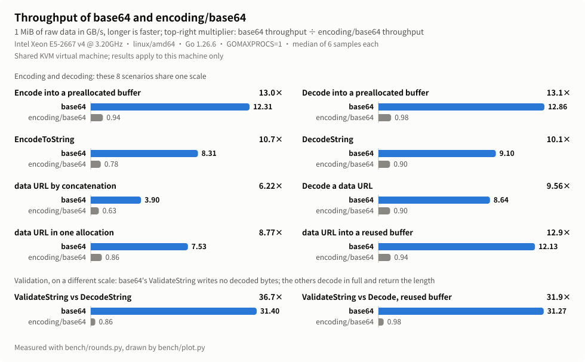
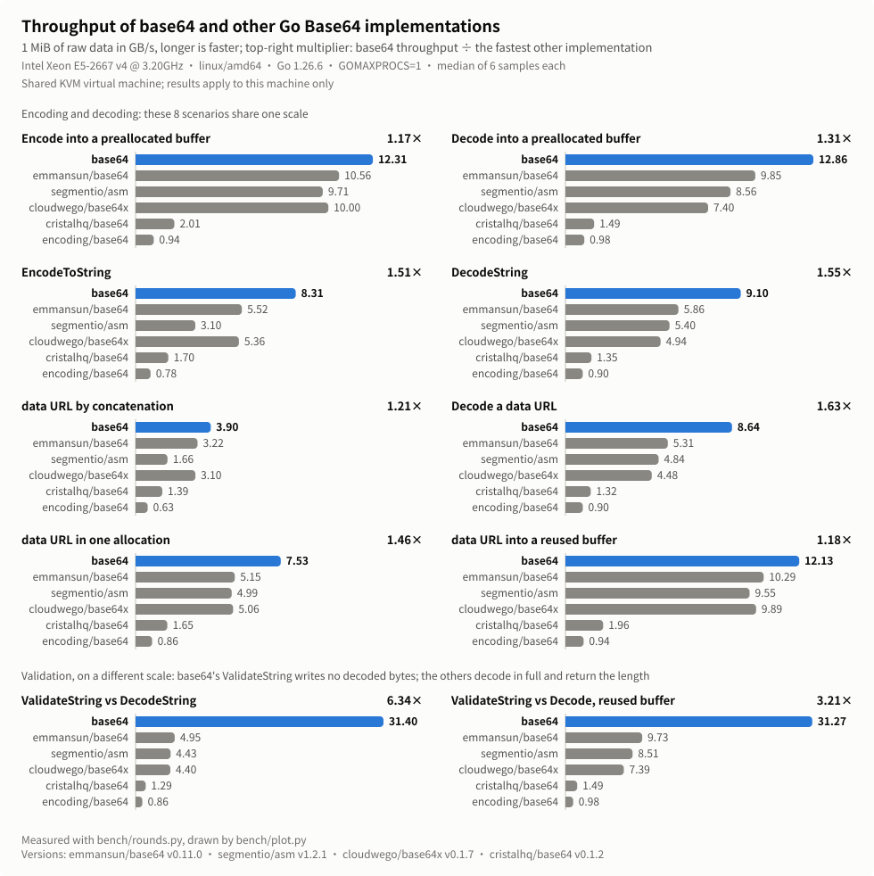

# base64 performance on Linux AMD64

`base64` compared with `encoding/base64` and other Go Base64 packages on one
Linux AMD64 machine: every result from 1 KiB to 4 MiB, and how to reproduce
the numbers.
[简体中文](benchmark-results-linux-amd64.zh_CN.md)

## Test environment

The numbers were measured on 2026-10-26 on a KVM virtual machine shared with
other users: Intel Xeon E5-2667 v4 @ 3.20GHz (Broadwell-EP, AVX2, no
AVX-512), linux/amd64, Go 1.26.6 with the default `GOAMD64=v1`,
`GOMAXPROCS=1`. Other users' load was on the machine during the
measurement.

The packages compared are `encoding/base64` of Go 1.26.6,
[`emmansun/base64`](https://github.com/emmansun/base64) v0.11.0,
[`segmentio/asm`](https://github.com/segmentio/asm) v1.2.1,
[`cloudwego/base64x`](https://github.com/cloudwego/base64x) v0.1.7 and
[`cristalhq/base64`](https://github.com/cristalhq/base64) v0.1.2. This CPU
has no AVX-512, so the AVX-512 VBMI path of `emmansun/base64` is not used;
`emmansun/base64`, `segmentio/asm` and `cloudwego/base64x` each take their
AVX2 path.

## Workloads

Every package is measured at the same call boundary:

- **Encode and decode into a preallocated buffer**: input and output
  buffers are allocated once and reused, so only encoding or decoding is
  measured. The decode target has 8 bytes more than `DecodedLen` for every
  package, because some packages write past the end of the result.
- **`EncodeToString` and `DecodeString`**: each package's own string API,
  including the allocation of the result and GC.
- **data URL by concatenation**: `"data:" + mime + ";base64," +
  EncodeToString(src)`. **Decode a data URL**: split at the comma with
  `strings.Cut`, then call `DecodeString`.
- **data URL in one allocation**: `base64` calls `EncodeDataURL`. The other
  packages do the same thing by hand: allocate the final length once, write
  the prefix, encode into the same memory with their own `Encode`, and
  return it as a string without a copy. This compares encoding speed, not
  the saved allocation.
- **data URL into a reused buffer**: `base64` calls `AppendDataURL`; the
  other packages write the prefix and the output of `Encode` into one
  reused byte slice.
- **Validation**: `base64` calls `ValidateString`. The other packages have
  no such API and return the length after `DecodeString` (allocating
  decode) or after `Decode` into a preallocated buffer (reused output).

Every result is checked after it is measured. `TestCompetitors` also
compares the output of every package with `encoding/base64` over all tail
lengths and SIMD block boundaries. All inputs are valid standard Base64
without line breaks.

## Method

- One test binary is built from the benchmarks in `bench/`, and every
  sample comes from it.
- [bench/rounds.py](../bench/rounds.md) samples serially: each size of each
  scenario runs in its own process with `-benchtime=200ms -count=1
  -cpu=1`, pinned to one vCPU with `taskset`.
- There are 6 rounds. Each round rotates the order of the six packages by
  one, so each package runs once in every position. Each result is the
  median of 6 samples.
- The data is pseudo-random binary data from a fixed seed, in five sizes:
  1 KiB, 32 KiB, 256 KiB, 1 MiB and 4 MiB. Throughput is computed from the
  raw bytes before encoding, so encoding and decoding can be compared
  directly.

## Results

<p align="center">
  
</p>

<p align="center">
  
</p>

The charts show 1 MiB of data and the table every size; both come from
the same complete run. Throughput is in GB/s of raw data; a multiplier is
the other package's median time divided by the median time of `base64`;
"fastest other" is the fastest package in the row apart from `base64`.

| Scenario | Size | base64 time (μs) | base64 (GB/s) | encoding/base64 (GB/s) | Fastest other (GB/s) | vs encoding/base64 | vs fastest other |
|---|---|--:|--:|--:|---|--:|--:|
| Encode into a preallocated buffer | 1 KiB | 0.07712 | 13.28 | 0.93 | emmansun/base64 9.94 | 14.2× | 1.34× |
| Encode into a preallocated buffer | 32 KiB | 2.112 | 15.51 | 0.94 | emmansun/base64 11.57 | 16.5× | 1.34× |
| Encode into a preallocated buffer | 256 KiB | 21.38 | 12.26 | 0.94 | emmansun/base64 10.50 | 13.0× | 1.17× |
| Encode into a preallocated buffer | 1 MiB | 85.18 | 12.31 | 0.94 | emmansun/base64 10.56 | 13.0× | 1.17× |
| Encode into a preallocated buffer | 4 MiB | 341.6 | 12.28 | 0.94 | emmansun/base64 10.55 | 13.0× | 1.16× |
| Decode into a preallocated buffer | 1 KiB | 0.09566 | 10.71 | 0.94 | emmansun/base64 6.64 | 11.4× | 1.61× |
| Decode into a preallocated buffer | 32 KiB | 2.479 | 13.22 | 0.98 | emmansun/base64 9.96 | 13.5× | 1.33× |
| Decode into a preallocated buffer | 256 KiB | 20.54 | 12.76 | 0.98 | emmansun/base64 9.78 | 13.1× | 1.31× |
| Decode into a preallocated buffer | 1 MiB | 81.52 | 12.86 | 0.98 | emmansun/base64 9.85 | 13.1× | 1.31× |
| Decode into a preallocated buffer | 4 MiB | 326.4 | 12.85 | 0.98 | emmansun/base64 9.82 | 13.1× | 1.31× |
| `EncodeToString` | 1 KiB | 0.2445 | 4.19 | 0.67 | emmansun/base64 3.37 | 6.21× | 1.24× |
| `EncodeToString` | 32 KiB | 6.017 | 5.45 | 0.71 | emmansun/base64 3.88 | 7.67× | 1.40× |
| `EncodeToString` | 256 KiB | 43.57 | 6.02 | 0.72 | emmansun/base64 4.39 | 8.34× | 1.37× |
| `EncodeToString` | 1 MiB | 126.2 | 8.31 | 0.78 | emmansun/base64 5.52 | 10.7× | 1.51× |
| `EncodeToString` | 4 MiB | 606.1 | 6.92 | 0.79 | cloudwego/base64x 4.38 | 8.72× | 1.58× |
| `DecodeString` | 1 KiB | 0.2472 | 4.14 | 0.80 | emmansun/base64 3.01 | 5.17× | 1.38× |
| `DecodeString` | 32 KiB | 5.263 | 6.23 | 0.85 | emmansun/base64 4.16 | 7.36× | 1.50× |
| `DecodeString` | 256 KiB | 37.92 | 6.91 | 0.88 | emmansun/base64 4.86 | 7.88× | 1.42× |
| `DecodeString` | 1 MiB | 115.3 | 9.10 | 0.90 | emmansun/base64 5.86 | 10.1× | 1.55× |
| `DecodeString` | 4 MiB | 602.4 | 6.96 | 0.84 | emmansun/base64 4.07 | 8.32× | 1.71× |
| data URL by concatenation | 1 KiB | 0.4958 | 2.07 | 0.57 | emmansun/base64 1.83 | 3.60× | 1.13× |
| data URL by concatenation | 32 KiB | 12.33 | 2.66 | 0.62 | emmansun/base64 2.22 | 4.27× | 1.20× |
| data URL by concatenation | 256 KiB | 92.69 | 2.83 | 0.64 | cloudwego/base64x 2.50 | 4.44× | 1.13× |
| data URL by concatenation | 1 MiB | 268.9 | 3.90 | 0.63 | emmansun/base64 3.22 | 6.22× | 1.21× |
| data URL by concatenation | 4 MiB | 854.8 | 4.91 | 0.62 | emmansun/base64 3.80 | 7.98× | 1.29× |
| Decode a data URL | 1 KiB | 0.2732 | 3.75 | 0.78 | emmansun/base64 2.82 | 4.79× | 1.33× |
| Decode a data URL | 32 KiB | 5.567 | 5.89 | 0.84 | emmansun/base64 3.86 | 7.04× | 1.52× |
| Decode a data URL | 256 KiB | 38.81 | 6.75 | 0.87 | emmansun/base64 4.46 | 7.72× | 1.52× |
| Decode a data URL | 1 MiB | 121.4 | 8.64 | 0.90 | emmansun/base64 5.31 | 9.56× | 1.63× |
| Decode a data URL | 4 MiB | 545.9 | 7.68 | 0.83 | segmentio/asm 4.14 | 9.25× | 1.86× |
| data URL in one allocation | 1 KiB | 0.2571 | 3.98 | 0.76 | emmansun/base64 3.04 | 5.21× | 1.31× |
| data URL in one allocation | 32 KiB | 6.159 | 5.32 | 0.81 | emmansun/base64 3.84 | 6.54× | 1.39× |
| data URL in one allocation | 256 KiB | 41.28 | 6.35 | 0.84 | emmansun/base64 4.57 | 7.56× | 1.39× |
| data URL in one allocation | 1 MiB | 139.2 | 7.53 | 0.86 | emmansun/base64 5.15 | 8.77× | 1.46× |
| data URL in one allocation | 4 MiB | 465.4 | 9.01 | 0.80 | segmentio/asm 5.88 | 11.2× | 1.53× |
| data URL into a reused buffer | 1 KiB | 0.08859 | 11.56 | 0.92 | emmansun/base64 8.61 | 12.5× | 1.34× |
| data URL into a reused buffer | 32 KiB | 2.201 | 14.88 | 0.94 | emmansun/base64 11.04 | 15.8× | 1.35× |
| data URL into a reused buffer | 256 KiB | 21.68 | 12.09 | 0.94 | emmansun/base64 10.25 | 12.8× | 1.18× |
| data URL into a reused buffer | 1 MiB | 86.45 | 12.13 | 0.94 | emmansun/base64 10.29 | 12.9× | 1.18× |
| data URL into a reused buffer | 4 MiB | 346.0 | 12.12 | 0.94 | emmansun/base64 10.29 | 12.9× | 1.18× |
| ValidateString vs DecodeString | 1 KiB | 0.05545 | 18.47 | 0.80 | emmansun/base64 3.02 | 23.2× | 6.12× |
| ValidateString vs DecodeString | 32 KiB | 0.9931 | 32.99 | 0.85 | emmansun/base64 4.18 | 38.9× | 7.89× |
| ValidateString vs DecodeString | 256 KiB | 8.442 | 31.05 | 0.89 | emmansun/base64 5.16 | 34.9× | 6.02× |
| ValidateString vs DecodeString | 1 MiB | 33.40 | 31.40 | 0.86 | emmansun/base64 4.95 | 36.7× | 6.34× |
| ValidateString vs DecodeString | 4 MiB | 133.3 | 31.45 | 0.87 | emmansun/base64 6.08 | 36.0× | 5.18× |
| ValidateString vs Decode, reused buffer | 1 KiB | 0.05508 | 18.59 | 0.93 | emmansun/base64 6.57 | 19.9× | 2.83× |
| ValidateString vs Decode, reused buffer | 32 KiB | 0.9889 | 33.14 | 0.97 | emmansun/base64 9.96 | 34.0× | 3.33× |
| ValidateString vs Decode, reused buffer | 256 KiB | 8.478 | 30.92 | 0.98 | emmansun/base64 9.70 | 31.6× | 3.19× |
| ValidateString vs Decode, reused buffer | 1 MiB | 33.54 | 31.27 | 0.98 | emmansun/base64 9.73 | 31.9× | 3.21× |
| ValidateString vs Decode, reused buffer | 4 MiB | 133.1 | 31.52 | 0.98 | emmansun/base64 9.77 | 32.2× | 3.22× |

In the two validation groups, `base64` only checks the input and computes
the decoded length without writing the decoded bytes, while the other
packages decode in full. The work differs, so these multipliers do not
measure decoding speed; for that, see the preallocated decode and
`DecodeString` rows.

## Repeated runs

Three complete runs of the same code each gave `base64` a lower median time
than every other package on every row. The closest is data URL by
concatenation, where the median time was as little as 5% below the fastest
other package.

## Allocation without zeroing

On amd64 and arm64, `EncodeToString`, `DecodeString` and `EncodeDataURL`
allocate their result through `runtime.mallocgc` with `//go:linkname`,
without zeroing it first; building with `-tags moego_zeroalloc` switches
to an ordinary `make` (see the
[README](../README.md#result-buffers-are-not-zeroed-first)). On the same
machine, a binary built with `moego_zeroalloc` was measured separately on
the 30 rows of `BenchmarkNewAPI` and `BenchmarkDataURL`, with the same
method.

The 25 rows that allocate their result all got slower; the median time of
`base64` rose by 8%–83%. `EncodeToString` is affected most: against the
fastest other package it is 1.24–1.58 times as fast in the default build
and 0.95–1.08 times as fast with `moego_zeroalloc`. Apart from
`EncodeToString` at 4 MiB, the median time of `base64` is still below that
of every other package.

| Size | Default build, base64 time (μs) | vs fastest other | `moego_zeroalloc`, base64 time (μs) | vs fastest other |
|---|--:|--:|--:|--:|
| 1 KiB | 0.2445 | 1.24× | 0.2813 | 1.08× |
| 32 KiB | 6.017 | 1.40× | 8.039 | 1.05× |
| 256 KiB | 43.57 | 1.37× | 55.19 | 1.08× |
| 1 MiB | 126.2 | 1.51× | 176.2 | 1.08× |
| 4 MiB | 606.1 | 1.58× | 1,111 | 0.95× |

The default build and `moego_zeroalloc` were not measured in the same run,
so the difference includes run-to-run variation. data URL into a reused
buffer, preallocated encode and decode, and validation do not allocate a
result and are not affected.

## Limitations

- Only one shared KVM virtual machine was measured, and the results apply
  to this machine only. Other users' load changes the L3 cache and memory
  bandwidth available; scenarios that allocate their result also depend on
  GC and heap state.
- Other CPUs may give different results. On a CPU with AVX-512 VBMI, for
  example, `emmansun/base64` takes an AVX-512 path that was not measured
  here.
- The speed of the arm64 NEON path has not been measured for this version.
- Encoding into a preallocated buffer is about 1.17 times as fast as the
  fastest other package from 256 KiB up, below the 1.34 times at 1 KiB and
  32 KiB.

## Reproducing

Run from `bench/` with Go 1.26, Python 3 and bash; on Linux, `taskset` pins
the CPU:

```sh
go test ./...
go test -c -o /tmp/moego-bench.test
cases=()
for op in Codec/Encode Codec/Decode NewAPI/EncodeToString NewAPI/DecodeString \
          NewAPI/DataURLConcat NewAPI/DataURLDecode DataURL/OneAllocation \
          DataURL/AppendReuse Validation/Allocate Validation/Reuse; do
  for size in 1KiB 32KiB 256KiB 1MiB 4MiB; do
    cases+=(--case "Benchmark$op/$size")
  done
done
taskset -c 2 python3 rounds.py --binary /tmp/moego-bench.test \
  --output results/linux-amd64 --rounds 6 --benchtime 200ms "${cases[@]}"
python3 compare.py --suite all results/linux-amd64/combined.txt
python3 plot.py results/linux-amd64 --output ../docs/images --lang zh --note "多人共用的 KVM 虚拟机，结果只代表这台机器"
python3 plot.py results/linux-amd64 --output ../docs/images --lang en --note "Shared KVM virtual machine; results apply to this machine only"
```

Replace the 2 in `taskset -c 2` with the number of an idle CPU; the
`--output` directory must not exist yet. `compare.py` lists the median time
and throughput multiplier of `base64` against the fastest other package for
every row; `plot.py` draws the Chinese (`.zh.svg`) and English (`.en.svg`)
charts of this page and the README. For the `moego_zeroalloc` comparison, build the
binary with `go test -c -tags moego_zeroalloc`, select only the 30 rows of
`BenchmarkNewAPI` and `BenchmarkDataURL`, and compare with
`compare.py --suite newapi` and `--suite dataurl`. Options and output files
are described in [bench/README.md](../bench/README.md) and
[bench/rounds.md](../bench/rounds.md) (in Chinese).
