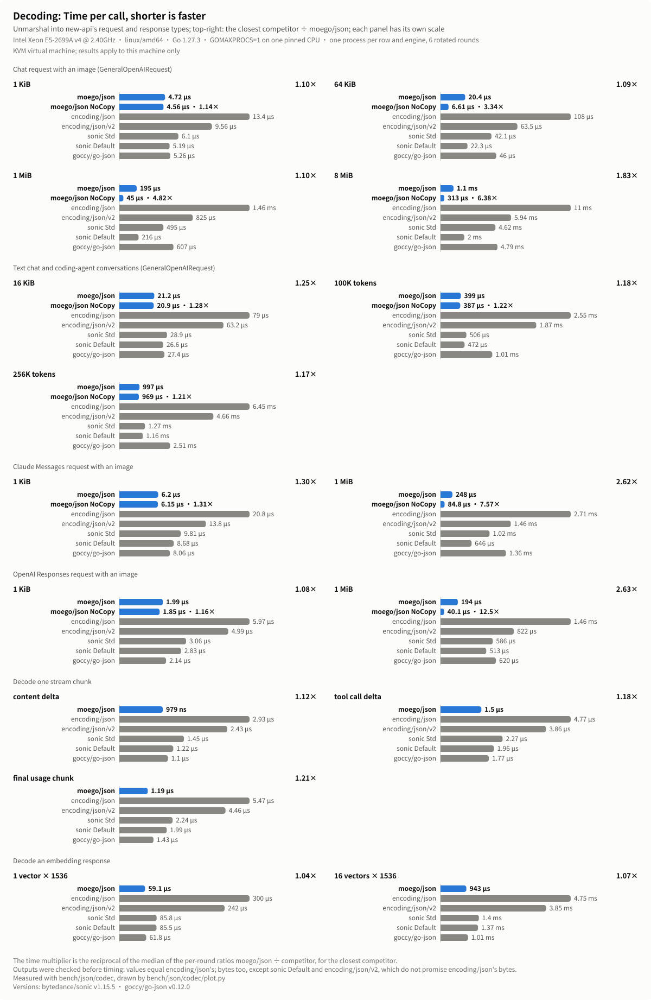
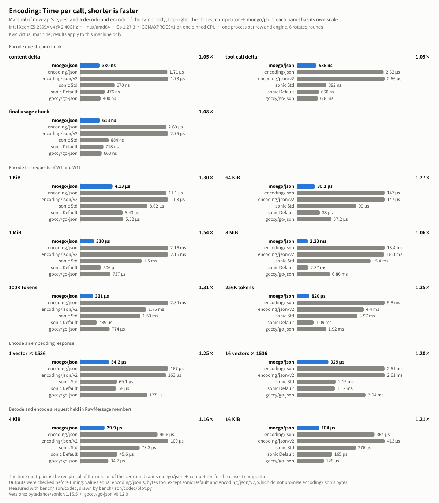
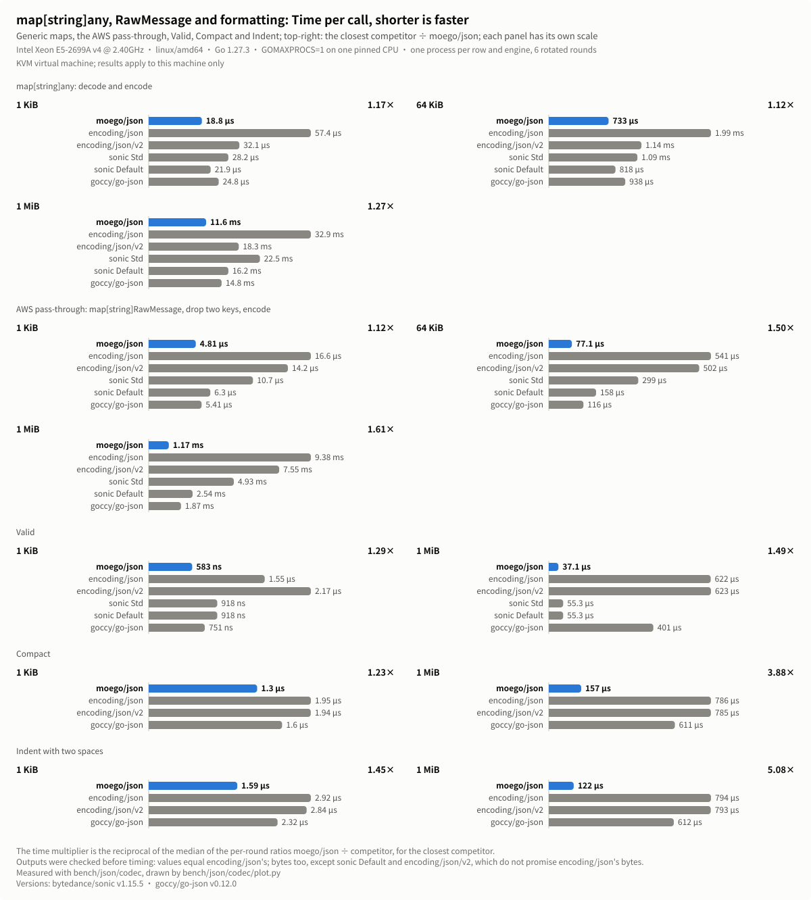

# moego/json performance on Linux AMD64

`moego/json` compared with `encoding/json`, `encoding/json/v2`, `sonic` and
`goccy/go-json` on one Linux AMD64 machine: every workload, size and engine
that was measured, where the margins are thinnest, and how to reproduce the
numbers.
[简体中文](json-benchmark-results-linux-amd64.zh_CN.md)

## Test environment

The numbers were measured on 2026-11-10 on a KVM virtual machine: Intel
Xeon E5-2699A v4 @ 2.40GHz (Broadwell-EP, AVX2, no AVX-512, 16 MiB L3),
24 vCPUs with one thread per core, Linux 6.12, transparent huge pages
`always`, Go 1.27.3 with the default `GOAMD64=v1`. Each benchmark process
ran on one CPU pinned with `taskset`, with `GOMAXPROCS=1`. No other
benchmark ran on the machine during the measurement; the load average
stayed between 0.4 and 1.3.

| Name in the charts | Package and version | What is measured |
|---|---|---|
| moego/json | this repository | `Marshal`, `Unmarshal`, `Valid`, `Compact`, `Indent`, `Decoder` |
| moego/json NoCopy | this repository | `UnmarshalNoCopy` |
| encoding/json | Go 1.27.3 | `Marshal`, `Unmarshal`, `Valid`, `Compact`, `Indent`, `Decoder` |
| encoding/json/v2 | Go 1.27.3 | `Marshal` with `OmitEmptyWithLegacySemantics(true)`, `Unmarshal`, `jsontext.Value.IsValid`, `jsontext.AppendFormat`, `UnmarshalRead` |
| sonic Std | github.com/bytedance/sonic v1.15.5 | `ConfigStd`: `Marshal`, `Unmarshal`, `Valid`, `Decoder` |
| sonic Default | github.com/bytedance/sonic v1.15.5 | `ConfigDefault`: `Marshal`, `Unmarshal`, `Valid`, `Decoder` |
| goccy/go-json | github.com/goccy/go-json v0.12.0 | `Marshal`, `Unmarshal`, `Valid`, `Compact`, `Indent`, `Decoder` |

With Go 1.27, `encoding/json` is built on `encoding/json/v2`, and
`moego/json` gives the results of that `encoding/json`. `sonic` runs its
JIT implementation; the benchmarks stop if `sonic.APIKind` reports the
`encoding/json` fallback. `sonic` Default does not escape HTML characters
or sort map keys, and its strings view the input, as those of
`UnmarshalNoCopy` do. `encoding/json/v2` needs one option to leave out the
zero numbers and bools that `encoding/json` leaves out; its `Compact` and
`Indent` rows use `jsontext.AppendFormat` with the options that
`jsontext.Value`'s methods use. `sonic` has no `Compact` or `Indent`.

## Workloads

The bodies come from `bench/json/codec`. The request and response types
follow [new-api](https://github.com/QuantumNous/new-api)'s declarations,
including their own `MarshalJSON` and `UnmarshalJSON` methods, which call
the engine under test.

- **W1**: a chat request with indented formatting whose last user message
  embeds a Base64 PNG data URL, sized to 1 KiB, 64 KiB, 1 MiB and 8 MiB,
  decoded into `GeneralOpenAIRequest`.
- **W1t**: text-only chat requests: 20 turns with six tools (16 KiB), and
  coding-agent conversations of 100K and 256K o200k_base tokens (376,782
  and 961,597 bytes) with code blocks, tool calls and tool results in
  English and Chinese, decoded into `GeneralOpenAIRequest`.
- **W2**: a Claude Messages request and an OpenAI Responses request of
  1 KiB and 1 MiB, each with an inline image, decoded into their types.
- **W3**: three stream chunks (a content delta, a tool call delta and the
  final chunk with usage), decoded and encoded.
- **W3m**: the requests of W1 and W1t, encoded.
- **W4**: a request whose size comes from many messages and tool schemas,
  of 1 KiB, 64 KiB and 1 MiB. `any` decodes it into `map[string]any` and
  encodes it again. `aws` decodes it into `map[string]json.RawMessage`,
  drops `model` and `stream` and encodes the rest, as new-api's AWS
  pass-through does.
- **W5**: a chat request of 4 KiB and 16 KiB whose size is in members kept
  as `RawMessage` (tool schemas, a response schema, metadata and
  `extra_body`), decoded and encoded again.
- **W6**: an embedding response with 1 or 16 vectors of 1536 float32
  values, decoded and encoded.
- **W8**: `Valid`, `Compact` and `Indent` (two spaces) on the W1 request of
  1 KiB and 1 MiB.
- **Large bodies**: the W1 request of 16 MiB and 64 MiB in a file, read by
  a program that links one engine only (`bench/json/cmd/w7`).

## Method

- Before timing, the tests check the outputs: every engine decodes the
  values that `encoding/json` decodes, and encodes, compacts and indents
  the bytes that `encoding/json` writes. `sonic` Default and
  `encoding/json/v2` do not promise `encoding/json`'s bytes, so their
  encoded output is compared as JSON values.
- Each row of each engine ran in a process of its own, with
  `-benchtime 1s` and one sample per process, so no engine runs on a heap
  that another left behind. The whole matrix ran in six rounds, and the
  order of the rows and of the engines in each row rotated by one each
  round: six samples per row and engine.
- Bars and table cells are the medians of the six samples. The speedup
  over a competitor is the reciprocal of the median of the six per-round
  ratios `moego/json` ÷ competitor, so it compares runs that saw the same
  conditions. "Closest" is the competitor with the smallest speedup.
- `moego/json` was faster than every competitor in every round of every
  row. The smallest per-round lead was 1.02×, over `goccy/go-json` on
  `W2/responses/1KiB`.
- Large bodies: one process per run, three runs per scenario and engine.
  Time was measured with the engine on one pinned CPU; memory in a second
  pass on two CPUs, so that the heap sampler runs while the engine works.
  The heap peak is the live heap above the start, sampled every 200 µs;
  the peak resident set is `VmHWM`, which includes the program and the
  runtime. Cells are medians.

## Results

Cells read time per call / bytes allocated per call / allocations per
call. "–" marks an engine that has no such operation.

<p align="center">
  
</p>

`moego/json` leads in all 41 rows. The median speedup is 4.51× over
`encoding/json` (1.50× to 16.7×) and 4.09× over `encoding/json/v2` (1.49×
to 16.8×).

### Decoding

<p align="center">
  
</p>

| Row | moego/json | NoCopy | encoding/json | encoding/json/v2 | sonic Std | sonic Default | goccy/go-json | vs closest (range over rounds) | vs encoding/json | NoCopy vs closest |
|---|--:|--:|--:|--:|--:|--:|--:|---|--:|--:|
| `W1/1KiB` | **4.72 µs / 3.99 KiB / 14** | 4.56 µs / 4.34 KiB / 19 | 13.4 µs / 4.48 KiB / 42 | 9.56 µs / 4.27 KiB / 32 | 6.1 µs / 5.73 KiB / 44 | 5.19 µs / 5.16 KiB / 27 | 5.26 µs / 5.23 KiB / 41 | **1.10×** sonic Default (1.06–1.14) | 2.84× | 1.14× sonic Default |
| `W1/64KiB` | **20.4 µs / 67.5 KiB / 15** | 6.61 µs / 3.72 KiB / 20 | 108 µs / 68 KiB / 42 | 63.5 µs / 67.8 KiB / 32 | 42.1 µs / 132 KiB / 44 | 22.3 µs / 68.2 KiB / 27 | 46 µs / 68.8 KiB / 41 | **1.09×** sonic Default (1.06–1.11) | 5.24× | 3.34× sonic Default |
| `W1/1MiB` | **195 µs / 1 MiB / 15** | 45 µs / 3.72 KiB / 20 | 1.46 ms / 1 MiB / 42 | 825 µs / 1 MiB / 32 | 495 µs / 2 MiB / 44 | 216 µs / 1 MiB / 27 | 607 µs / 1.01 MiB / 41 | **1.10×** sonic Default (1.10–1.15) | 7.52× | 4.82× sonic Default |
| `W1/8MiB` | **1.1 ms / 8 MiB / 15** | 313 µs / 3.72 KiB / 20 | 11 ms / 8 MiB / 43 | 5.94 ms / 8 MiB / 33 | 4.62 ms / 16 MiB / 46 | 2 ms / 8 MiB / 28 | 4.79 ms / 8.04 MiB / 41 | **1.83×** sonic Default (1.81–1.90) | 10.00× | 6.38× sonic Default |
| `W1t/16KiB` | **21.2 µs / 14.3 KiB / 30** | 20.9 µs / 16.6 KiB / 41 | 79 µs / 30 KiB / 123 | 63.2 µs / 29.6 KiB / 101 | 28.9 µs / 36.2 KiB / 103 | 26.6 µs / 35.4 KiB / 61 | 27.4 µs / 25.9 KiB / 113 | **1.25×** sonic Default (1.25–1.27) | 3.71× | 1.28× sonic Default |
| `W1t/100Ktok` | **399 µs / 406 KiB / 182** | 387 µs / 401 KiB / 330 | 2.55 ms / 840 KiB / 845 | 1.87 ms / 836 KiB / 621 | 506 µs / 856 KiB / 509 | 472 µs / 853 KiB / 252 | 1.01 ms / 466 KiB / 699 | **1.18×** sonic Default (1.17–1.20) | 6.40× | 1.22× sonic Default |
| `W1t/256Ktok` | **997 µs / 1.02 MiB / 363** | 969 µs / 0.998 MiB / 816 | 6.45 ms / 2.04 MiB / 2146 | 4.66 ms / 2.03 MiB / 1587 | 1.27 ms / 2.14 MiB / 1249 | 1.16 ms / 2.13 MiB / 595 | 2.51 ms / 1.12 MiB / 1726 | **1.17×** sonic Default (1.16–1.18) | 6.47× | 1.21× sonic Default |
| `W2/claude/1KiB` | **6.2 µs / 3.87 KiB / 26** | 6.15 µs / 4.52 KiB / 34 | 20.8 µs / 4.3 KiB / 68 | 13.8 µs / 3.98 KiB / 53 | 9.81 µs / 7.07 KiB / 72 | 8.68 µs / 6.59 KiB / 47 | 8.06 µs / 5.55 KiB / 66 | **1.30×** goccy/go-json (1.29–1.31) | 3.35× | 1.31× goccy/go-json |
| `W2/claude/1MiB` | **248 µs / 1 MiB / 27** | 84.8 µs / 3.74 KiB / 35 | 2.71 ms / 1 MiB / 69 | 1.46 ms / 1 MiB / 54 | 1.02 ms / 3 MiB / 73 | 646 µs / 2 MiB / 47 | 1.36 ms / 2.01 MiB / 67 | **2.62×** sonic Default (2.37–2.64) | 10.9× | 7.57× sonic Default |
| `W2/responses/1KiB` | **1.99 µs / 1.83 KiB / 3** | 1.85 µs / 1.83 KiB / 3 | 5.97 µs / 1.87 KiB / 9 | 4.99 µs / 1.87 KiB / 9 | 3.06 µs / 3.04 KiB / 14 | 2.83 µs / 3.02 KiB / 11 | 2.14 µs / 1.88 KiB / 12 | **1.08×** goccy/go-json (1.02–1.10) | 3.00× | 1.16× goccy/go-json |
| `W2/responses/1MiB` | **194 µs / 1 MiB / 4** | 40.1 µs / 984 B / 3 | 1.46 ms / 1 MiB / 9 | 822 µs / 1 MiB / 9 | 586 µs / 2.01 MiB / 14 | 513 µs / 2.01 MiB / 11 | 620 µs / 1 MiB / 12 | **2.63×** sonic Default (2.56–2.88) | 7.53× | 12.5× sonic Default |
| `W3/unmarshal/content` | **979 ns / 240 B / 4** | – | 2.93 µs / 240 B / 4 | 2.43 µs / 240 B / 4 | 1.45 µs / 864 B / 11 | 1.22 µs / 704 B / 6 | 1.1 µs / 736 B / 9 | **1.12×** goccy/go-json (1.11–1.12) | 2.99× | – |
| `W3/unmarshal/tool` | **1.5 µs / 344 B / 5** | – | 4.77 µs / 424 B / 8 | 3.86 µs / 408 B / 7 | 2.27 µs / 1.19 KiB / 16 | 1.96 µs / 1.02 KiB / 9 | 1.77 µs / 1.17 KiB / 14 | **1.18×** goccy/go-json (1.17–1.19) | 3.19× | – |
| `W3/unmarshal/usage` | **1.19 µs / 352 B / 3** | – | 5.47 µs / 352 B / 3 | 4.46 µs / 352 B / 3 | 2.24 µs / 1.11 KiB / 9 | 1.99 µs / 1 KiB / 5 | 1.43 µs / 464 B / 7 | **1.21×** goccy/go-json (1.20–1.21) | 4.60× | – |
| `W6/unmarshal/1x1536` | **59.1 µs / 12.5 KiB / 4** | – | 300 µs / 39 KiB / 15 | 242 µs / 39 KiB / 15 | 85.8 µs / 65.1 KiB / 18 | 85.5 µs / 65 KiB / 15 | 61.8 µs / 40.8 KiB / 15 | **1.04×** goccy/go-json (1.03–1.05) | 5.06× | – |
| `W6/unmarshal/16x1536` | **943 µs / 194 KiB / 35** | – | 4.75 ms / 620 KiB / 214 | 3.85 ms / 620 KiB / 214 | 1.4 ms / 0.996 MiB / 201 | 1.37 ms / 0.996 MiB / 183 | 1.01 ms / 646 KiB / 182 | **1.07×** goccy/go-json (1.06–1.07) | 5.04× | – |

### Encoding

<p align="center">
  
</p>

| Row | moego/json | encoding/json | encoding/json/v2 | sonic Std | sonic Default | goccy/go-json | vs closest (range over rounds) | vs encoding/json |
|---|--:|--:|--:|--:|--:|--:|---|--:|
| `W3/marshal/content` | **380 ns / 320 B / 1** | 1.71 µs / 320 B / 1 | 1.73 µs / 320 B / 1 | 670 ns / 336 B / 2 | 476 ns / 336 B / 2 | 400 ns / 320 B / 1 | **1.05×** goccy/go-json (1.05–1.08) | 4.51× |
| `W3/marshal/tool` | **586 ns / 416 B / 1** | 2.62 µs / 432 B / 2 | 2.66 µs / 432 B / 2 | 882 ns / 432 B / 2 | 660 ns / 432 B / 2 | 636 ns / 416 B / 1 | **1.09×** goccy/go-json (1.08–1.10) | 4.48× |
| `W3/marshal/usage` | **613 ns / 640 B / 1** | 2.69 µs / 640 B / 1 | 2.75 µs / 640 B / 1 | 884 ns / 656 B / 2 | 718 ns / 656 B / 2 | 663 ns / 640 B / 1 | **1.08×** goccy/go-json (1.07–1.09) | 4.39× |
| `W3m/1KiB` | **4.13 µs / 4.03 KiB / 5** | 11.1 µs / 4.07 KiB / 7 | 11.3 µs / 4.07 KiB / 7 | 8.62 µs / 4.36 KiB / 11 | 5.43 µs / 4.36 KiB / 11 | 5.52 µs / 4.03 KiB / 5 | **1.30×** sonic Default (1.27–1.40) | 2.66× |
| `W3m/64KiB` | **30.1 µs / 130 KiB / 5** | 147 µs / 130 KiB / 7 | 147 µs / 130 KiB / 7 | 99 µs / 130 KiB / 11 | 38 µs / 130 KiB / 11 | 57.2 µs / 130 KiB / 5 | **1.27×** sonic Default (1.25–1.30) | 4.91× |
| `W3m/1MiB` | **330 µs / 2 MiB / 5** | 2.16 ms / 2 MiB / 7 | 2.16 ms / 2 MiB / 7 | 1.5 ms / 2.04 MiB / 12 | 506 µs / 2 MiB / 12 | 737 µs / 2 MiB / 5 | **1.54×** sonic Default (1.50–1.63) | 6.54× |
| `W3m/8MiB` | **2.23 ms / 16 MiB / 5** | 18.4 ms / 16.3 MiB / 10 | 18.3 ms / 16.3 MiB / 9 | 15.4 ms / 48 MiB / 39 | 2.37 ms / 16 MiB / 20 | 6.86 ms / 16.1 MiB / 6 | **1.06×** sonic Default (1.03–1.08) | 8.24× |
| `W3m/100Ktok` | **331 µs / 739 KiB / 9** | 2.34 ms / 778 KiB / 222 | 1.75 ms / 779 KiB / 222 | 1.59 ms / 2.33 MiB / 33 | 439 µs / 739 KiB / 14 | 774 µs / 740 KiB / 9 | **1.31×** sonic Default (1.30–1.33) | 7.04× |
| `W3m/256Ktok` | **820 µs / 1.83 MiB / 9** | 5.8 ms / 2.08 MiB / 543 | 4.4 ms / 2.15 MiB / 544 | 3.97 ms / 6.58 MiB / 40 | 1.09 ms / 1.84 MiB / 14 | 1.92 ms / 1.84 MiB / 9 | **1.35×** sonic Default (1.31–1.35) | 7.07× |
| `W6/marshal/1x1536` | **54.2 µs / 20 KiB / 1** | 167 µs / 20 KiB / 1 | 163 µs / 20 KiB / 1 | 69.1 µs / 20 KiB / 2 | 68 µs / 20 KiB / 2 | 127 µs / 20 KiB / 1 | **1.25×** sonic Default (1.24–1.26) | 3.09× |
| `W6/marshal/16x1536` | **929 µs / 304 KiB / 1** | 2.61 ms / 304 KiB / 1 | 2.61 ms / 304 KiB / 1 | 1.15 ms / 304 KiB / 2 | 1.12 ms / 304 KiB / 2 | 2.04 ms / 304 KiB / 1 | **1.20×** sonic Default (1.20–1.21) | 2.81× |
| `W5/4KiB` | **29.9 µs / 24.2 KiB / 39** | 95.6 µs / 41.5 KiB / 58 | 109 µs / 41.5 KiB / 57 | 73.3 µs / 50.1 KiB / 98 | 45.6 µs / 32.9 KiB / 66 | 34.7 µs / 28 KiB / 72 | **1.16×** goccy/go-json (1.15–1.19) | 3.23× |
| `W5/16KiB` | **104 µs / 84.2 KiB / 135** | 364 µs / 171 KiB / 206 | 413 µs / 171 KiB / 205 | 276 µs / 206 KiB / 345 | 165 µs / 123 KiB / 236 | 126 µs / 104 KiB / 266 | **1.21×** goccy/go-json (1.18–1.22) | 3.49× |

### Maps, RawMessage and formatting

<p align="center">
  
</p>

| Row | moego/json | encoding/json | encoding/json/v2 | sonic Std | sonic Default | goccy/go-json | vs closest (range over rounds) | vs encoding/json |
|---|--:|--:|--:|--:|--:|--:|---|--:|
| `W4/any/1KiB` | **18.8 µs / 8.3 KiB / 53** | 57.4 µs / 11.4 KiB / 243 | 32.1 µs / 10.1 KiB / 170 | 28.2 µs / 14.3 KiB / 203 | 21.9 µs / 13.2 KiB / 115 | 24.8 µs / 9.91 KiB / 174 | **1.17×** sonic Default (1.10–1.23) | 3.04× |
| `W4/any/64KiB` | **733 µs / 390 KiB / 1734** | 1.99 ms / 478 KiB / 8587 | 1.14 ms / 433 KiB / 6143 | 1.09 ms / 607 KiB / 7759 | 818 µs / 548 KiB / 4185 | 938 µs / 421 KiB / 6817 | **1.12×** sonic Default (1.11–1.16) | 2.72× |
| `W4/any/1MiB` | **11.6 ms / 5.88 MiB / 27022** | 32.9 ms / 7.43 MiB / 134716 | 18.3 ms / 6.7 MiB / 97604 | 22.5 ms / 14.4 MiB / 121126 | 16.2 ms / 12 MiB / 65265 | 14.8 ms / 6.36 MiB / 106510 | **1.27×** goccy/go-json (1.25–1.28) | 2.81× |
| `W4/aws/1KiB` | **4.81 µs / 2.9 KiB / 5** | 16.6 µs / 3.15 KiB / 23 | 14.2 µs / 3.03 KiB / 18 | 10.7 µs / 4.52 KiB / 22 | 6.3 µs / 4.45 KiB / 15 | 5.41 µs / 3 KiB / 18 | **1.12×** goccy/go-json (1.12–1.14) | 3.45× |
| `W4/aws/64KiB` | **77.1 µs / 147 KiB / 7** | 541 µs / 147 KiB / 23 | 502 µs / 147 KiB / 18 | 299 µs / 219 KiB / 22 | 158 µs / 219 KiB / 15 | 116 µs / 147 KiB / 18 | **1.50×** goccy/go-json (1.47–1.55) | 7.02× |
| `W4/aws/1MiB` | **1.17 ms / 2.02 MiB / 7** | 9.38 ms / 2.02 MiB / 24 | 7.55 ms / 2.02 MiB / 19 | 4.93 ms / 5.48 MiB / 32 | 2.54 ms / 4 MiB / 20 | 1.87 ms / 2.02 MiB / 18 | **1.61×** goccy/go-json (1.53–1.68) | 8.04× |
| `W8/valid/1KiB` | **583 ns / 0 B / 0** | 1.55 µs / 0 B / 0 | 2.17 µs / 0 B / 0 | 918 ns / 0 B / 0 | 918 ns / 0 B / 0 | 751 ns / 0 B / 0 | **1.29×** goccy/go-json (1.29–1.29) | 2.66× |
| `W8/valid/1MiB` | **37.1 µs / 0 B / 0** | 622 µs / 0 B / 0 | 623 µs / 0 B / 0 | 55.3 µs / 0 B / 0 | 55.3 µs / 0 B / 0 | 401 µs / 0 B / 0 | **1.49×** sonic Default (1.46–1.52) | 16.7× |
| `W8/compact/1KiB` | **1.3 µs / 0 B / 0** | 1.95 µs / 0 B / 0 | 1.94 µs / 0 B / 0 | – | – | 1.6 µs / 0 B / 0 | **1.23×** goccy/go-json (1.22–1.24) | 1.50× |
| `W8/compact/1MiB` | **157 µs / 0 B / 0** | 786 µs / 0 B / 0 | 785 µs / 0 B / 0 | – | – | 611 µs / 0 B / 0 | **3.88×** goccy/go-json (3.81–3.94) | 5.00× |
| `W8/indent/1KiB` | **1.59 µs / 0 B / 0** | 2.92 µs / 0 B / 0 | 2.84 µs / 0 B / 0 | – | – | 2.32 µs / 0 B / 0 | **1.45×** goccy/go-json (1.45–1.46) | 1.83× |
| `W8/indent/1MiB` | **122 µs / 0 B / 0** | 794 µs / 0 B / 0 | 793 µs / 1.54 KiB / 0 | – | – | 612 µs / 0 B / 0 | **5.08×** goccy/go-json (4.98–5.28) | 6.52× |

### Memory

`moego/json` makes no more allocations per call than the competitor with
the fewest in all 41 rows, and fewer in 23. It allocates no more bytes per
call than the competitor with the fewest in 40 rows, and fewer in 27. The
other row is `W6/marshal/16x1536`: every engine makes one 304 KiB
allocation for the output, and the average over the run was one byte more
per call than `encoding/json`'s (311,302 against 311,301 bytes).

### UnmarshalNoCopy

`UnmarshalNoCopy` stores strings that view the input instead of copies.
On the image requests most of the body is one Base64 string, which it
does not copy: on `W1/8MiB` it takes 313 µs and allocates 3.72 KiB per
call, 6.38× as fast as `sonic` Default, whose strings also view the input.
On text-only bodies, with many short strings, it is 1.6% to 2.9% faster
than `Unmarshal`.

### Large bodies

<p align="center">
  
</p>

Cells read time / heap peak above the start / peak resident set.

| Scenario | Size | moego/json | encoding/json | encoding/json/v2 | sonic Std | sonic Default | goccy/go-json |
|---|--:|--:|--:|--:|--:|--:|--:|
| Decoder on the file | 16 MiB | **9.3 ms / 16.5 MiB / 24 MiB** | 55.5 ms / 40 MiB / 56 MiB | 34.6 ms / 40.1 MiB / 56 MiB | 68 ms / 59.1 MiB / 86 MiB | 62.9 ms / 57.2 MiB / 68 MiB | 63.5 ms / 40.1 MiB / 57 MiB |
| Read the file, Unmarshal | 16 MiB | **12.9 ms / 32 MiB / 38 MiB** | 33.2 ms / 32 MiB / 39 MiB | 23.5 ms / 32.1 MiB / 40 MiB | 51.1 ms / 39.8 MiB / 62 MiB | 40.8 ms / 32.1 MiB / 44 MiB | 27.1 ms / 48.1 MiB / 57 MiB |
| Marshal the request | 16 MiB | **12.5 ms / 32.1 MiB / 56 MiB** | 50.3 ms / 64 MiB / 88 MiB | 49.9 ms / 64 MiB / 88 MiB | 67 ms / 96.8 MiB / 117 MiB | 29.2 ms / 35.2 MiB / 64 MiB | 27.7 ms / 48.2 MiB / 74 MiB |
| Marshal the messages | 16 MiB | **5.4 ms / 16 MiB / 40 MiB** | 30.1 ms / 32 MiB / 55 MiB | 30.1 ms / 32 MiB / 53 MiB | 18 ms / 40.9 MiB / 64 MiB | 9.4 ms / 17.7 MiB / 46 MiB | 12.1 ms / 32 MiB / 55 MiB |
| Read the file, Valid | 16 MiB | **4.7 ms / 16 MiB / 23 MiB** | 14.4 ms / 16 MiB / 21 MiB | 14.3 ms / 16 MiB / 23 MiB | – | – | 16.4 ms / 32 MiB / 38 MiB |
| Decoder on the file | 64 MiB | **57.2 ms / 64.5 MiB / 71 MiB** | 220 ms / 160 MiB / 198 MiB | 142 ms / 160 MiB / 198 MiB | 197 ms / 245 MiB / 274 MiB | 158 ms / 181 MiB / 208 MiB | 258 ms / 160 MiB / 201 MiB |
| Read the file, Unmarshal | 64 MiB | **64.6 ms / 128 MiB / 134 MiB** | 140 ms / 128 MiB / 134 MiB | 100 ms / 128 MiB / 134 MiB | 128 ms / 136 MiB / 206 MiB | 88 ms / 128 MiB / 142 MiB | 112 ms / 192 MiB / 201 MiB |
| Marshal the request | 64 MiB | **61.5 ms / 128 MiB / 200 MiB** | 222 ms / 256 MiB / 328 MiB | 221 ms / 256 MiB / 326 MiB | 223 ms / 385 MiB / 406 MiB | 78.9 ms / 131 MiB / 209 MiB | 118 ms / 192 MiB / 266 MiB |
| Marshal the messages | 64 MiB | **27.6 ms / 64 MiB / 134 MiB** | 124 ms / 128 MiB / 200 MiB | 122 ms / 128 MiB / 200 MiB | 67.6 ms / 161 MiB / 208 MiB | 33.5 ms / 65.7 MiB / 142 MiB | 63.9 ms / 128 MiB / 201 MiB |
| Read the file, Valid | 64 MiB | **34.4 ms / 64 MiB / 71 MiB** | 67.7 ms / 64 MiB / 71 MiB | 67.6 ms / 64 MiB / 71 MiB | – | – | 77.7 ms / 128 MiB / 135 MiB |

`moego/json` is the fastest in every scenario: 1.74× to 3.72× as fast as
the fastest competitor at 16 MiB, 1.21× to 2.49× at 64 MiB. Its
`Decoder` on a file reads values longer than 128 KiB twice, once to check
them and once to decode them, and holds a 256 KiB window instead of the
input, so its heap peak is about the size of the decoded value: 64.5 MiB
for a 64 MiB body, where the other engines need 160 MiB to 245 MiB. When
`Marshal` writes the output, it reaches the lowest heap peak and resident
set of all engines.

The bytes and valid scenarios hold the whole body in memory in every
engine, and the resident set follows: with 2 MiB huge pages, each run's
peak lands on one of two levels 2 MiB apart. In ten further rounds of
these two scenarios with the engine order rotated, `moego/json`'s median
peak at each level was within −108 KiB to +44 KiB of `encoding/json`'s.
The 23 MiB against 21 MiB in the 16 MiB valid row comes from the three
runs of the table landing on different levels.

`moego/ojson` reads the same files with its own functions
(`bench/json/cmd/w7/ojson`). `ValidReader` and `GetManyReaderAt` read the
file through a fixed buffer; `GetManyReaderAt` reads `model` and `group`
and stops once both are found. The resident set includes the program and
the Go runtime.

| Scenario | 16 MiB | 64 MiB |
|---|--:|--:|
| `ValidReader` on the file | 2.1 ms / 0.1 MiB / 7 MiB | 12.1 ms / 0.1 MiB / 5 MiB |
| `GetManyReaderAt` on the file | 0.1 ms / <0.1 MiB / 7 MiB | 0.1 ms / <0.1 MiB / 7 MiB |
| Read the file, `GetManyBytes` | 4.4 ms / 16 MiB / 23 MiB | 30.6 ms / 64 MiB / 71 MiB |

## Where the margins are thinnest

Eight rows lead the closest competitor by less than 10%:

- **Embedding vectors** (`W6/unmarshal`, 1.04× and 1.07× over
  `goccy/go-json`). Most of the time goes to parsing 1536 numbers per
  vector. `moego/json` allocates a third of `goccy/go-json`'s bytes.
- **Stream chunks, encoded** (`W3/marshal`, 1.05× to 1.09× over
  `goccy/go-json`). These calls take 380 ns to 613 ns and make one
  allocation in both packages.
- **8 MiB image request, encoded** (`W3m/8MiB`, 1.06× over `sonic`
  Default). Most of the time goes to writing one long string.
- **1 KiB Responses request, decoded** (`W2/responses/1KiB`, 1.08× over
  `goccy/go-json`). The smallest per-round lead of the whole matrix, 1.02×,
  is in this row.
- **64 KiB image request, decoded** (`W1/64KiB`, 1.09× over `sonic`
  Default).

## Limitations

- One KVM virtual machine was measured. The results apply to this machine
  only; other CPUs, with other cache sizes and memory bandwidth, may give
  different results.
- Only linux/amd64 with Go 1.27.3 was measured, where `encoding/json` is
  built on `encoding/json/v2`. With Go 1.26 or earlier, or with
  `GOEXPERIMENT=nojsonv2`, `moego/json` follows the classic `encoding/json`,
  whose speed relative to `moego/json` has not been measured here.
- On arm64 `moego/json` checks long strings for characters to escape, and
  validates JSON in `Valid` and `Indent`, with NEON kernels, and uses
  portable Go code for the rest; on amd64 CPUs without AVX2 and with
  `-tags purego` it uses portable Go code instead of the AVX2 kernels. Its
  speed in those cases has not been measured.
- The bodies are synthetic requests and responses with new-api's types.
  Real traffic differs in layout and size.

## Reproducing

From the repository root, with Go 1.27, Python 3 and Bash, on Linux:

```sh
cd bench/json
go test ./codec ./w7    # checks every output before timing

go test -c -o /tmp/codec.test ./codec
bash codec/matrix.sh /tmp/codec.test 2 6 > /tmp/matrix.txt

mkdir -p /tmp/w7
for e in moego encjson jsonv2 sonic-std sonic-default goccy ojson; do
  go build -o /tmp/w7/w7-$e ./cmd/w7/$e
done
bash codec/w7.sh /tmp/w7 2 2,3 16
bash codec/w7.sh /tmp/w7 2 2,3 64

for lang in en zh; do
  python3 codec/plot.py /tmp/matrix.txt --w7 /tmp/w7/w7t.out /tmp/w7/w7p.out \
    --go "$(go env GOVERSION)" --lang $lang --output ../../docs/images
done
```

Replace the CPUs 2 and 2,3 with idle ones, and stop other benchmarks and
builds while measuring. The matrix takes about half an hour. `w7.sh`
appends to `w7t.out` and `w7p.out`, so remove them before a new run.
`plot.py` writes the summary chart in the README and the charts of this
page, in English (`.en.svg`) and Chinese (`.zh.svg`).
