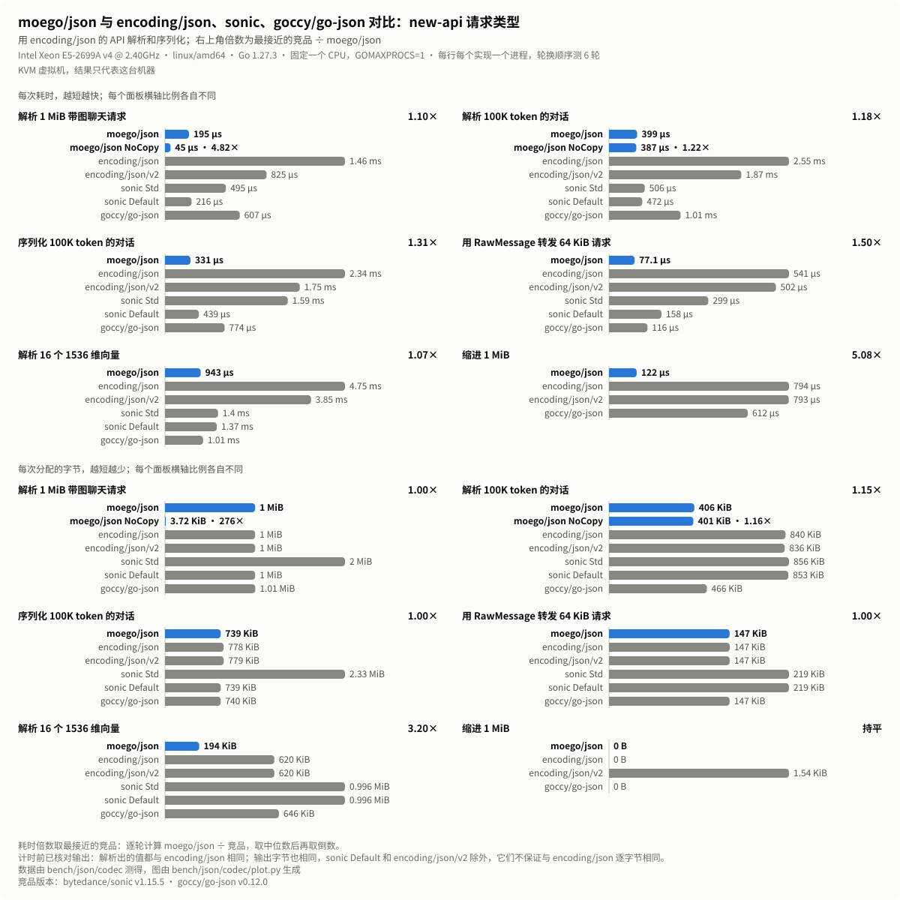
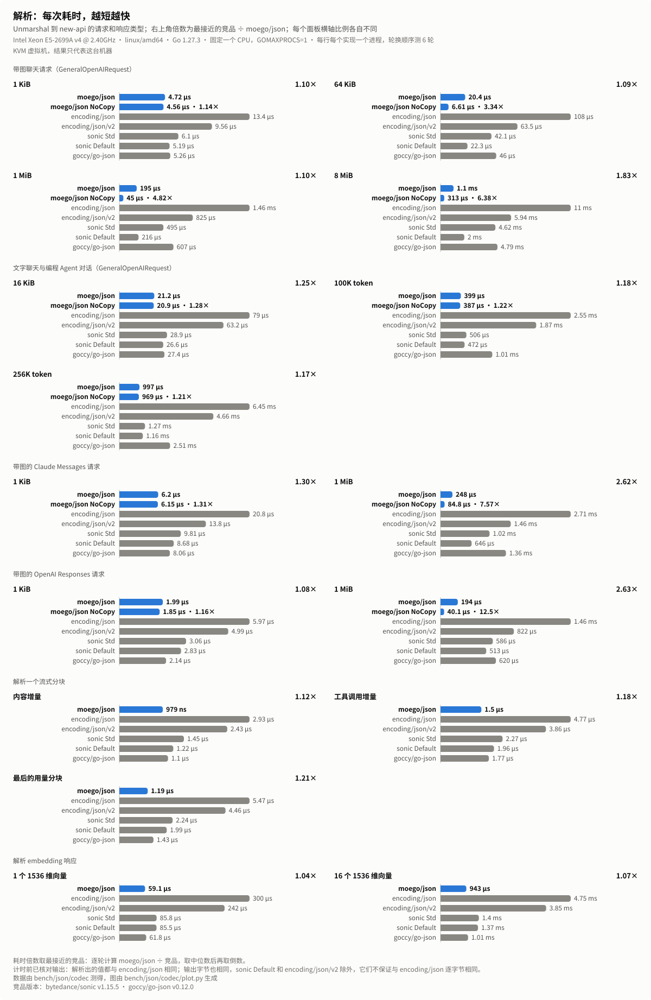
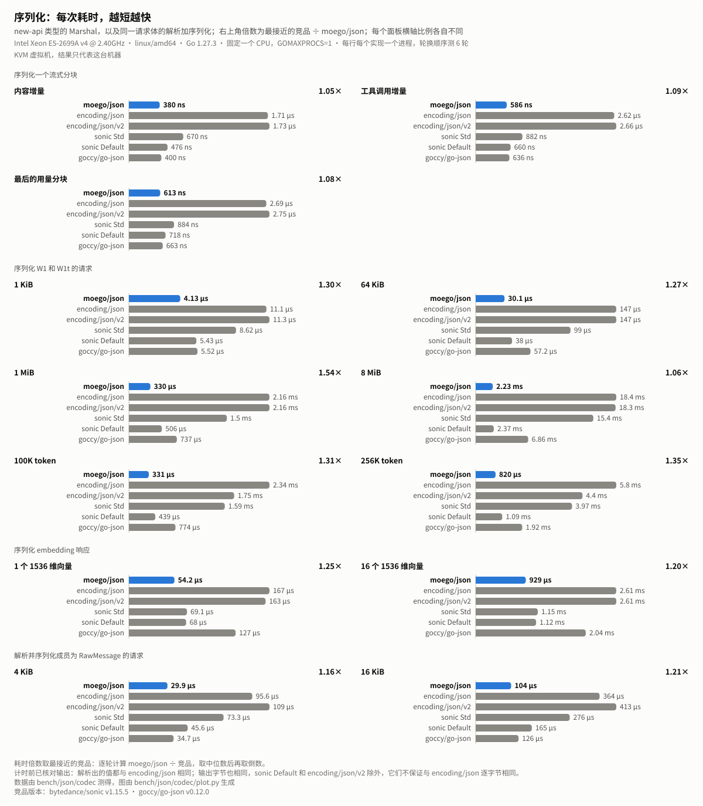
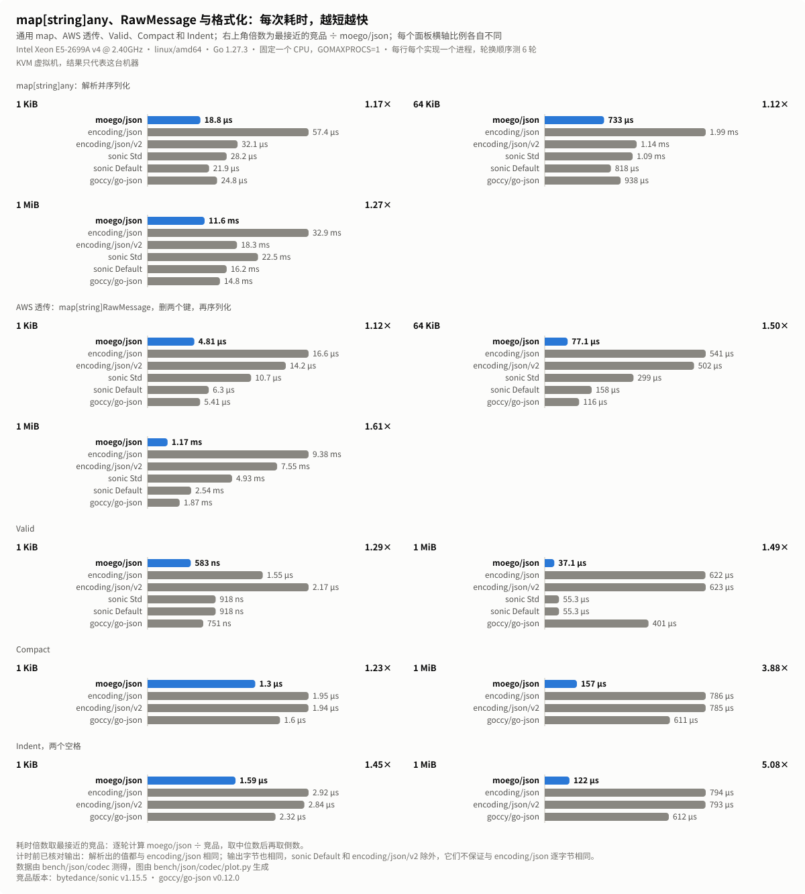
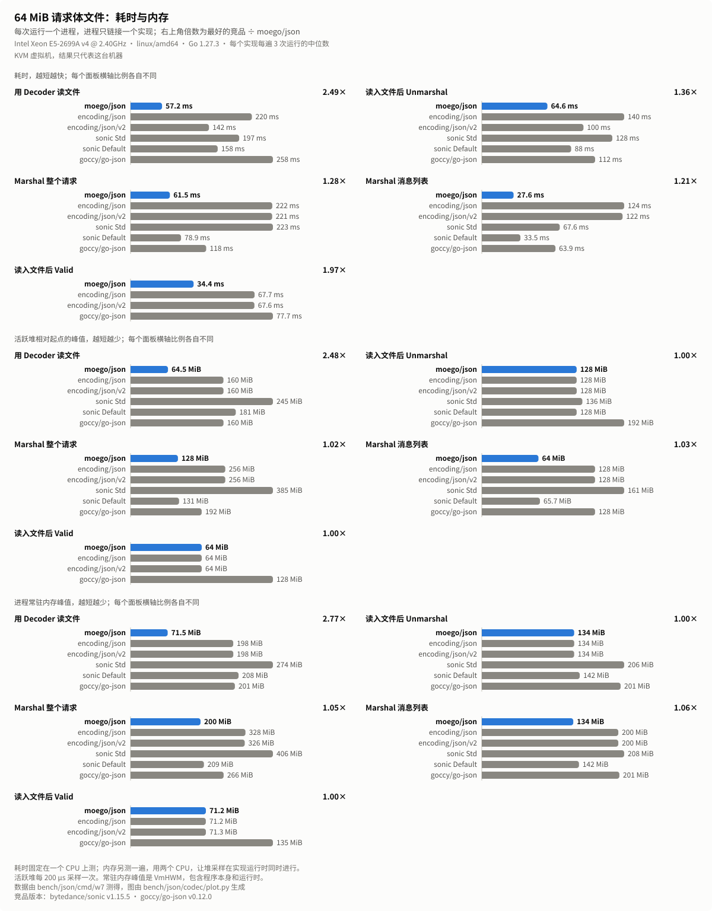

# moego/json 在 Linux AMD64 上的性能

在一台 Linux AMD64 机器上对比 `moego/json` 与 `encoding/json`、`encoding/json/v2`、`sonic` 和 `goccy/go-json`：测过的每个场景、大小和实现，领先幅度最小的地方，以及怎样复现这些数字。
[English](json-benchmark-results-linux-amd64.md)

## 测试环境

数据在 2026-11-10 测得，测试机是 KVM 虚拟机：Intel Xeon E5-2699A v4 @ 2.40GHz（Broadwell-EP，AVX2，没有 AVX-512，16 MiB L3），24 个 vCPU，每核一个线程，Linux 6.12，透明大页为 `always`，Go 1.27.3，默认的 `GOAMD64=v1`。每个基准测试进程用 `taskset` 固定在一个 CPU 上，`GOMAXPROCS=1`。测量期间机器上没有运行其他基准测试，负载均值保持在 0.4 到 1.3 之间。

| 图表中的名称 | 包和版本 | 测量的内容 |
|---|---|---|
| moego/json | 本仓库 | `Marshal`、`Unmarshal`、`Valid`、`Compact`、`Indent`、`Decoder` |
| moego/json NoCopy | 本仓库 | `UnmarshalNoCopy` |
| encoding/json | Go 1.27.3 | `Marshal`、`Unmarshal`、`Valid`、`Compact`、`Indent`、`Decoder` |
| encoding/json/v2 | Go 1.27.3 | 带 `OmitEmptyWithLegacySemantics(true)` 的 `Marshal`、`Unmarshal`、`jsontext.Value.IsValid`、`jsontext.AppendFormat`、`UnmarshalRead` |
| sonic Std | github.com/bytedance/sonic v1.15.5 | `ConfigStd`：`Marshal`、`Unmarshal`、`Valid`、`Decoder` |
| sonic Default | github.com/bytedance/sonic v1.15.5 | `ConfigDefault`：`Marshal`、`Unmarshal`、`Valid`、`Decoder` |
| goccy/go-json | github.com/goccy/go-json v0.12.0 | `Marshal`、`Unmarshal`、`Valid`、`Compact`、`Indent`、`Decoder` |

Go 1.27 的 `encoding/json` 基于 `encoding/json/v2` 实现，`moego/json` 给出的就是这个 `encoding/json` 的结果。`sonic` 用的是它的 JIT 实现；如果 `sonic.APIKind` 显示退回到了 `encoding/json`，基准测试会直接停止。`sonic` Default 不转义 HTML 字符，不排序 map 的键，解析出的字符串直接引用输入，和 `UnmarshalNoCopy` 一样。`encoding/json/v2` 需要一个选项，才会像 `encoding/json` 那样省略值为零的数字和布尔值；它的 `Compact` 和 `Indent` 行用 `jsontext.AppendFormat`，选项与 `jsontext.Value` 的对应方法相同。`sonic` 没有 `Compact` 和 `Indent`。

## 测试场景

请求体来自 `bench/json/codec`。请求和响应类型照搬 [new-api](https://github.com/QuantumNous/new-api) 的声明，包括它们自己的 `MarshalJSON` 和 `UnmarshalJSON` 方法，这些方法调用被测的实现。

- **W1**：带缩进排版的聊天请求，最后一条用户消息里嵌着一个 Base64 PNG data URL，大小为 1 KiB、64 KiB、1 MiB 和 8 MiB，解析到 `GeneralOpenAIRequest`。
- **W1t**：纯文字聊天请求：20 轮对话加 6 个工具（16 KiB），以及 100K 和 256K 个 o200k_base token 的编程 Agent 对话（376,782 和 961,597 字节），含中英文、代码块、工具调用和工具结果，解析到 `GeneralOpenAIRequest`。
- **W2**：1 KiB 和 1 MiB 的 Claude Messages 请求和 OpenAI Responses 请求，各带一张内嵌图片，解析到各自的类型。
- **W3**：三个流式分块（内容增量、工具调用增量、带用量的最后一个分块），解析和序列化。
- **W3m**：序列化 W1 和 W1t 的请求。
- **W4**：大小来自大量消息和工具定义的请求，1 KiB、64 KiB 和 1 MiB。`any` 把它解析到 `map[string]any` 再序列化；`aws` 把它解析到 `map[string]json.RawMessage`，删掉 `model` 和 `stream`，再序列化其余部分，和 new-api 的 AWS 透传一样。
- **W5**：4 KiB 和 16 KiB 的聊天请求，大小集中在保持为 `RawMessage` 的成员里（工具定义、响应 schema、metadata 和 `extra_body`），解析后再序列化。
- **W6**：embedding 响应，含 1 个或 16 个 1536 维的 float32 向量，解析和序列化。
- **W8**：在 1 KiB 和 1 MiB 的 W1 请求上调用 `Valid`、`Compact` 和 `Indent`（两个空格）。
- **大请求体**：16 MiB 和 64 MiB 的 W1 请求放在文件里，由只链接一个实现的程序读取（`bench/json/cmd/w7`）。

## 测量方法

- 计时前，测试会核对输出：每个实现解析出的值都与 `encoding/json` 相同，序列化、`Compact` 和 `Indent` 写出的字节也与 `encoding/json` 相同。`sonic` Default 和 `encoding/json/v2` 不保证与 `encoding/json` 逐字节相同，它们的序列化输出按 JSON 值比较。
- 每个实现的每一行都在单独的进程里运行，`-benchtime 1s`，每个进程一个样本，这样没有哪个实现会在别的实现留下的堆上运行。整个矩阵跑 6 轮，每轮把行的顺序和每行里实现的顺序各轮换一位：每行每个实现 6 个样本。
- 条形和表格里的数值是 6 个样本的中位数。相对某个竞品的倍数，是 6 轮里逐轮计算 `moego/json` ÷ 竞品、取中位数后的倒数，比较的是条件相同的运行。“最接近的竞品”指倍数最小的那个。
- 每一行的每一轮里，`moego/json` 都比所有竞品快。逐轮领先幅度最小的是 `W2/responses/1KiB` 上对 `goccy/go-json` 的 1.02 倍。
- 大请求体：每次运行一个进程，每个场景每个实现跑 3 次。耗时在固定的一个 CPU 上测；内存另测一遍，用两个 CPU，让堆采样在实现运行时同时进行。堆峰值是活跃堆相对起点的峰值，每 200 µs 采样一次；常驻内存峰值是 `VmHWM`，包含程序本身和运行时。表中是中位数。

## 结果

单元格依次是每次调用的耗时 / 分配的字节 / 分配次数。“–”表示该实现没有这个操作。

<p align="center">
  
</p>

41 行里 `moego/json` 全部领先。相对 `encoding/json` 的倍数中位数是 4.51 倍（1.50 到 16.7 倍），相对 `encoding/json/v2` 是 4.09 倍（1.49 到 16.8 倍）。

### 解析

<p align="center">
  
</p>

| 行 | moego/json | NoCopy | encoding/json | encoding/json/v2 | sonic Std | sonic Default | goccy/go-json | 对比最接近的竞品（各轮范围） | 对比 encoding/json | NoCopy 对比最接近的竞品 |
|---|--:|--:|--:|--:|--:|--:|--:|---|--:|--:|
| `W1/1KiB` | **4.72 µs / 3.99 KiB / 14** | 4.56 µs / 4.34 KiB / 19 | 13.4 µs / 4.48 KiB / 42 | 9.56 µs / 4.27 KiB / 32 | 6.1 µs / 5.73 KiB / 44 | 5.19 µs / 5.16 KiB / 27 | 5.26 µs / 5.23 KiB / 41 | **1.10×** sonic Default (1.06–1.14) | 2.84× | 1.14× sonic Default |
| `W1/64KiB` | **20.4 µs / 67.5 KiB / 15** | 6.61 µs / 3.72 KiB / 20 | 108 µs / 68 KiB / 42 | 63.5 µs / 67.8 KiB / 32 | 42.1 µs / 132 KiB / 44 | 22.3 µs / 68.2 KiB / 27 | 46 µs / 68.8 KiB / 41 | **1.09×** sonic Default (1.06–1.11) | 5.24× | 3.34× sonic Default |
| `W1/1MiB` | **195 µs / 1 MiB / 15** | 45 µs / 3.72 KiB / 20 | 1.46 ms / 1 MiB / 42 | 825 µs / 1 MiB / 32 | 495 µs / 2 MiB / 44 | 216 µs / 1 MiB / 27 | 607 µs / 1.01 MiB / 41 | **1.10×** sonic Default (1.10–1.15) | 7.52× | 4.82× sonic Default |
| `W1/8MiB` | **1.1 ms / 8 MiB / 15** | 313 µs / 3.72 KiB / 20 | 11 ms / 8 MiB / 43 | 5.94 ms / 8 MiB / 33 | 4.62 ms / 16 MiB / 46 | 2 ms / 8 MiB / 28 | 4.79 ms / 8.04 MiB / 41 | **1.83×** sonic Default (1.81–1.90) | 10.00× | 6.38× sonic Default |
| `W1t/16KiB` | **21.2 µs / 14.3 KiB / 30** | 20.9 µs / 16.6 KiB / 41 | 79 µs / 30 KiB / 123 | 63.2 µs / 29.6 KiB / 101 | 28.9 µs / 36.2 KiB / 103 | 26.6 µs / 35.4 KiB / 61 | 27.4 µs / 25.9 KiB / 113 | **1.25×** sonic Default (1.25–1.27) | 3.71× | 1.28× sonic Default |
| `W1t/100Ktok` | **399 µs / 406 KiB / 182** | 387 µs / 401 KiB / 330 | 2.55 ms / 840 KiB / 845 | 1.87 ms / 836 KiB / 621 | 506 µs / 856 KiB / 509 | 472 µs / 853 KiB / 252 | 1.01 ms / 466 KiB / 699 | **1.18×** sonic Default (1.17–1.20) | 6.40× | 1.22× sonic Default |
| `W1t/256Ktok` | **997 µs / 1.02 MiB / 363** | 969 µs / 0.998 MiB / 816 | 6.45 ms / 2.04 MiB / 2146 | 4.66 ms / 2.03 MiB / 1587 | 1.27 ms / 2.14 MiB / 1249 | 1.16 ms / 2.13 MiB / 595 | 2.51 ms / 1.12 MiB / 1726 | **1.17×** sonic Default (1.16–1.18) | 6.47× | 1.21× sonic Default |
| `W2/claude/1KiB` | **6.2 µs / 3.87 KiB / 26** | 6.15 µs / 4.52 KiB / 34 | 20.8 µs / 4.3 KiB / 68 | 13.8 µs / 3.98 KiB / 53 | 9.81 µs / 7.07 KiB / 72 | 8.68 µs / 6.59 KiB / 47 | 8.06 µs / 5.55 KiB / 66 | **1.30×** goccy/go-json (1.29–1.31) | 3.35× | 1.31× goccy/go-json |
| `W2/claude/1MiB` | **248 µs / 1 MiB / 27** | 84.8 µs / 3.74 KiB / 35 | 2.71 ms / 1 MiB / 69 | 1.46 ms / 1 MiB / 54 | 1.02 ms / 3 MiB / 73 | 646 µs / 2 MiB / 47 | 1.36 ms / 2.01 MiB / 67 | **2.62×** sonic Default (2.37–2.64) | 10.9× | 7.57× sonic Default |
| `W2/responses/1KiB` | **1.99 µs / 1.83 KiB / 3** | 1.85 µs / 1.83 KiB / 3 | 5.97 µs / 1.87 KiB / 9 | 4.99 µs / 1.87 KiB / 9 | 3.06 µs / 3.04 KiB / 14 | 2.83 µs / 3.02 KiB / 11 | 2.14 µs / 1.88 KiB / 12 | **1.08×** goccy/go-json (1.02–1.10) | 3.00× | 1.16× goccy/go-json |
| `W2/responses/1MiB` | **194 µs / 1 MiB / 4** | 40.1 µs / 984 B / 3 | 1.46 ms / 1 MiB / 9 | 822 µs / 1 MiB / 9 | 586 µs / 2.01 MiB / 14 | 513 µs / 2.01 MiB / 11 | 620 µs / 1 MiB / 12 | **2.63×** sonic Default (2.56–2.88) | 7.53× | 12.5× sonic Default |
| `W3/unmarshal/content` | **979 ns / 240 B / 4** | – | 2.93 µs / 240 B / 4 | 2.43 µs / 240 B / 4 | 1.45 µs / 864 B / 11 | 1.22 µs / 704 B / 6 | 1.1 µs / 736 B / 9 | **1.12×** goccy/go-json (1.11–1.12) | 2.99× | – |
| `W3/unmarshal/tool` | **1.5 µs / 344 B / 5** | – | 4.77 µs / 424 B / 8 | 3.86 µs / 408 B / 7 | 2.27 µs / 1.19 KiB / 16 | 1.96 µs / 1.02 KiB / 9 | 1.77 µs / 1.17 KiB / 14 | **1.18×** goccy/go-json (1.17–1.19) | 3.19× | – |
| `W3/unmarshal/usage` | **1.19 µs / 352 B / 3** | – | 5.47 µs / 352 B / 3 | 4.46 µs / 352 B / 3 | 2.24 µs / 1.11 KiB / 9 | 1.99 µs / 1 KiB / 5 | 1.43 µs / 464 B / 7 | **1.21×** goccy/go-json (1.20–1.21) | 4.60× | – |
| `W6/unmarshal/1x1536` | **59.1 µs / 12.5 KiB / 4** | – | 300 µs / 39 KiB / 15 | 242 µs / 39 KiB / 15 | 85.8 µs / 65.1 KiB / 18 | 85.5 µs / 65 KiB / 15 | 61.8 µs / 40.8 KiB / 15 | **1.04×** goccy/go-json (1.03–1.05) | 5.06× | – |
| `W6/unmarshal/16x1536` | **943 µs / 194 KiB / 35** | – | 4.75 ms / 620 KiB / 214 | 3.85 ms / 620 KiB / 214 | 1.4 ms / 0.996 MiB / 201 | 1.37 ms / 0.996 MiB / 183 | 1.01 ms / 646 KiB / 182 | **1.07×** goccy/go-json (1.06–1.07) | 5.04× | – |

### 序列化

<p align="center">
  
</p>

| 行 | moego/json | encoding/json | encoding/json/v2 | sonic Std | sonic Default | goccy/go-json | 对比最接近的竞品（各轮范围） | 对比 encoding/json |
|---|--:|--:|--:|--:|--:|--:|---|--:|
| `W3/marshal/content` | **380 ns / 320 B / 1** | 1.71 µs / 320 B / 1 | 1.73 µs / 320 B / 1 | 670 ns / 336 B / 2 | 476 ns / 336 B / 2 | 400 ns / 320 B / 1 | **1.05×** goccy/go-json (1.05–1.08) | 4.51× |
| `W3/marshal/tool` | **586 ns / 416 B / 1** | 2.62 µs / 432 B / 2 | 2.66 µs / 432 B / 2 | 882 ns / 432 B / 2 | 660 ns / 432 B / 2 | 636 ns / 416 B / 1 | **1.09×** goccy/go-json (1.08–1.10) | 4.48× |
| `W3/marshal/usage` | **613 ns / 640 B / 1** | 2.69 µs / 640 B / 1 | 2.75 µs / 640 B / 1 | 884 ns / 656 B / 2 | 718 ns / 656 B / 2 | 663 ns / 640 B / 1 | **1.08×** goccy/go-json (1.07–1.09) | 4.39× |
| `W3m/1KiB` | **4.13 µs / 4.03 KiB / 5** | 11.1 µs / 4.07 KiB / 7 | 11.3 µs / 4.07 KiB / 7 | 8.62 µs / 4.36 KiB / 11 | 5.43 µs / 4.36 KiB / 11 | 5.52 µs / 4.03 KiB / 5 | **1.30×** sonic Default (1.27–1.40) | 2.66× |
| `W3m/64KiB` | **30.1 µs / 130 KiB / 5** | 147 µs / 130 KiB / 7 | 147 µs / 130 KiB / 7 | 99 µs / 130 KiB / 11 | 38 µs / 130 KiB / 11 | 57.2 µs / 130 KiB / 5 | **1.27×** sonic Default (1.25–1.30) | 4.91× |
| `W3m/1MiB` | **330 µs / 2 MiB / 5** | 2.16 ms / 2 MiB / 7 | 2.16 ms / 2 MiB / 7 | 1.5 ms / 2.04 MiB / 12 | 506 µs / 2 MiB / 12 | 737 µs / 2 MiB / 5 | **1.54×** sonic Default (1.50–1.63) | 6.54× |
| `W3m/8MiB` | **2.23 ms / 16 MiB / 5** | 18.4 ms / 16.3 MiB / 10 | 18.3 ms / 16.3 MiB / 9 | 15.4 ms / 48 MiB / 39 | 2.37 ms / 16 MiB / 20 | 6.86 ms / 16.1 MiB / 6 | **1.06×** sonic Default (1.03–1.08) | 8.24× |
| `W3m/100Ktok` | **331 µs / 739 KiB / 9** | 2.34 ms / 778 KiB / 222 | 1.75 ms / 779 KiB / 222 | 1.59 ms / 2.33 MiB / 33 | 439 µs / 739 KiB / 14 | 774 µs / 740 KiB / 9 | **1.31×** sonic Default (1.30–1.33) | 7.04× |
| `W3m/256Ktok` | **820 µs / 1.83 MiB / 9** | 5.8 ms / 2.08 MiB / 543 | 4.4 ms / 2.15 MiB / 544 | 3.97 ms / 6.58 MiB / 40 | 1.09 ms / 1.84 MiB / 14 | 1.92 ms / 1.84 MiB / 9 | **1.35×** sonic Default (1.31–1.35) | 7.07× |
| `W6/marshal/1x1536` | **54.2 µs / 20 KiB / 1** | 167 µs / 20 KiB / 1 | 163 µs / 20 KiB / 1 | 69.1 µs / 20 KiB / 2 | 68 µs / 20 KiB / 2 | 127 µs / 20 KiB / 1 | **1.25×** sonic Default (1.24–1.26) | 3.09× |
| `W6/marshal/16x1536` | **929 µs / 304 KiB / 1** | 2.61 ms / 304 KiB / 1 | 2.61 ms / 304 KiB / 1 | 1.15 ms / 304 KiB / 2 | 1.12 ms / 304 KiB / 2 | 2.04 ms / 304 KiB / 1 | **1.20×** sonic Default (1.20–1.21) | 2.81× |
| `W5/4KiB` | **29.9 µs / 24.2 KiB / 39** | 95.6 µs / 41.5 KiB / 58 | 109 µs / 41.5 KiB / 57 | 73.3 µs / 50.1 KiB / 98 | 45.6 µs / 32.9 KiB / 66 | 34.7 µs / 28 KiB / 72 | **1.16×** goccy/go-json (1.15–1.19) | 3.23× |
| `W5/16KiB` | **104 µs / 84.2 KiB / 135** | 364 µs / 171 KiB / 206 | 413 µs / 171 KiB / 205 | 276 µs / 206 KiB / 345 | 165 µs / 123 KiB / 236 | 126 µs / 104 KiB / 266 | **1.21×** goccy/go-json (1.18–1.22) | 3.49× |

### map、RawMessage 与格式化

<p align="center">
  
</p>

| 行 | moego/json | encoding/json | encoding/json/v2 | sonic Std | sonic Default | goccy/go-json | 对比最接近的竞品（各轮范围） | 对比 encoding/json |
|---|--:|--:|--:|--:|--:|--:|---|--:|
| `W4/any/1KiB` | **18.8 µs / 8.3 KiB / 53** | 57.4 µs / 11.4 KiB / 243 | 32.1 µs / 10.1 KiB / 170 | 28.2 µs / 14.3 KiB / 203 | 21.9 µs / 13.2 KiB / 115 | 24.8 µs / 9.91 KiB / 174 | **1.17×** sonic Default (1.10–1.23) | 3.04× |
| `W4/any/64KiB` | **733 µs / 390 KiB / 1734** | 1.99 ms / 478 KiB / 8587 | 1.14 ms / 433 KiB / 6143 | 1.09 ms / 607 KiB / 7759 | 818 µs / 548 KiB / 4185 | 938 µs / 421 KiB / 6817 | **1.12×** sonic Default (1.11–1.16) | 2.72× |
| `W4/any/1MiB` | **11.6 ms / 5.88 MiB / 27022** | 32.9 ms / 7.43 MiB / 134716 | 18.3 ms / 6.7 MiB / 97604 | 22.5 ms / 14.4 MiB / 121126 | 16.2 ms / 12 MiB / 65265 | 14.8 ms / 6.36 MiB / 106510 | **1.27×** goccy/go-json (1.25–1.28) | 2.81× |
| `W4/aws/1KiB` | **4.81 µs / 2.9 KiB / 5** | 16.6 µs / 3.15 KiB / 23 | 14.2 µs / 3.03 KiB / 18 | 10.7 µs / 4.52 KiB / 22 | 6.3 µs / 4.45 KiB / 15 | 5.41 µs / 3 KiB / 18 | **1.12×** goccy/go-json (1.12–1.14) | 3.45× |
| `W4/aws/64KiB` | **77.1 µs / 147 KiB / 7** | 541 µs / 147 KiB / 23 | 502 µs / 147 KiB / 18 | 299 µs / 219 KiB / 22 | 158 µs / 219 KiB / 15 | 116 µs / 147 KiB / 18 | **1.50×** goccy/go-json (1.47–1.55) | 7.02× |
| `W4/aws/1MiB` | **1.17 ms / 2.02 MiB / 7** | 9.38 ms / 2.02 MiB / 24 | 7.55 ms / 2.02 MiB / 19 | 4.93 ms / 5.48 MiB / 32 | 2.54 ms / 4 MiB / 20 | 1.87 ms / 2.02 MiB / 18 | **1.61×** goccy/go-json (1.53–1.68) | 8.04× |
| `W8/valid/1KiB` | **583 ns / 0 B / 0** | 1.55 µs / 0 B / 0 | 2.17 µs / 0 B / 0 | 918 ns / 0 B / 0 | 918 ns / 0 B / 0 | 751 ns / 0 B / 0 | **1.29×** goccy/go-json (1.29–1.29) | 2.66× |
| `W8/valid/1MiB` | **37.1 µs / 0 B / 0** | 622 µs / 0 B / 0 | 623 µs / 0 B / 0 | 55.3 µs / 0 B / 0 | 55.3 µs / 0 B / 0 | 401 µs / 0 B / 0 | **1.49×** sonic Default (1.46–1.52) | 16.7× |
| `W8/compact/1KiB` | **1.3 µs / 0 B / 0** | 1.95 µs / 0 B / 0 | 1.94 µs / 0 B / 0 | – | – | 1.6 µs / 0 B / 0 | **1.23×** goccy/go-json (1.22–1.24) | 1.50× |
| `W8/compact/1MiB` | **157 µs / 0 B / 0** | 786 µs / 0 B / 0 | 785 µs / 0 B / 0 | – | – | 611 µs / 0 B / 0 | **3.88×** goccy/go-json (3.81–3.94) | 5.00× |
| `W8/indent/1KiB` | **1.59 µs / 0 B / 0** | 2.92 µs / 0 B / 0 | 2.84 µs / 0 B / 0 | – | – | 2.32 µs / 0 B / 0 | **1.45×** goccy/go-json (1.45–1.46) | 1.83× |
| `W8/indent/1MiB` | **122 µs / 0 B / 0** | 794 µs / 0 B / 0 | 793 µs / 1.54 KiB / 0 | – | – | 612 µs / 0 B / 0 | **5.08×** goccy/go-json (4.98–5.28) | 6.52× |

### 内存

41 行里，`moego/json` 每次调用的分配次数都不多于分配最少的竞品，其中 23 行更少。每次分配的字节在 40 行里不多于最少的竞品，其中 27 行更少。剩下的一行是 `W6/marshal/16x1536`：每个实现都为输出分配一块 304 KiB，整次运行平均下来每次调用比 `encoding/json` 多 1 个字节（311,302 对 311,301 字节）。

### UnmarshalNoCopy

`UnmarshalNoCopy` 存下的字符串直接引用输入，不做拷贝。在带图请求上，请求体的大部分是一个 Base64 字符串，它不会被拷贝：在 `W1/8MiB` 上每次调用 313 µs、分配 3.72 KiB，是 `sonic` Default 的 6.38 倍，而后者的字符串同样引用输入。在短字符串很多的纯文字请求体上，它比 `Unmarshal` 快 1.6% 到 2.9%。

### 大请求体

<p align="center">
  
</p>

单元格依次是耗时 / 活跃堆相对起点的峰值 / 常驻内存峰值。

| 场景 | 大小 | moego/json | encoding/json | encoding/json/v2 | sonic Std | sonic Default | goccy/go-json |
|---|--:|--:|--:|--:|--:|--:|--:|
| 用 Decoder 读文件 | 16 MiB | **9.3 ms / 16.5 MiB / 24 MiB** | 55.5 ms / 40 MiB / 56 MiB | 34.6 ms / 40.1 MiB / 56 MiB | 68 ms / 59.1 MiB / 86 MiB | 62.9 ms / 57.2 MiB / 68 MiB | 63.5 ms / 40.1 MiB / 57 MiB |
| 读入文件后 Unmarshal | 16 MiB | **12.9 ms / 32 MiB / 38 MiB** | 33.2 ms / 32 MiB / 39 MiB | 23.5 ms / 32.1 MiB / 40 MiB | 51.1 ms / 39.8 MiB / 62 MiB | 40.8 ms / 32.1 MiB / 44 MiB | 27.1 ms / 48.1 MiB / 57 MiB |
| Marshal 整个请求 | 16 MiB | **12.5 ms / 32.1 MiB / 56 MiB** | 50.3 ms / 64 MiB / 88 MiB | 49.9 ms / 64 MiB / 88 MiB | 67 ms / 96.8 MiB / 117 MiB | 29.2 ms / 35.2 MiB / 64 MiB | 27.7 ms / 48.2 MiB / 74 MiB |
| Marshal 消息列表 | 16 MiB | **5.4 ms / 16 MiB / 40 MiB** | 30.1 ms / 32 MiB / 55 MiB | 30.1 ms / 32 MiB / 53 MiB | 18 ms / 40.9 MiB / 64 MiB | 9.4 ms / 17.7 MiB / 46 MiB | 12.1 ms / 32 MiB / 55 MiB |
| 读入文件后 Valid | 16 MiB | **4.7 ms / 16 MiB / 23 MiB** | 14.4 ms / 16 MiB / 21 MiB | 14.3 ms / 16 MiB / 23 MiB | – | – | 16.4 ms / 32 MiB / 38 MiB |
| 用 Decoder 读文件 | 64 MiB | **57.2 ms / 64.5 MiB / 71 MiB** | 220 ms / 160 MiB / 198 MiB | 142 ms / 160 MiB / 198 MiB | 197 ms / 245 MiB / 274 MiB | 158 ms / 181 MiB / 208 MiB | 258 ms / 160 MiB / 201 MiB |
| 读入文件后 Unmarshal | 64 MiB | **64.6 ms / 128 MiB / 134 MiB** | 140 ms / 128 MiB / 134 MiB | 100 ms / 128 MiB / 134 MiB | 128 ms / 136 MiB / 206 MiB | 88 ms / 128 MiB / 142 MiB | 112 ms / 192 MiB / 201 MiB |
| Marshal 整个请求 | 64 MiB | **61.5 ms / 128 MiB / 200 MiB** | 222 ms / 256 MiB / 328 MiB | 221 ms / 256 MiB / 326 MiB | 223 ms / 385 MiB / 406 MiB | 78.9 ms / 131 MiB / 209 MiB | 118 ms / 192 MiB / 266 MiB |
| Marshal 消息列表 | 64 MiB | **27.6 ms / 64 MiB / 134 MiB** | 124 ms / 128 MiB / 200 MiB | 122 ms / 128 MiB / 200 MiB | 67.6 ms / 161 MiB / 208 MiB | 33.5 ms / 65.7 MiB / 142 MiB | 63.9 ms / 128 MiB / 201 MiB |
| 读入文件后 Valid | 64 MiB | **34.4 ms / 64 MiB / 71 MiB** | 67.7 ms / 64 MiB / 71 MiB | 67.6 ms / 64 MiB / 71 MiB | – | – | 77.7 ms / 128 MiB / 135 MiB |

`moego/json` 在每个场景里都最快：16 MiB 时是最快竞品的 1.74 到 3.72 倍，64 MiB 时是 1.21 到 2.49 倍。它的 `Decoder` 读文件时，长于 128 KiB 的值会读两遍，一遍检查、一遍解析，只保留一个 256 KiB 的窗口而不是整个输入，所以堆峰值约等于解析出的值的大小：64 MiB 请求体是 64.5 MiB，其他实现需要 160 MiB 到 245 MiB。`Marshal` 写输出时，它的堆峰值和常驻内存峰值是所有实现里最低的。

“读入文件后 Unmarshal”和“读入文件后 Valid”两个场景里，每个实现都把整个请求体放在内存里，常驻内存也随之而定：在 2 MiB 大页下，每次运行的峰值落在相差 2 MiB 的两个档位之一。另外把这两个场景轮换顺序跑了 10 轮，每个档位上 `moego/json` 的峰值中位数与 `encoding/json` 相差 −108 KiB 到 +44 KiB。16 MiB Valid 一行里 23 MiB 对 21 MiB 的差别，来自表中三次运行落在了不同的档位。

`moego/ojson` 用自己的函数读取同样的文件（`bench/json/cmd/w7/ojson`）。`ValidReader` 和 `GetManyReaderAt` 通过固定大小的缓冲区读取文件；`GetManyReaderAt` 读取 `model` 和 `group`，两者都找到后就停止。常驻内存包含程序本身和 Go 运行时。

| 场景 | 16 MiB | 64 MiB |
|---|--:|--:|
| 对文件调用 `ValidReader` | 2.1 ms / 0.1 MiB / 7 MiB | 12.1 ms / 0.1 MiB / 5 MiB |
| 对文件调用 `GetManyReaderAt` | 0.1 ms / <0.1 MiB / 7 MiB | 0.1 ms / <0.1 MiB / 7 MiB |
| 读入文件后调用 `GetManyBytes` | 4.4 ms / 16 MiB / 23 MiB | 30.6 ms / 64 MiB / 71 MiB |

## 领先幅度最小的地方

有 8 行领先最接近的竞品不到 10%：

- **embedding 向量**（`W6/unmarshal`，领先 `goccy/go-json` 1.04 和 1.07 倍）。大部分时间花在解析每个向量的 1536 个数字上。`moego/json` 分配的字节约为 `goccy/go-json` 的三分之一。
- **序列化流式分块**（`W3/marshal`，领先 `goccy/go-json` 1.05 到 1.09 倍）。这些调用耗时 380 ns 到 613 ns，两个库都只分配一次。
- **序列化 8 MiB 带图请求**（`W3m/8MiB`，领先 `sonic` Default 1.06 倍）。大部分时间花在写一个长字符串上。
- **解析 1 KiB Responses 请求**（`W2/responses/1KiB`，领先 `goccy/go-json` 1.08 倍）。整个矩阵里逐轮领先幅度最小的 1.02 倍就在这一行。
- **解析 64 KiB 带图请求**（`W1/64KiB`，领先 `sonic` Default 1.09 倍）。

## 限制

- 只测了一台 KVM 虚拟机，结果只代表这台机器；缓存大小和内存带宽不同的其他 CPU，结果可能不同。
- 只测了 linux/amd64 上的 Go 1.27.3，这时 `encoding/json` 基于 `encoding/json/v2` 实现。在 Go 1.26 及更早版本上，或设置 `GOEXPERIMENT=nojsonv2` 时，`moego/json` 跟随经典的 `encoding/json`，这里没有测量两者在那种情况下的速度对比。
- 在 arm64 上，`moego/json` 检查长字符串里要转义的字符，以及 `Valid` 和 `Indent` 校验 JSON 时，用 NEON 内核，其余用可移植的 Go 代码；在不支持 AVX2 的 amd64 CPU 上，以及使用 `-tags purego` 时，用可移植的 Go 代码代替 AVX2 内核。这些情况下的速度没有测量。
- 请求体是按 new-api 类型合成的请求和响应，真实流量的排版和大小会有所不同。

## 复现

在仓库根目录下，需要 Go 1.27、Python 3 和 Bash，在 Linux 上运行：

```sh
cd bench/json
go test ./codec ./w7    # 计时前核对所有输出

go test -c -o /tmp/codec.test ./codec
bash codec/matrix.sh /tmp/codec.test 2 6 > /tmp/matrix.txt

mkdir -p /tmp/w7
for e in moego encjson jsonv2 sonic-std sonic-default goccy ojson; do
  go build -o /tmp/w7/w7-$e ./cmd/w7/$e
done
bash codec/w7.sh /tmp/w7 2 2,3 16
bash codec/w7.sh /tmp/w7 2 2,3 64

for lang in en zh; do
  python3 codec/plot.py /tmp/matrix.txt --w7 /tmp/w7/w7t.out /tmp/w7/w7p.out \
    --go "$(go env GOVERSION)" --lang $lang --output ../../docs/images
done
```

把 CPU 2 和 2,3 换成空闲的 CPU，测量期间停掉其他基准测试和编译。矩阵大约要跑半小时。`w7.sh` 会追加写入 `w7t.out` 和 `w7p.out`，重新测量前先删掉它们。`plot.py` 生成 README 里的汇总图和本页的图，有英文（`.en.svg`）和中文（`.zh.svg`）两种。
