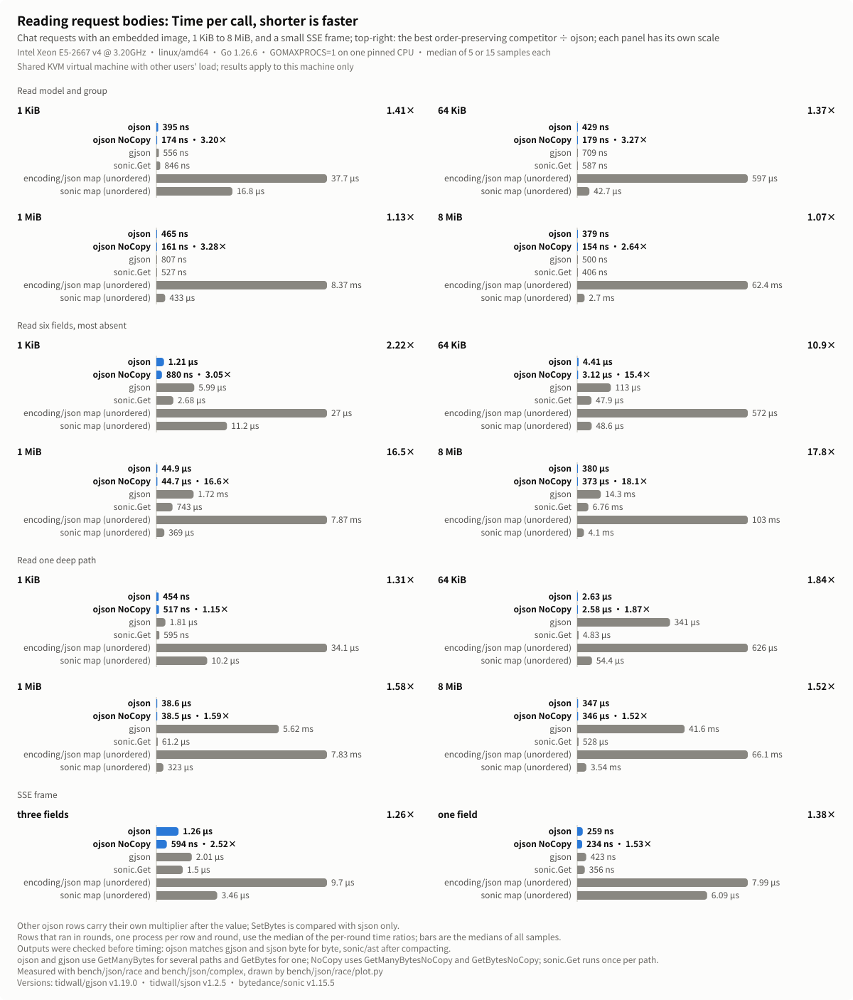
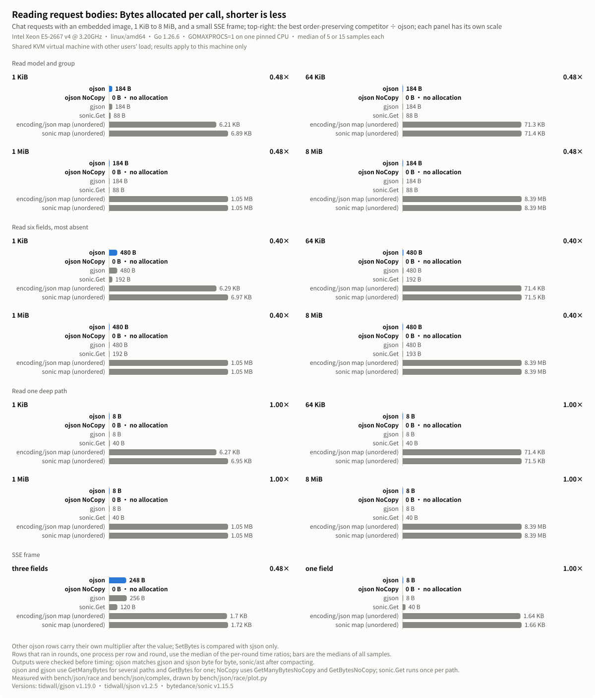
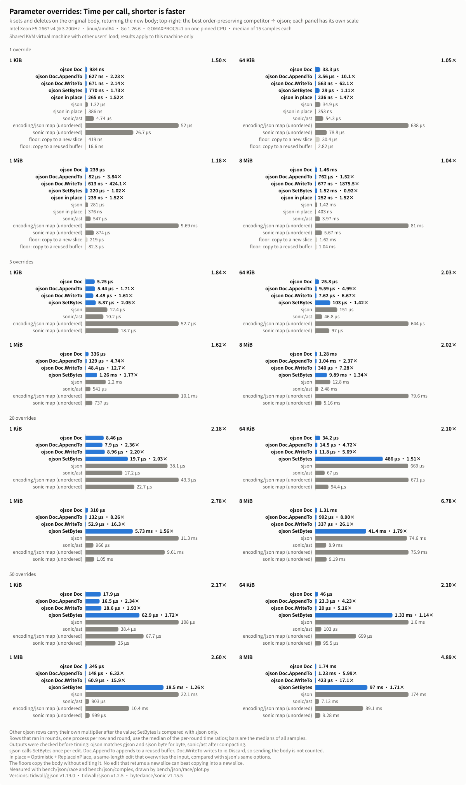
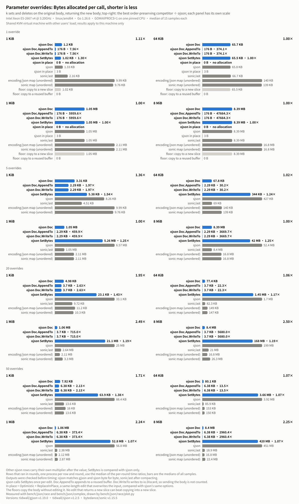

# ojson performance on Linux AMD64

`ojson` compared with `gjson`, `sjson`, `sonic` and `encoding/json` on one Linux
AMD64 machine: every workload, size and engine that was measured, where
`ojson` does not lead, and how to reproduce the numbers.
[简体中文](ojson-benchmark-results-linux-amd64.zh_CN.md)

## Test environment

The numbers were measured on 2026-11-01 on a KVM virtual machine shared with
other users: Intel Xeon E5-2667 v4 @ 3.20GHz (Broadwell-EP, AVX2, no
AVX-512), linux/amd64, Go 1.26.6 with the default `GOAMD64=v1`. Each
benchmark process ran on one CPU pinned with `taskset`, with
`GOMAXPROCS=1`. Other users' jobs kept the machine busy during the whole
measurement.

| Name in the charts | Package and version | What is measured |
|---|---|---|
| ojson | this repository | `GetBytes`, `GetManyBytes`, `SetBytes`, `Doc` |
| ojson NoCopy | this repository | `GetBytesNoCopy`, `GetManyBytesNoCopy` |
| gjson | github.com/tidwall/gjson v1.19.0 | `GetBytes`, `GetManyBytes` |
| sjson | github.com/tidwall/sjson v1.2.5 | `SetBytes`, `DeleteBytes`, one call per edit |
| sonic.Get, sonic/ast | github.com/bytedance/sonic v1.15.5 | `sonic.Get` per path; edits on an `ast.Node`, then `MarshalJSON` |
| encoding/json map, sonic map | Go 1.26.6, sonic v1.15.5 | decode into `map[string]any`, edit, encode (loses member order) |

`sonic` runs its JIT implementation; the benchmarks stop if `sonic.APIKind`
reports the `encoding/json` fallback. The two map round trips lose member
order and are shown as a reference only. The measured `ojson` build differs
slightly from the code of this release; instruction counts per call of the
two builds differ by at most 0.36% on every workload.

## Workloads

The bodies come from `bench/json/race`: a chat request with indented
formatting whose last user message embeds a Base64 PNG data URL, sized to
1 KiB, 64 KiB, 1 MiB and 8 MiB. The image is near the end, as in real
requests.

- **Reads**: `model` and `group`, as a router reads them; six fields that
  are mostly absent (`service_tier`, `inference_geo`, `store`,
  `safety_identifier`, `stream_options.include_obfuscation`, `speed`), as a
  check for disabled fields reads them; and one deep path,
  `messages.1.content.1.image_url.detail`. Several paths go through
  `GetManyBytes`, one through `GetBytes`.
- **SSE**: a 177-byte streamed chunk, reading three fields or one.
- **Overrides**: 1, 5, 20 or 50 sets and deletes, applied to the original
  body, producing the new body. Most set top-level sampling parameters, a
  few set nested values or delete `stream`, and later edits may overwrite
  earlier ones.
- **Complex paths**: nine `Get` paths (`#` maps and queries, wildcards,
  multi-paths, pipes, counts) on three request sizes and on a response with
  200 choices, and three `Set` paths through queries and `#` maps.
- **Modifiers** at the root of a 1 KiB document and a 64 KiB array of
  objects, and the **`Result` methods** (`Value`, `ForEach`, `Array`, `Map`,
  `Path`, `Paths`, `Escape`, `AppendJSONString`, `Less`, iterators).

The `Doc` rows of the overrides write the result in three ways: `Bytes`
returns a new slice, `AppendTo` appends to a buffer reused across calls,
and `WriteTo` writes to `io.Discard`. "In place" sets `Optimistic` and
`ReplaceInPlace`: a same-length replacement that overwrites the input,
compared with `sjson`'s same options. Two floors copy the body without
editing it: into a new slice (`bytes.Clone`) and into a reused buffer. No
edit that returns a new slice can be faster than the first floor.

## Method

- Every benchmark ran with `-count 5 -benchtime 0.5s -cpu 1`. Bars and
  table cells are the medians of all samples of a row.
- Before timing, the tests check the outputs: `ojson` returns the same bytes
  as `gjson` and `sjson` on every workload, `sonic/ast` the same bytes after
  compacting, and the map round trips the same values.
- Reads, SSE, complex `Get` and `GetBytes`, modifiers and `Result` methods
  run in one process per group, so `ojson` and its competitors share the
  same load.
- Overrides and complex `Set` run one process per row, because a one-shot
  edit of a large body is mostly allocation and GC and depends on the heap
  that earlier benchmarks leave behind. The whole section ran in three
  rounds, and in each round every `ojson` row ran right before the
  competitor it is compared with: 15 samples per row.
- For rows that ran in rounds, the speedup is the median of the three
  per-round ratios (competitor median ÷ `ojson` median of the same round).
  This compares runs that saw similar load. For rows that ran in one
  process, it is the ratio of the two medians. Because of this, a speedup
  can differ from the ratio of the two medians in a table.
- Speedups compare `ojson` with the fastest competitor that keeps member
  order: `gjson` and `sonic.Get` for reads, `sjson` and `sonic/ast` for edits.
  `SetBytes` is compared with `sjson` only, since both make one call per
  edit, and the in-place rows only with `sjson`'s in-place option.
- Nine rows where `ojson` lost or led by less than 3% in the main run were
  measured again, together with their competitors, in three rounds of one
  process per row: SSE three fields, 1 edit at 64 KiB and 8 MiB (`Doc` and
  `SetBytes`), complex `Get` of `queryAll` on 1 KiB, and the `Result`
  methods `Value`, `Map` and `tostr-parse-64KiB`. The tables and charts
  use the samples of that second run for those rows.

## Results

Cells read time per call / bytes allocated per call / allocations per call.

### Reads

<p align="center">
  
</p>

<p align="center">
  
</p>

| Read | Size | ojson | ojson NoCopy | gjson | sonic.Get | ojson speedup | NoCopy speedup |
|---|---|--:|--:|--:|--:|--:|--:|
| model and group | 1 KiB | 395 ns / 184 B / 2 | 174 ns / 0 B / 0 | 556 ns / 184 B / 3 | 846 ns / 88 B / 4 | 1.41× | 3.20× |
| model and group | 64 KiB | 429 ns / 184 B / 2 | 179 ns / 0 B / 0 | 709 ns / 184 B / 3 | 587 ns / 88 B / 4 | 1.37× | 3.27× |
| model and group | 1 MiB | 465 ns / 184 B / 2 | 161 ns / 0 B / 0 | 807 ns / 184 B / 3 | 527 ns / 88 B / 4 | 1.13× | 3.28× |
| model and group | 8 MiB | 379 ns / 184 B / 2 | 154 ns / 0 B / 0 | 500 ns / 184 B / 3 | 406 ns / 88 B / 4 | 1.07× | 2.64× |
| six fields | 1 KiB | 1.21 µs / 480 B / 1 | 880 ns / 0 B / 0 | 5.99 µs / 480 B / 1 | 2.68 µs / 192 B / 6 | 2.22× | 3.05× |
| six fields | 64 KiB | 4.41 µs / 480 B / 1 | 3.12 µs / 0 B / 0 | 113 µs / 480 B / 1 | 47.9 µs / 192 B / 6 | 10.86× | 15.36× |
| six fields | 1 MiB | 44.9 µs / 480 B / 1 | 44.7 µs / 0 B / 0 | 1.72 ms / 480 B / 1 | 743 µs / 192 B / 6 | 16.54× | 16.62× |
| six fields | 8 MiB | 380 µs / 480 B / 1 | 373 µs / 0 B / 0 | 14.3 ms / 480 B / 1 | 6.76 ms / 193 B / 6 | 17.79× | 18.12× |
| deep path | 1 KiB | 454 ns / 8 B / 1 | 517 ns / 0 B / 0 | 1.81 µs / 8 B / 1 | 595 ns / 40 B / 2 | 1.31× | 1.15× |
| deep path | 64 KiB | 2.63 µs / 8 B / 1 | 2.58 µs / 0 B / 0 | 341 µs / 8 B / 1 | 4.83 µs / 40 B / 2 | 1.84× | 1.87× |
| deep path | 1 MiB | 38.6 µs / 8 B / 1 | 38.5 µs / 0 B / 0 | 5.62 ms / 8 B / 1 | 61.2 µs / 40 B / 2 | 1.58× | 1.59× |
| deep path | 8 MiB | 347 µs / 8 B / 1 | 346 µs / 0 B / 0 | 41.6 ms / 8 B / 1 | 528 µs / 40 B / 2 | 1.52× | 1.52× |
| SSE, three fields |  | 1.26 µs / 248 B / 2 | 594 ns / 0 B / 0 | 2.01 µs / 256 B / 4 | 1.5 µs / 120 B / 6 | 1.26× | 2.52× |
| SSE, one field |  | 259 ns / 8 B / 1 | 234 ns / 0 B / 0 | 423 ns / 8 B / 1 | 356 ns / 40 B / 2 | 1.38× | 1.53× |

The speedup columns compare with the faster of `gjson` and `sonic.Get`. The
SSE three-field row ran in rounds.

### Overrides

<p align="center">
  
</p>

<p align="center">
  
</p>

One edit, producing a new body:

| Size | SetBytes | Doc.Bytes | Doc.AppendTo | Doc.WriteTo | sjson | sonic/ast | copy to new slice | copy to reused buffer |
|---|--:|--:|--:|--:|--:|--:|--:|--:|
| 1 KiB | 770 ns / 1,024 B / 1 | 934 ns / 1,200 B / 2 | 627 ns / 176 B / 1 | 671 ns / 176 B / 1 | 1.32 µs / 1,331 B / 5 | 4.74 µs / 2,160 B / 7 | 419 ns / 1,024 B / 1 | 16.6 ns / 0 B / 0 |
| 64 KiB | 29 µs / 65,536 B / 1 | 33.3 µs / 65,712 B / 2 | 3.56 µs / 176 B / 1 | 563 ns / 176 B / 1 | 34.9 µs / 65,843 B / 5 | 54.3 µs / 66,683 B / 7 | 30.4 µs / 65,536 B / 1 | 2.82 µs / 0 B / 0 |
| 1 MiB | 220 µs / 1,048,576 B / 1 | 239 µs / 1,048,752 B / 2 | 82 µs / 176 B / 1 | 613 ns / 176 B / 1 | 281 µs / 1,048,884 B / 5 | 547 µs / 1,049,784 B / 7 | 219 µs / 1,048,576 B / 1 | 82.3 µs / 0 B / 0 |
| 8 MiB | 1.52 ms / 8,388,608 B / 1 | 1.46 ms / 8,388,784 B / 2 | 762 µs / 176 B / 1 | 677 ns / 176 B / 1 | 1.42 ms / 8,388,917 B / 5 | 3.97 ms / 8,394,011 B / 11 | 1.62 ms / 8,388,608 B / 1 | 1.04 ms / 0 B / 0 |

One same-length edit in place (`Optimistic` and `ReplaceInPlace`):

| Size | ojson | sjson | speedup |
|---|--:|--:|--:|
| 1 KiB | 265 ns / 0 B / 0 | 386 ns / 3 B / 1 | 1.52× |
| 64 KiB | 236 ns / 0 B / 0 | 353 ns / 3 B / 1 | 1.47× |
| 1 MiB | 239 ns / 0 B / 0 | 376 ns / 3 B / 1 | 1.52× |
| 8 MiB | 252 ns / 0 B / 0 | 403 ns / 3 B / 1 | 1.52× |

Speedups for every count and size, as the median of the three per-round
ratios, with the per-round ratios in parentheses. `SetBytes` is compared
with `sjson`; the `Doc` columns with the faster of `sjson` and `sonic/ast`.

| Edits | Size | SetBytes : sjson | Doc.Bytes | Doc.AppendTo | Doc.WriteTo |
|---|---|--:|--:|--:|--:|
| 1 | 1 KiB | 1.73× (1.64 / 2.01 / 1.73) | 1.50× (0.63 / 1.51 / 1.50) | 2.23× (1.25 / 2.23 / 2.34) | 2.14× (1.07 / 2.63 / 2.14) |
| 1 | 64 KiB | 1.11× (1.07 / 1.27 / 1.11) | 1.05× (1.12 / 1.05 / 1.00) | 10.11× (10.11 / 8.15 / 16.32) | 62.07× (56.40 / 62.07 / 98.42) |
| 1 | 1 MiB | 1.02× (1.02 / 1.00 / 1.57) | 1.18× (1.18 / 0.98 / 1.69) | 3.84× (3.84 / 2.60 / 4.74) | 424.15× (424.15 / 361.78 / 668.84) |
| 1 | 8 MiB | 0.92× (0.92 / 1.08 / 0.91) | 1.04× (0.88 / 1.09 / 1.04) | 1.52× (1.52 / 2.46 / 1.42) | 1875.48× (2785.24 / 1875.48 / 1767.05) |
| 5 | 1 KiB | 2.05× (1.98 / 2.11 / 2.05) | 1.84× (1.70 / 1.90 / 1.84) | 1.71× (1.64 / 1.81 / 1.71) | 1.61× (1.61 / 2.58 / 1.39) |
| 5 | 64 KiB | 1.42× (1.23 / 1.54 / 1.42) | 2.03× (2.03 / 1.60 / 2.08) | 4.99× (5.51 / 4.61 / 4.99) | 6.67× (6.67 / 6.20 / 6.83) |
| 5 | 1 MiB | 1.77× (1.75 / 1.78 / 1.77) | 1.62× (1.61 / 1.66 / 1.62) | 4.74× (4.83 / 3.97 / 4.74) | 12.68× (13.06 / 10.54 / 12.68) |
| 5 | 8 MiB | 1.34× (1.34 / 1.35 / 1.27) | 2.02× (1.77 / 2.12 / 2.02) | 2.37× (2.01 / 2.80 / 2.37) | 7.28× (6.58 / 8.06 / 7.28) |
| 20 | 1 KiB | 2.03× (2.03 / 2.24 / 1.72) | 2.18× (2.02 / 2.18 / 2.29) | 2.36× (2.16 / 2.47 / 2.36) | 2.20× (2.24 / 2.20 / 1.86) |
| 20 | 64 KiB | 1.51× (1.75 / 1.26 / 1.51) | 2.10× (2.36 / 2.10 / 1.90) | 4.72× (4.72 / 4.77 / 4.49) | 5.69× (5.65 / 5.80 / 5.69) |
| 20 | 1 MiB | 1.56× (2.29 / 1.56 / 1.52) | 2.78× (2.41 / 2.78 / 3.51) | 8.26× (8.41 / 6.45 / 8.26) | 16.26× (13.98 / 16.26 / 20.50) |
| 20 | 8 MiB | 1.79× (1.71 / 1.81 / 1.79) | 6.78× (6.72 / 6.92 / 6.78) | 8.90× (10.08 / 8.47 / 8.90) | 26.12× (27.83 / 25.71 / 26.12) |
| 50 | 1 KiB | 1.72× (1.58 / 1.72 / 1.82) | 2.17× (1.96 / 2.17 / 2.18) | 2.34× (2.55 / 2.27 / 2.34) | 1.93× (1.81 / 1.93 / 2.22) |
| 50 | 64 KiB | 1.14× (1.12 / 1.14 / 1.35) | 2.10× (1.89 / 2.32 / 2.10) | 4.23× (5.50 / 4.23 / 3.69) | 5.16× (5.97 / 5.16 / 4.34) |
| 50 | 1 MiB | 1.26× (0.84 / 1.28 / 1.26) | 2.60× (2.59 / 2.97 / 2.60) | 6.32× (6.32 / 6.47 / 6.23) | 15.86× (17.24 / 15.86 / 14.27) |
| 50 | 8 MiB | 1.71× (1.80 / 1.47 / 1.71) | 4.89× (4.11 / 4.89 / 5.09) | 5.99× (5.82 / 5.99 / 6.74) | 17.09× (16.84 / 17.09 / 19.68) |

Several edits, producing a new body:

| Edits | Size | Doc.Bytes | Doc.AppendTo | Doc.WriteTo | SetBytes | sjson | sonic/ast |
|---|---|--:|--:|--:|--:|--:|--:|
| 5 | 1 KiB | 5.25 µs / 3,312 B / 11 | 5.44 µs / 2,288 B / 10 | 4.49 µs / 2,288 B / 10 | 5.87 µs / 5,376 B / 5 | 12.4 µs / 8,256 B / 22 | 10.2 µs / 4,512 B / 23 |
| 5 | 64 KiB | 25.8 µs / 67,824 B / 11 | 9.59 µs / 2,288 B / 10 | 7.62 µs / 2,288 B / 10 | 103 µs / 344,064 B / 5 | 151 µs / 427,480 B / 22 | 46.8 µs / 69,036 B / 23 |
| 5 | 1 MiB | 336 µs / 1,050,864 B / 11 | 129 µs / 2,288 B / 10 | 48.4 µs / 2,288 B / 10 | 1.26 ms / 5,259,264 B / 5 | 2.2 ms / 6,571,730 B / 26 | 541 µs / 1,052,155 B / 24 |
| 5 | 8 MiB | 1.28 ms / 8,390,896 B / 11 | 1.04 ms / 2,288 B / 10 | 340 µs / 2,288 B / 10 | 9.89 ms / 41,959,424 B / 5 | 12.8 ms / 52,446,980 B / 27 | 2.48 ms / 8,396,367 B / 27 |
| 20 | 1 KiB | 8.46 µs / 4,976 B / 17 | 7.9 µs / 3,696 B / 16 | 8.96 µs / 3,696 B / 16 | 19.7 µs / 23,104 B / 24 | 38.1 µs / 33,081 B / 88 | 17.2 µs / 9,721 B / 87 |
| 20 | 64 KiB | 34.2 µs / 77,424 B / 17 | 14.5 µs / 3,696 B / 16 | 11.8 µs / 3,696 B / 16 | 486 µs / 1,450,048 B / 24 | 669 µs / 1,701,910 B / 89 | 67 µs / 82,310 B / 87 |
| 20 | 1 MiB | 310 µs / 1,060,464 B / 17 | 132 µs / 3,696 B / 16 | 52.9 µs / 3,696 B / 16 | 5.73 ms / 21,110,848 B / 24 | 11.3 ms / 25,049,659 B / 98 | 966 µs / 2,642,605 B / 93 |
| 20 | 8 MiB | 1.31 ms / 8,400,496 B / 17 | 992 µs / 3,696 B / 16 | 337 µs / 3,696 B / 16 | 41.4 ms / 167,911,488 B / 24 | 74.6 ms / 199,375,548 B / 100 | 8.9 ms / 20,993,103 B / 93 |
| 50 | 1 KiB | 17.9 µs / 7,920 B / 19 | 16.5 µs / 6,384 B / 18 | 18.6 µs / 6,384 B / 18 | 62.9 µs / 63,936 B / 54 | 108 µs / 88,444 B / 224 | 38.4 µs / 13,570 B / 209 |
| 50 | 64 KiB | 46 µs / 80,112 B / 19 | 23.3 µs / 6,384 B / 18 | 20 µs / 6,384 B / 18 | 1.33 ms / 3,661,888 B / 54 | 1.6 ms / 3,924,813 B / 225 | 103 µs / 85,903 B / 209 |
| 50 | 1 MiB | 345 µs / 1,063,152 B / 19 | 148 µs / 6,384 B / 18 | 60.9 µs / 6,384 B / 18 | 18.5 ms / 52,813,888 B / 54 | 22.1 ms / 56,764,766 B / 248 | 903 µs / 2,384,054 B / 215 |
| 50 | 8 MiB | 1.74 ms / 8,403,184 B / 19 | 1.23 ms / 6,384 B / 18 | 423 µs / 6,384 B / 18 | 97 ms / 419,815,488 B / 54 | 174 ms / 451,291,866 B / 254 | 7.13 ms / 18,899,475 B / 215 |

### Complex paths

`req` documents are the chat requests above; `list200` is a chat completion
response with 200 choices. Paths that do not apply to a document still run:
a miss costs a full search.

| Name | Path |
|---|---|
| map | `messages.#.role` |
| query | `messages.#(role=="user").content.#(type=="image_url").image_url.detail` |
| queryAll | `messages.#(role=="system")#.content` |
| wild | `metadata.tr*.span` |
| multi | `{model,group,stream,temperature}` |
| pipe | `metadata\|trace.tags.1` |
| choices | `choices.#.message.content` |
| choicesQuery | `choices.#(message.role=="tool")#.index` |
| count | `choices.#` |

`Get` on a string:

| Document | Path | ojson | gjson | speedup |
|---|---|--:|--:|--:|
| req1KiB | map | 1.17 µs / 64 B / 1 | 2.67 µs / 536 B / 2 | 2.28× |
| req1KiB | query | 2.97 µs / 0 B / 0 | 3.98 µs / 0 B / 0 | 1.34× |
| req1KiB | queryAll | 1.66 µs / 64 B / 1 | 2.7 µs / 80 B / 4 | 1.20× |
| req1KiB | wild | 222 ns / 0 B / 0 | 297 ns / 0 B / 0 | 1.34× |
| req1KiB | multi | 1.19 µs / 80 B / 1 | 1.5 µs / 496 B / 6 | 1.26× |
| req1KiB | pipe | 447 ns / 0 B / 0 | 507 ns / 0 B / 0 | 1.13× |
| req1KiB | choices | 326 ns / 0 B / 0 | 758 ns / 0 B / 0 | 2.32× |
| req1KiB | choicesQuery | 350 ns / 0 B / 0 | 746 ns / 0 B / 0 | 2.13× |
| req1KiB | count | 293 ns / 0 B / 0 | 745 ns / 0 B / 0 | 2.54× |
| req64KiB | map | 3.02 µs / 64 B / 1 | 34.5 µs / 536 B / 2 | 11.41× |
| req64KiB | query | 8.18 µs / 0 B / 0 | 347 µs / 0 B / 0 | 42.47× |
| req64KiB | queryAll | 6.14 µs / 64 B / 1 | 18.9 µs / 80 B / 4 | 3.08× |
| req64KiB | wild | 264 ns / 0 B / 0 | 349 ns / 0 B / 0 | 1.32× |
| req64KiB | multi | 1.23 µs / 80 B / 1 | 1.5 µs / 496 B / 6 | 1.23× |
| req64KiB | pipe | 430 ns / 0 B / 0 | 512 ns / 0 B / 0 | 1.19× |
| req64KiB | choices | 2.69 µs / 0 B / 0 | 18.5 µs / 0 B / 0 | 6.90× |
| req64KiB | choicesQuery | 2.81 µs / 0 B / 0 | 18.8 µs / 0 B / 0 | 6.68× |
| req64KiB | count | 2.99 µs / 0 B / 0 | 29.6 µs / 0 B / 0 | 9.87× |
| req1MiB | map | 33.8 µs / 64 B / 1 | 456 µs / 536 B / 2 | 13.49× |
| req1MiB | query | 96.5 µs / 0 B / 0 | 4.64 ms / 0 B / 0 | 48.13× |
| req1MiB | queryAll | 68.7 µs / 64 B / 1 | 229 µs / 80 B / 4 | 3.33× |
| req1MiB | wild | 220 ns / 0 B / 0 | 289 ns / 0 B / 0 | 1.31× |
| req1MiB | multi | 1.05 µs / 80 B / 1 | 1.28 µs / 496 B / 6 | 1.22× |
| req1MiB | pipe | 373 ns / 0 B / 0 | 427 ns / 0 B / 0 | 1.14× |
| req1MiB | choices | 33.2 µs / 0 B / 0 | 228 µs / 0 B / 0 | 6.86× |
| req1MiB | choicesQuery | 33.7 µs / 0 B / 0 | 229 µs / 0 B / 0 | 6.79× |
| req1MiB | count | 33.8 µs / 0 B / 0 | 228 µs / 0 B / 0 | 6.74× |
| list200 | map | 3.93 µs / 0 B / 0 | 22.3 µs / 0 B / 0 | 5.68× |
| list200 | query | 4.07 µs / 0 B / 0 | 22.6 µs / 0 B / 0 | 5.54× |
| list200 | queryAll | 3.99 µs / 0 B / 0 | 22.3 µs / 0 B / 0 | 5.59× |
| list200 | wild | 3.97 µs / 0 B / 0 | 22.2 µs / 0 B / 0 | 5.59× |
| list200 | multi | 13.3 µs / 24 B / 1 | 67.3 µs / 248 B / 4 | 5.05× |
| list200 | pipe | 4.41 µs / 0 B / 0 | 22.2 µs / 0 B / 0 | 5.05× |
| list200 | choices | 48.1 µs / 28,352 B / 14 | 97.3 µs / 39,232 B / 20 | 2.02× |
| list200 | choicesQuery | 40.9 µs / 704 B / 3 | 56.5 µs / 864 B / 12 | 1.38× |
| list200 | count | 7.47 µs / 0 B / 0 | 24.2 µs / 3 B / 1 | 3.24× |

`GetBytes`, which copies the result:

| Document | Path | ojson | gjson | speedup |
|---|---|--:|--:|--:|
| req1KiB | map | 595 ns / 64 B / 1 | 1.32 µs / 560 B / 3 | 2.22× |
| req1KiB | query | 1.52 µs / 8 B / 1 | 2.04 µs / 8 B / 1 | 1.34× |
| req1KiB | queryAll | 1.08 µs / 64 B / 1 | 1.36 µs / 112 B / 5 | 1.26× |
| req1KiB | wild | 241 ns / 5 B / 1 | 339 ns / 5 B / 1 | 1.40× |
| req1KiB | multi | 1.08 µs / 80 B / 1 | 1.37 µs / 576 B / 7 | 1.27× |
| req1KiB | pipe | 420 ns / 3 B / 1 | 507 ns / 3 B / 1 | 1.21× |
| req1KiB | choices | 284 ns / 0 B / 0 | 654 ns / 0 B / 0 | 2.31× |
| req1KiB | choicesQuery | 313 ns / 0 B / 0 | 654 ns / 0 B / 0 | 2.09× |
| req1KiB | count | 257 ns / 0 B / 0 | 654 ns / 0 B / 0 | 2.55× |
| req64KiB | map | 2.5 µs / 64 B / 1 | 29.8 µs / 560 B / 3 | 11.93× |
| req64KiB | query | 6.88 µs / 8 B / 1 | 295 µs / 8 B / 1 | 42.83× |
| req64KiB | queryAll | 5.05 µs / 64 B / 1 | 15.6 µs / 112 B / 5 | 3.09× |
| req64KiB | wild | 241 ns / 5 B / 1 | 337 ns / 5 B / 1 | 1.40× |
| req64KiB | multi | 1.08 µs / 80 B / 1 | 1.35 µs / 576 B / 7 | 1.25× |
| req64KiB | pipe | 425 ns / 3 B / 1 | 500 ns / 3 B / 1 | 1.18× |
| req64KiB | choices | 2.19 µs / 0 B / 0 | 14.7 µs / 0 B / 0 | 6.71× |
| req64KiB | choicesQuery | 2.24 µs / 0 B / 0 | 14.8 µs / 0 B / 0 | 6.58× |
| req64KiB | count | 2.21 µs / 0 B / 0 | 14.7 µs / 0 B / 0 | 6.67× |
| req1MiB | map | 34.7 µs / 64 B / 1 | 466 µs / 560 B / 3 | 13.45× |
| req1MiB | query | 99.1 µs / 8 B / 1 | 4.65 ms / 8 B / 1 | 46.88× |
| req1MiB | queryAll | 68.7 µs / 64 B / 1 | 229 µs / 112 B / 5 | 3.33× |
| req1MiB | wild | 239 ns / 5 B / 1 | 339 ns / 5 B / 1 | 1.42× |
| req1MiB | multi | 1.14 µs / 80 B / 1 | 1.43 µs / 576 B / 7 | 1.26× |
| req1MiB | pipe | 418 ns / 3 B / 1 | 493 ns / 3 B / 1 | 1.18× |
| req1MiB | choices | 34.6 µs / 0 B / 0 | 228 µs / 0 B / 0 | 6.58× |
| req1MiB | choicesQuery | 33.8 µs / 0 B / 0 | 228 µs / 0 B / 0 | 6.75× |
| req1MiB | count | 33.3 µs / 0 B / 0 | 228 µs / 0 B / 0 | 6.84× |
| list200 | map | 4 µs / 0 B / 0 | 22.2 µs / 0 B / 0 | 5.55× |
| list200 | query | 4.12 µs / 0 B / 0 | 22.2 µs / 0 B / 0 | 5.39× |
| list200 | queryAll | 4.04 µs / 0 B / 0 | 22.3 µs / 0 B / 0 | 5.52× |
| list200 | wild | 4.02 µs / 0 B / 0 | 22.3 µs / 0 B / 0 | 5.54× |
| list200 | multi | 13.2 µs / 24 B / 1 | 67.5 µs / 272 B / 5 | 5.10× |
| list200 | pipe | 4.43 µs / 0 B / 0 | 22.3 µs / 0 B / 0 | 5.03× |
| list200 | choices | 47.1 µs / 28,352 B / 14 | 99.6 µs / 46,144 B / 21 | 2.12× |
| list200 | choicesQuery | 40.3 µs / 704 B / 3 | 57.2 µs / 976 B / 13 | 1.42× |
| list200 | count | 7.64 µs / 0 B / 0 | 24.3 µs / 6 B / 2 | 3.18× |

`SetBytes` through a query or a `#` map, in rounds. The paths are
`messages.#(role=="system").content` (query), `tools.#.type` (map) and
`choices.#(message.role=="tool")#.finish_reason` (queryAll).

| Document | Path | ojson | sjson | speedup |
|---|---|--:|--:|--:|
| req1KiB | query | 1.29 µs / 1,024 B / 1 | 1.68 µs / 3,856 B / 6 | 1.29× |
| req1KiB | map | 1.6 µs / 1,088 B / 2 | 2.14 µs / 3,784 B / 8 | 1.34× |
| req1KiB | queryAll | 627 ns / 1,024 B / 1 | 1.02 µs / 1,088 B / 2 | 1.64× |
| req64KiB | query | 10.3 µs / 65,536 B / 1 | 28.7 µs / 197,392 B / 6 | 2.78× |
| req64KiB | map | 14.7 µs / 65,600 B / 2 | 42.8 µs / 197,320 B / 8 | 2.91× |
| req64KiB | queryAll | 11 µs / 65,536 B / 1 | 23.5 µs / 65,600 B / 2 | 2.13× |
| req1MiB | query | 118 µs / 1,048,576 B / 1 | 355 µs / 3,146,512 B / 6 | 3.00× |
| req1MiB | map | 191 µs / 1,048,640 B / 2 | 567 µs / 3,146,440 B / 8 | 2.99× |
| req1MiB | queryAll | 151 µs / 1,048,576 B / 1 | 351 µs / 1,048,640 B / 2 | 2.34× |
| list200 | query | 9.32 µs / 32,768 B / 1 | 27.6 µs / 32,832 B / 2 | 2.95× |
| list200 | map | 9.24 µs / 32,768 B / 1 | 27.4 µs / 32,832 B / 2 | 2.98× |
| list200 | queryAll | 99.9 µs / 34,624 B / 8 | 489 µs / 2,442,728 B / 104 | 4.82× |

### Modifiers

`Get(doc, path)` with the modifier at the root. `64KiB` is an array of
objects; `64KiB-indented` is the same document after `@pretty`.

| Case | ojson | gjson | speedup |
|---|--:|--:|--:|
| `1KiB/@this` | 39.4 ns / 0 B / 0 | 61.7 ns / 0 B / 0 | 1.57× |
| `1KiB/@reverse` | 569 ns / 768 B / 4 | 1.52 µs / 2,912 B / 5 | 2.66× |
| `1KiB/@ugly` | 109 ns / 0 B / 0 | 469 ns / 320 B / 1 | 4.32× |
| `1KiB/@pretty` | 1.47 µs / 512 B / 1 | 1.58 µs / 960 B / 2 | 1.07× |
| `1KiB/@pretty:{"sortKeys":true}` | 2.73 µs / 512 B / 1 | 3.98 µs / 3,408 B / 16 | 1.46× |
| `1KiB/@valid` | 358 ns / 0 B / 0 | 573 ns / 0 B / 0 | 1.60× |
| `1KiB/@keys` | 335 ns / 48 B / 1 | 706 ns / 120 B / 4 | 2.11× |
| `1KiB/@values` | 378 ns / 288 B / 1 | 808 ns / 440 B / 4 | 2.14× |
| `1KiB/@tostr` | 1.52 µs / 832 B / 2 | 2.61 µs / 2,112 B / 5 | 1.72× |
| `1KiB/@fromstr` | 385 ns / 0 B / 0 | 597 ns / 0 B / 0 | 1.55× |
| `1KiB/@group` | 610 ns / 288 B / 1 | 2.18 µs / 1,728 B / 16 | 3.57× |
| `1KiB/@dig:name` | 3.84 µs / 48 B / 1 | 4.52 µs / 192 B / 3 | 1.18× |
| `1KiB/friends\|@join` | 1.42 µs / 320 B / 7 | 2.61 µs / 680 B / 7 | 1.83× |
| `64KiB/@this` | 39.5 ns / 0 B / 0 | 61.7 ns / 0 B / 0 | 1.56× |
| `64KiB/@reverse` | 31.5 µs / 73,792 B / 2 | 88.1 µs / 74,208 B / 3 | 2.80× |
| `64KiB/@ugly` | 5.08 µs / 0 B / 0 | 103 µs / 73,728 B / 1 | 20.28× |
| `64KiB/@pretty` | 342 µs / 114,693 B / 1 | 501 µs / 278,528 B / 3 | 1.47× |
| `64KiB/@pretty:{"sortKeys":true}` | 791 µs / 114,692 B / 1 | 1.21 ms / 611,984 B / 2087 | 1.54× |
| `64KiB/@valid` | 131 µs / 0 B / 0 | 173 µs / 0 B / 0 | 1.32× |
| `64KiB/@keys` | 24.5 µs / 24 B / 1 | 120 µs / 56 B / 3 | 4.91× |
| `64KiB/@values` | 48.4 µs / 73,728 B / 1 | 143 µs / 73,736 B / 2 | 2.95× |
| `64KiB/@tostr` | 391 µs / 163,840 B / 2 | 872 µs / 409,600 B / 5 | 2.23× |
| `64KiB/@fromstr` | 197 µs / 0 B / 0 | 267 µs / 0 B / 0 | 1.35× |
| `64KiB/@group` | 95.8 µs / 164,608 B / 8 | 381 µs / 572,728 B / 1418 | 3.98× |
| `64KiB/items\|@flatten` | 154 µs / 284,001 B / 19 | 356 µs / 284,008 B / 19 | 2.31× |
| `64KiB/items.#.dims\|@flatten:{"deep":true}` | 459 µs / 85,824 B / 33 | 1.78 ms / 138,152 B / 2816 | 3.87× |
| `64KiB/items\|@join` | 466 µs / 704 B / 9 | 1.2 ms / 1,512 B / 9 | 2.58× |
| `64KiB/@dig:name` | 2.29 ms / 42,880 B / 7 | 3.06 ms / 222,256 B / 24 | 1.33× |
| `64KiB-indented/@ugly` | 58.9 µs / 73,731 B / 1 | 263 µs / 114,688 B / 1 | 4.47× |
| `64KiB-indented/@pretty` | 733 µs / 0 B / 0 | 859 µs / 114,688 B / 1 | 1.17× |

### Result methods

On the 64 KiB array of objects. `Value`, `Map` and `Path` use one element,
`Map-500` an object with 500 members, `Array-Indexes` and `Paths` the
result of `items.#.id`. `Value`, `Map` and `tostr-parse-64KiB` ran in
rounds.

| Case | ojson | gjson | speedup |
|---|--:|--:|--:|
| `Value` | 4.5 µs / 688 B / 20 | 3.38 µs / 800 B / 25 | 1.04× |
| `Value-64KiB` | 4.26 ms / 558,472 B / 13894 | 5.04 ms / 590,744 B / 17364 | 1.18× |
| `ForEach-64KiB` | 50.5 µs / 0 B / 0 | 171 µs / 0 B / 0 | 3.39× |
| `Array-64KiB` | 113 µs / 57,344 B / 1 | 204 µs / 179,824 B / 11 | 1.81× |
| `Map` | 1.23 µs / 944 B / 2 | 1.37 µs / 944 B / 2 | 1.10× |
| `Map-500` | 126 µs / 106,584 B / 4 | 223 µs / 217,368 B / 17 | 1.77× |
| `Array-Indexes` | 77.3 µs / 57,344 B / 1 | 137 µs / 179,824 B / 11 | 1.77× |
| `Path` | 808 ns / 8 B / 1 | 1.79 µs / 56 B / 3 | 2.21× |
| `Paths` | 409 µs / 38,360 B / 706 | 49.5 ms / 67,808 B / 1983 | 120.99× |
| `Escape` | 91 ns / 16 B / 1 | 163 ns / 32 B / 2 | 1.79× |
| `AppendJSONString` | 242 ns / 48 B / 1 | 258 ns / 72 B / 2 | 1.07× |
| `Less` | 280 ns / 0 B / 0 | 313 ns / 0 B / 0 | 1.12× |
| `Less-only` | 11.8 ns / 0 B / 0 | 12.9 ns / 0 B / 0 | 1.10× |
| `AppendJSONString-64KiB` | 29.3 µs / 0 B / 0 | 394 µs / 0 B / 0 | 13.46× |
| `tostr-parse-64KiB` | 297 µs / 81,920 B / 1 | 337 µs / 155,648 B / 2 | 1.14× |
| `All` | 669 ns / 0 B / 0 | 751 ns / 0 B / 0 | 1.12× |

## Where ojson does not lead

By the speedup columns, `ojson` is faster than the fastest order-preserving
competitor in every row except one edit with `SetBytes` on 8 MiB. In three
rows the medians in the tables show `ojson` slower, because one of the three
rounds ran under heavier load than the others: `Result.Value`, and one edit
on 8 MiB with `SetBytes` and with `Doc.Bytes`. `ojson` allocates no more than
its competitors in every row except the reads that return `gjson`'s
`[]Result`. The details:

- **One edit on 1 MiB and 8 MiB with `SetBytes` (1.02× and 0.92×).** An
  edit that returns a new slice must copy the body once. `SetBytes` makes
  one allocation of exactly the output size and one copy, and takes as long
  as the floor "copy to a new slice": 220 µs and 1.52 ms, against 219 µs
  and 1.62 ms for the floor. It executes 0.62% and 0.34% more instructions
  than the floor; `sjson` executes 1.8% and 1.0% more and makes five
  allocations. Copying
  1 MiB or 8 MiB is bound by memory bandwidth, which the other users of
  this machine share, and the cycles of the same copy varied by 10–20%
  between neighboring processes. Alternating `SetBytes` and the floor in
  ten rounds, the median ratio of their cycle counts was 1.01 at 8 MiB and
  1.00 at 1 MiB. To avoid the copy, use `Doc.WriteTo` (677 ns at 8 MiB) or
  `Doc.AppendTo` into a reused buffer.
- **One edit on 8 MiB with `Doc.Bytes` (1.04×).** The per-round ratios
  were 0.88, 1.09 and 1.04. `Doc.Bytes` also makes one allocation and one
  copy of the body; the bound is the same as for `SetBytes`.
- **`Result.Value` (1.04×).** The per-round ratios were 1.09, 1.04 and
  0.59. `ojson` allocates 688 B in 20 allocations against 800 B in 25, and
  with GC off executes 8% fewer instructions and 9% fewer cycles.
- **Reads that return `[]Result`.** `gjson`'s API returns a `[]Result`, 80 B
  per path, plus one copy of the values. `sonic.Get` returns nodes that
  point into the input and allocates less: 88 B against 184 B for two
  paths, 192 B against 480 B for six, 120 B against 248 B for the SSE
  chunk. `ojson` is faster in every read row, and `GetManyBytesNoCopy` with
  a reused slice allocates nothing.
- **Equal memory.** Many `Get` rows allocate nothing in either library, and
  `GetBytes` copies the value as `gjson` does, so both allocate the same few
  bytes. `Result.Map` on six members allocates 944 B in two allocations in
  both libraries: a map header and one group of slots, which is what a Go
  map of that size needs. `ojson` is faster in all of these rows.

## Limitations

- One shared KVM virtual machine was measured, under other users' load.
  The results apply to this machine only. The load changes the available
  cache and memory bandwidth, and rows that allocate also depend on GC
  timing. The paired rounds reduce, but do not remove, its effect.
- Other CPUs, with other cache sizes and memory bandwidth, may give
  different results.
- Only linux/amd64 was measured. On arm64 `ojson` uses NEON kernels, and
  with `-tags purego` it uses portable Go code instead of the AVX2 kernels;
  their speed has not been measured.
- The bodies are synthetic chat requests and responses. Real requests
  differ in layout and size.

## Reproducing

From the repository root, with Go 1.26 and Python 3, on Linux:

```sh
cd bench/json
go test ./...    # checks every output before timing

go test -c -o /tmp/ojson-race.test ./race
go test -c -o /tmp/ojson-complex.test ./complex
go test -c -o /tmp/ojson-api.test .
B="-test.run ^$ -test.benchmem -test.cpu 1 -test.count 5 -test.benchtime 0.5s"
taskset -c 2 /tmp/ojson-race.test $B -test.bench '^Benchmark(Read|SSE)$' > /tmp/read.txt
taskset -c 2 /tmp/ojson-complex.test $B -test.bench '^BenchmarkGet(Bytes)?$' > /tmp/complex.txt
taskset -c 2 /tmp/ojson-api.test $B -test.bench '^Benchmark(Modifiers|ResultAPI)$' > /tmp/api.txt  # tables only

# Overrides and complex Set: one process per row, three rounds, each ojson
# row right before the competitor it is compared with.
for round in 1 2 3; do
  for size in 1KiB 64KiB 1MiB 8MiB; do
    for k in 1 5 20 50; do
      engines="ojson-setbytes sjson ojson-doc sonic-ast ojson-doc-append encjson-map ojson-doc-writeto sonic-map"
      [ $k = 1 ] && engines="ojson-setbytes sjson ojson-doc sonic-ast ojson-doc-append floor-clone
        ojson-doc-writeto floor-copy ojson-inplace sjson-inplace encjson-map sonic-map"
      for e in $engines; do
        taskset -c 2 /tmp/ojson-race.test $B -test.bench "^BenchmarkOverride\$/^$k\$/^$size\$/^$e\$"
      done
    done
  done
  for d in req1KiB req64KiB req1MiB list200; do
    for p in query map queryAll; do
      for e in ojson sjson; do
        taskset -c 2 /tmp/ojson-complex.test $B -test.bench "^BenchmarkSet\$/^$d\$/^$p\$/^$e\$"
      done
    done
  done
done > /tmp/override.txt

python3 race/plot.py /tmp/read.txt /tmp/override.txt /tmp/complex.txt \
  --go "$(go env GOVERSION)" --lang en --output ../../docs/images
python3 race/plot.py /tmp/read.txt /tmp/override.txt /tmp/complex.txt \
  --go "$(go env GOVERSION)" --lang zh --output ../../docs/images
```

Replace the 2 in `taskset -c 2` with an idle CPU, and stop other benchmarks
and builds while measuring. `plot.py` writes the summary chart in the
README and the read and override charts of this page, in English
(`.en.svg`) and Chinese (`.zh.svg`). When several files hold the same row,
the later file wins, so rows measured again can be passed after the main
output.
