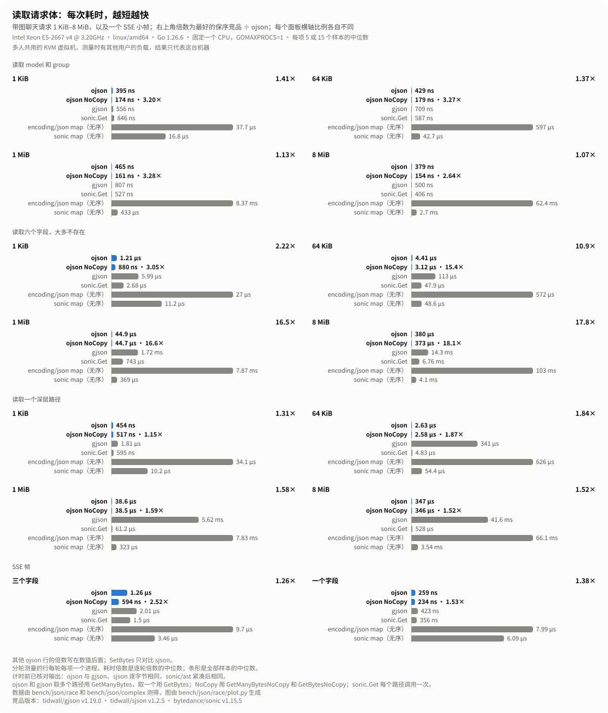
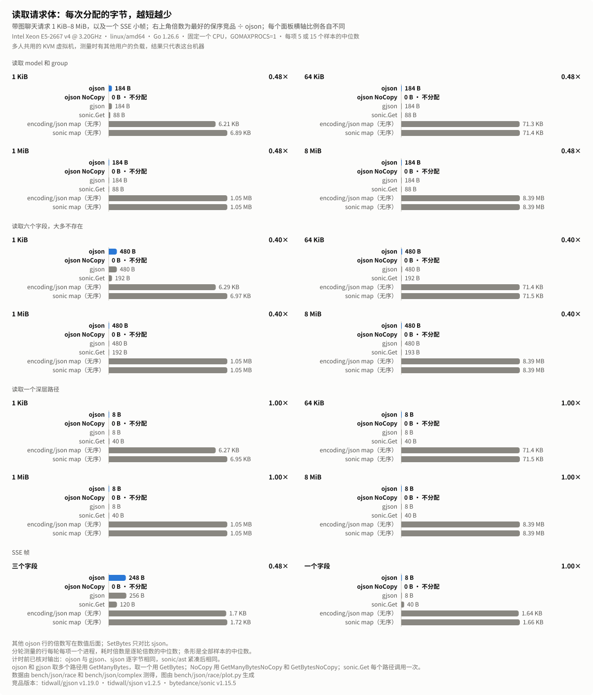
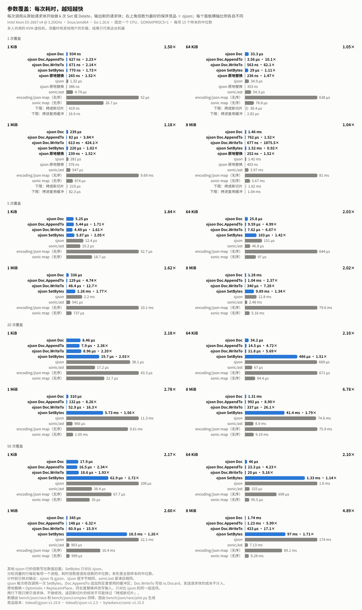
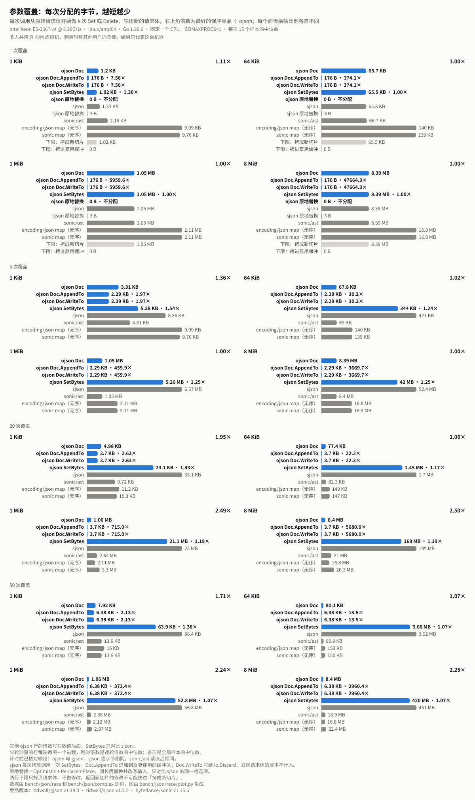

# ojson 在 Linux AMD64 上的性能

在一台 Linux AMD64 机器上对比 `ojson` 与 `gjson`、`sjson`、`sonic` 和 `encoding/json`：测过的每个场景、大小和实现，`ojson` 不领先的地方，以及怎样复现这些数字。
[English](ojson-benchmark-results-linux-amd64.md)

## 测试环境

数据在 2026-11-01 测得，测试机是多人共用的 KVM 虚拟机：Intel Xeon E5-2667 v4 @ 3.20GHz（Broadwell-EP，AVX2，没有 AVX-512），linux/amd64，Go 1.26.6，默认的 `GOAMD64=v1`。每个基准测试进程用 `taskset` 固定在一个 CPU 上，`GOMAXPROCS=1`。整个测量期间，其他用户的任务一直让机器保持繁忙。

| 图表中的名称 | 包和版本 | 测量的内容 |
|---|---|---|
| ojson | 本仓库 | `GetBytes`、`GetManyBytes`、`SetBytes`、`Doc` |
| ojson NoCopy | 本仓库 | `GetBytesNoCopy`、`GetManyBytesNoCopy` |
| gjson | github.com/tidwall/gjson v1.19.0 | `GetBytes`、`GetManyBytes` |
| sjson | github.com/tidwall/sjson v1.2.5 | `SetBytes`、`DeleteBytes`，每次修改调用一次 |
| sonic.Get、sonic/ast | github.com/bytedance/sonic v1.15.5 | 每个路径调用一次 `sonic.Get`；修改 `ast.Node` 后调用 `MarshalJSON` |
| encoding/json map、sonic map | Go 1.26.6、sonic v1.15.5 | 解码到 `map[string]any`，修改，再编码（成员顺序会丢失） |

`sonic` 用的是它的 JIT 实现；如果 `sonic.APIKind` 显示退回到了 `encoding/json`，基准测试会直接停止。两种 map 往返会打乱成员顺序，只作参考。测量用的 `ojson` 构建和这个版本的代码略有不同，两者在每个场景上每次调用的指令数相差不超过 0.36%。

## 测试场景

请求体来自 `bench/json/race`：带缩进排版的聊天请求，最后一条用户消息里嵌着一个 Base64 PNG data URL，大小分别为 1 KiB、64 KiB、1 MiB 和 8 MiB。图片在靠近末尾的位置，和真实请求一样。

- **读取**：`model` 和 `group`，即路由读取的字段；六个大多不存在的字段（`service_tier`、`inference_geo`、`store`、`safety_identifier`、`stream_options.include_obfuscation`、`speed`），即检查禁用字段时读取的字段；还有一个深层路径 `messages.1.content.1.image_url.detail`。多个路径用 `GetManyBytes`，单个路径用 `GetBytes`。
- **SSE**：一个 177 字节的流式分片，读取三个字段或一个字段。
- **参数覆盖**：在原始请求体上做 1、5、20 或 50 次设置和删除，输出新的请求体。大多数是设置顶层的采样参数，少数设置嵌套值或删除 `stream`，后面的修改可能覆盖前面的。
- **复杂路径**：在三种大小的请求和一个含 200 个 choices 的响应上，测九个 `Get` 路径（`#` 映射和查询、通配符、多路径、管道、计数），以及三个经过查询和 `#` 映射的 `Set` 路径。
- **modifier**：在 1 KiB 文档和 64 KiB 对象数组的根部调用；以及 **`Result` 方法**（`Value`、`ForEach`、`Array`、`Map`、`Path`、`Paths`、`Escape`、`AppendJSONString`、`Less`、迭代器）。

参数覆盖里的 `Doc` 行用三种方式写出结果：`Bytes` 返回新切片，`AppendTo` 追加到多次调用之间复用的缓冲区，`WriteTo` 写到 `io.Discard`。「原地替换」设置 `Optimistic` 和 `ReplaceInPlace`：等长替换，覆盖输入，对比的是 `sjson` 的同样选项。两个下限只拷贝请求体、不做修改：拷成新切片（`bytes.Clone`）和拷进复用的缓冲区。返回新切片的修改不可能比第一个下限更快。

## 测量方法

- 每个基准测试都用 `-count 5 -benchtime 0.5s -cpu 1` 运行。柱子和表格里的数值是一行所有样本的中位数。
- 计时之前，测试先核对输出：在每个场景上，`ojson` 返回的字节和 `gjson`、`sjson` 相同，`sonic/ast` 压缩空白后字节相同，map 往返的值相同。
- 读取、SSE、复杂路径的 `Get` 和 `GetBytes`、modifier 和 `Result` 方法，每组在一个进程里运行，`ojson` 和对手承受同样的负载。
- 参数覆盖和复杂路径的 `Set` 每行一个进程，因为对大请求体的一次性修改主要是分配和 GC，结果取决于前面的基准测试留下的堆。这一部分整体跑了 3 轮，每轮里每个 `ojson` 行都紧挨在它所对比的对手之前运行：每行 15 个样本。
- 分轮测量的行，倍数是 3 个逐轮倍数的中位数（同一轮里对手的中位数 ÷ `ojson` 的中位数），这样比较的是负载相近的运行。在一个进程里测量的行，倍数是两个中位数之比。所以倍数可能和表里两个中位数之比不同。
- 倍数是 `ojson` 和保持成员顺序的最快对手相比：读取对比 `gjson` 和 `sonic.Get`，修改对比 `sjson` 和 `sonic/ast`。`SetBytes` 只和 `sjson` 比，因为两者都是每次修改调用一次；原地替换只和 `sjson` 的原地选项比。
- 主运行里 `ojson` 落后或领先不到 3% 的九行，和它们的对手一起按每行一个进程又测了 3 轮：SSE 三个字段，64 KiB 和 8 MiB 上的 1 次修改（`Doc` 和 `SetBytes`），1 KiB 上 `queryAll` 的复杂路径 `Get`，以及 `Result` 方法 `Value`、`Map` 和 `tostr-parse-64KiB`。这些行的表格和图表用的是第二次运行的样本。

## 结果

单元格依次是每次调用的耗时、分配字节数和分配次数。

### 读取

<p align="center">
  
</p>

<p align="center">
  
</p>

| 读取 | 大小 | ojson | ojson NoCopy | gjson | sonic.Get | ojson 倍数 | NoCopy 倍数 |
|---|---|--:|--:|--:|--:|--:|--:|
| model 和 group | 1 KiB | 395 ns / 184 B / 2 | 174 ns / 0 B / 0 | 556 ns / 184 B / 3 | 846 ns / 88 B / 4 | 1.41× | 3.20× |
| model 和 group | 64 KiB | 429 ns / 184 B / 2 | 179 ns / 0 B / 0 | 709 ns / 184 B / 3 | 587 ns / 88 B / 4 | 1.37× | 3.27× |
| model 和 group | 1 MiB | 465 ns / 184 B / 2 | 161 ns / 0 B / 0 | 807 ns / 184 B / 3 | 527 ns / 88 B / 4 | 1.13× | 3.28× |
| model 和 group | 8 MiB | 379 ns / 184 B / 2 | 154 ns / 0 B / 0 | 500 ns / 184 B / 3 | 406 ns / 88 B / 4 | 1.07× | 2.64× |
| 六个字段 | 1 KiB | 1.21 µs / 480 B / 1 | 880 ns / 0 B / 0 | 5.99 µs / 480 B / 1 | 2.68 µs / 192 B / 6 | 2.22× | 3.05× |
| 六个字段 | 64 KiB | 4.41 µs / 480 B / 1 | 3.12 µs / 0 B / 0 | 113 µs / 480 B / 1 | 47.9 µs / 192 B / 6 | 10.86× | 15.36× |
| 六个字段 | 1 MiB | 44.9 µs / 480 B / 1 | 44.7 µs / 0 B / 0 | 1.72 ms / 480 B / 1 | 743 µs / 192 B / 6 | 16.54× | 16.62× |
| 六个字段 | 8 MiB | 380 µs / 480 B / 1 | 373 µs / 0 B / 0 | 14.3 ms / 480 B / 1 | 6.76 ms / 193 B / 6 | 17.79× | 18.12× |
| 深层路径 | 1 KiB | 454 ns / 8 B / 1 | 517 ns / 0 B / 0 | 1.81 µs / 8 B / 1 | 595 ns / 40 B / 2 | 1.31× | 1.15× |
| 深层路径 | 64 KiB | 2.63 µs / 8 B / 1 | 2.58 µs / 0 B / 0 | 341 µs / 8 B / 1 | 4.83 µs / 40 B / 2 | 1.84× | 1.87× |
| 深层路径 | 1 MiB | 38.6 µs / 8 B / 1 | 38.5 µs / 0 B / 0 | 5.62 ms / 8 B / 1 | 61.2 µs / 40 B / 2 | 1.58× | 1.59× |
| 深层路径 | 8 MiB | 347 µs / 8 B / 1 | 346 µs / 0 B / 0 | 41.6 ms / 8 B / 1 | 528 µs / 40 B / 2 | 1.52× | 1.52× |
| SSE 三个字段 |  | 1.26 µs / 248 B / 2 | 594 ns / 0 B / 0 | 2.01 µs / 256 B / 4 | 1.5 µs / 120 B / 6 | 1.26× | 2.52× |
| SSE 一个字段 |  | 259 ns / 8 B / 1 | 234 ns / 0 B / 0 | 423 ns / 8 B / 1 | 356 ns / 40 B / 2 | 1.38× | 1.53× |

倍数列对比 `gjson` 和 `sonic.Get` 中较快的一个。SSE 三个字段这一行是分轮测的。

### 参数覆盖

<p align="center">
  
</p>

<p align="center">
  
</p>

一次修改，输出新的请求体：

| 大小 | SetBytes | Doc.Bytes | Doc.AppendTo | Doc.WriteTo | sjson | sonic/ast | 拷成新切片 | 拷进复用缓冲 |
|---|--:|--:|--:|--:|--:|--:|--:|--:|
| 1 KiB | 770 ns / 1,024 B / 1 | 934 ns / 1,200 B / 2 | 627 ns / 176 B / 1 | 671 ns / 176 B / 1 | 1.32 µs / 1,331 B / 5 | 4.74 µs / 2,160 B / 7 | 419 ns / 1,024 B / 1 | 16.6 ns / 0 B / 0 |
| 64 KiB | 29 µs / 65,536 B / 1 | 33.3 µs / 65,712 B / 2 | 3.56 µs / 176 B / 1 | 563 ns / 176 B / 1 | 34.9 µs / 65,843 B / 5 | 54.3 µs / 66,683 B / 7 | 30.4 µs / 65,536 B / 1 | 2.82 µs / 0 B / 0 |
| 1 MiB | 220 µs / 1,048,576 B / 1 | 239 µs / 1,048,752 B / 2 | 82 µs / 176 B / 1 | 613 ns / 176 B / 1 | 281 µs / 1,048,884 B / 5 | 547 µs / 1,049,784 B / 7 | 219 µs / 1,048,576 B / 1 | 82.3 µs / 0 B / 0 |
| 8 MiB | 1.52 ms / 8,388,608 B / 1 | 1.46 ms / 8,388,784 B / 2 | 762 µs / 176 B / 1 | 677 ns / 176 B / 1 | 1.42 ms / 8,388,917 B / 5 | 3.97 ms / 8,394,011 B / 11 | 1.62 ms / 8,388,608 B / 1 | 1.04 ms / 0 B / 0 |

一次同长度的原地替换（`Optimistic` 加 `ReplaceInPlace`）：

| 大小 | ojson | sjson | 倍数 |
|---|--:|--:|--:|
| 1 KiB | 265 ns / 0 B / 0 | 386 ns / 3 B / 1 | 1.52× |
| 64 KiB | 236 ns / 0 B / 0 | 353 ns / 3 B / 1 | 1.47× |
| 1 MiB | 239 ns / 0 B / 0 | 376 ns / 3 B / 1 | 1.52× |
| 8 MiB | 252 ns / 0 B / 0 | 403 ns / 3 B / 1 | 1.52× |

各次数、各大小的倍数，取 3 轮倍数的中位数，括号里是每轮的倍数。`SetBytes` 对比 `sjson`；`Doc` 各列对比 `sjson` 和 `sonic/ast` 中较快的一个。

| 次数 | 大小 | SetBytes : sjson | Doc.Bytes | Doc.AppendTo | Doc.WriteTo |
|---|---|--:|--:|--:|--:|
| 1 | 1 KiB | 1.73× (1.64 / 2.01 / 1.73) | 1.50× (0.63 / 1.51 / 1.50) | 2.23× (1.25 / 2.23 / 2.34) | 2.14× (1.07 / 2.63 / 2.14) |
| 1 | 64 KiB | 1.11× (1.07 / 1.27 / 1.11) | 1.05× (1.12 / 1.05 / 1.00) | 10.11× (10.11 / 8.15 / 16.32) | 62.07× (56.40 / 62.07 / 98.42) |
| 1 | 1 MiB | 1.02× (1.02 / 1.00 / 1.57) | 1.18× (1.18 / 0.98 / 1.69) | 3.84× (3.84 / 2.60 / 4.74) | 424.15× (424.15 / 361.78 / 668.84) |
| 1 | 8 MiB | 0.92× (0.92 / 1.08 / 0.91) | 1.04× (0.88 / 1.09 / 1.04) | 1.52× (1.52 / 2.46 / 1.42) | 1875.48× (2785.24 / 1875.48 / 1767.05) |
| 5 | 1 KiB | 2.05× (1.98 / 2.11 / 2.05) | 1.84× (1.70 / 1.90 / 1.84) | 1.71× (1.64 / 1.81 / 1.71) | 1.61× (1.61 / 2.58 / 1.39) |
| 5 | 64 KiB | 1.42× (1.23 / 1.54 / 1.42) | 2.03× (2.03 / 1.60 / 2.08) | 4.99× (5.51 / 4.61 / 4.99) | 6.67× (6.67 / 6.20 / 6.83) |
| 5 | 1 MiB | 1.77× (1.75 / 1.78 / 1.77) | 1.62× (1.61 / 1.66 / 1.62) | 4.74× (4.83 / 3.97 / 4.74) | 12.68× (13.06 / 10.54 / 12.68) |
| 5 | 8 MiB | 1.34× (1.34 / 1.35 / 1.27) | 2.02× (1.77 / 2.12 / 2.02) | 2.37× (2.01 / 2.80 / 2.37) | 7.28× (6.58 / 8.06 / 7.28) |
| 20 | 1 KiB | 2.03× (2.03 / 2.24 / 1.72) | 2.18× (2.02 / 2.18 / 2.29) | 2.36× (2.16 / 2.47 / 2.36) | 2.20× (2.24 / 2.20 / 1.86) |
| 20 | 64 KiB | 1.51× (1.75 / 1.26 / 1.51) | 2.10× (2.36 / 2.10 / 1.90) | 4.72× (4.72 / 4.77 / 4.49) | 5.69× (5.65 / 5.80 / 5.69) |
| 20 | 1 MiB | 1.56× (2.29 / 1.56 / 1.52) | 2.78× (2.41 / 2.78 / 3.51) | 8.26× (8.41 / 6.45 / 8.26) | 16.26× (13.98 / 16.26 / 20.50) |
| 20 | 8 MiB | 1.79× (1.71 / 1.81 / 1.79) | 6.78× (6.72 / 6.92 / 6.78) | 8.90× (10.08 / 8.47 / 8.90) | 26.12× (27.83 / 25.71 / 26.12) |
| 50 | 1 KiB | 1.72× (1.58 / 1.72 / 1.82) | 2.17× (1.96 / 2.17 / 2.18) | 2.34× (2.55 / 2.27 / 2.34) | 1.93× (1.81 / 1.93 / 2.22) |
| 50 | 64 KiB | 1.14× (1.12 / 1.14 / 1.35) | 2.10× (1.89 / 2.32 / 2.10) | 4.23× (5.50 / 4.23 / 3.69) | 5.16× (5.97 / 5.16 / 4.34) |
| 50 | 1 MiB | 1.26× (0.84 / 1.28 / 1.26) | 2.60× (2.59 / 2.97 / 2.60) | 6.32× (6.32 / 6.47 / 6.23) | 15.86× (17.24 / 15.86 / 14.27) |
| 50 | 8 MiB | 1.71× (1.80 / 1.47 / 1.71) | 4.89× (4.11 / 4.89 / 5.09) | 5.99× (5.82 / 5.99 / 6.74) | 17.09× (16.84 / 17.09 / 19.68) |

多次修改，输出新的请求体：

| 次数 | 大小 | Doc.Bytes | Doc.AppendTo | Doc.WriteTo | SetBytes | sjson | sonic/ast |
|---|---|--:|--:|--:|--:|--:|--:|
| 5 | 1 KiB | 5.25 µs / 3,312 B / 11 | 5.44 µs / 2,288 B / 10 | 4.49 µs / 2,288 B / 10 | 5.87 µs / 5,376 B / 5 | 12.4 µs / 8,256 B / 22 | 10.2 µs / 4,512 B / 23 |
| 5 | 64 KiB | 25.8 µs / 67,824 B / 11 | 9.59 µs / 2,288 B / 10 | 7.62 µs / 2,288 B / 10 | 103 µs / 344,064 B / 5 | 151 µs / 427,480 B / 22 | 46.8 µs / 69,036 B / 23 |
| 5 | 1 MiB | 336 µs / 1,050,864 B / 11 | 129 µs / 2,288 B / 10 | 48.4 µs / 2,288 B / 10 | 1.26 ms / 5,259,264 B / 5 | 2.2 ms / 6,571,730 B / 26 | 541 µs / 1,052,155 B / 24 |
| 5 | 8 MiB | 1.28 ms / 8,390,896 B / 11 | 1.04 ms / 2,288 B / 10 | 340 µs / 2,288 B / 10 | 9.89 ms / 41,959,424 B / 5 | 12.8 ms / 52,446,980 B / 27 | 2.48 ms / 8,396,367 B / 27 |
| 20 | 1 KiB | 8.46 µs / 4,976 B / 17 | 7.9 µs / 3,696 B / 16 | 8.96 µs / 3,696 B / 16 | 19.7 µs / 23,104 B / 24 | 38.1 µs / 33,081 B / 88 | 17.2 µs / 9,721 B / 87 |
| 20 | 64 KiB | 34.2 µs / 77,424 B / 17 | 14.5 µs / 3,696 B / 16 | 11.8 µs / 3,696 B / 16 | 486 µs / 1,450,048 B / 24 | 669 µs / 1,701,910 B / 89 | 67 µs / 82,310 B / 87 |
| 20 | 1 MiB | 310 µs / 1,060,464 B / 17 | 132 µs / 3,696 B / 16 | 52.9 µs / 3,696 B / 16 | 5.73 ms / 21,110,848 B / 24 | 11.3 ms / 25,049,659 B / 98 | 966 µs / 2,642,605 B / 93 |
| 20 | 8 MiB | 1.31 ms / 8,400,496 B / 17 | 992 µs / 3,696 B / 16 | 337 µs / 3,696 B / 16 | 41.4 ms / 167,911,488 B / 24 | 74.6 ms / 199,375,548 B / 100 | 8.9 ms / 20,993,103 B / 93 |
| 50 | 1 KiB | 17.9 µs / 7,920 B / 19 | 16.5 µs / 6,384 B / 18 | 18.6 µs / 6,384 B / 18 | 62.9 µs / 63,936 B / 54 | 108 µs / 88,444 B / 224 | 38.4 µs / 13,570 B / 209 |
| 50 | 64 KiB | 46 µs / 80,112 B / 19 | 23.3 µs / 6,384 B / 18 | 20 µs / 6,384 B / 18 | 1.33 ms / 3,661,888 B / 54 | 1.6 ms / 3,924,813 B / 225 | 103 µs / 85,903 B / 209 |
| 50 | 1 MiB | 345 µs / 1,063,152 B / 19 | 148 µs / 6,384 B / 18 | 60.9 µs / 6,384 B / 18 | 18.5 ms / 52,813,888 B / 54 | 22.1 ms / 56,764,766 B / 248 | 903 µs / 2,384,054 B / 215 |
| 50 | 8 MiB | 1.74 ms / 8,403,184 B / 19 | 1.23 ms / 6,384 B / 18 | 423 µs / 6,384 B / 18 | 97 ms / 419,815,488 B / 54 | 174 ms / 451,291,866 B / 254 | 7.13 ms / 18,899,475 B / 215 |

### 复杂路径

`req` 开头的文档是上面的聊天请求；`list200` 是含 200 个 choices 的聊天补全响应。路径不适用于某个文档时照样测量：找不到也要搜完整个文档。

| 名称 | 路径 |
|---|---|
| map | `messages.#.role` |
| query | `messages.#(role=="user").content.#(type=="image_url").image_url.detail` |
| queryAll | `messages.#(role=="system")#.content` |
| wild | `metadata.tr*.span` |
| multi | `{model,group,stream,temperature}` |
| pipe | `metadata\|trace.tags.1` |
| choices | `choices.#.message.content` |
| choicesQuery | `choices.#(message.role=="tool")#.index` |
| count | `choices.#` |

在 string 上调用 `Get`：

| 文档 | 路径 | ojson | gjson | 倍数 |
|---|---|--:|--:|--:|
| req1KiB | map | 1.17 µs / 64 B / 1 | 2.67 µs / 536 B / 2 | 2.28× |
| req1KiB | query | 2.97 µs / 0 B / 0 | 3.98 µs / 0 B / 0 | 1.34× |
| req1KiB | queryAll | 1.66 µs / 64 B / 1 | 2.7 µs / 80 B / 4 | 1.20× |
| req1KiB | wild | 222 ns / 0 B / 0 | 297 ns / 0 B / 0 | 1.34× |
| req1KiB | multi | 1.19 µs / 80 B / 1 | 1.5 µs / 496 B / 6 | 1.26× |
| req1KiB | pipe | 447 ns / 0 B / 0 | 507 ns / 0 B / 0 | 1.13× |
| req1KiB | choices | 326 ns / 0 B / 0 | 758 ns / 0 B / 0 | 2.32× |
| req1KiB | choicesQuery | 350 ns / 0 B / 0 | 746 ns / 0 B / 0 | 2.13× |
| req1KiB | count | 293 ns / 0 B / 0 | 745 ns / 0 B / 0 | 2.54× |
| req64KiB | map | 3.02 µs / 64 B / 1 | 34.5 µs / 536 B / 2 | 11.41× |
| req64KiB | query | 8.18 µs / 0 B / 0 | 347 µs / 0 B / 0 | 42.47× |
| req64KiB | queryAll | 6.14 µs / 64 B / 1 | 18.9 µs / 80 B / 4 | 3.08× |
| req64KiB | wild | 264 ns / 0 B / 0 | 349 ns / 0 B / 0 | 1.32× |
| req64KiB | multi | 1.23 µs / 80 B / 1 | 1.5 µs / 496 B / 6 | 1.23× |
| req64KiB | pipe | 430 ns / 0 B / 0 | 512 ns / 0 B / 0 | 1.19× |
| req64KiB | choices | 2.69 µs / 0 B / 0 | 18.5 µs / 0 B / 0 | 6.90× |
| req64KiB | choicesQuery | 2.81 µs / 0 B / 0 | 18.8 µs / 0 B / 0 | 6.68× |
| req64KiB | count | 2.99 µs / 0 B / 0 | 29.6 µs / 0 B / 0 | 9.87× |
| req1MiB | map | 33.8 µs / 64 B / 1 | 456 µs / 536 B / 2 | 13.49× |
| req1MiB | query | 96.5 µs / 0 B / 0 | 4.64 ms / 0 B / 0 | 48.13× |
| req1MiB | queryAll | 68.7 µs / 64 B / 1 | 229 µs / 80 B / 4 | 3.33× |
| req1MiB | wild | 220 ns / 0 B / 0 | 289 ns / 0 B / 0 | 1.31× |
| req1MiB | multi | 1.05 µs / 80 B / 1 | 1.28 µs / 496 B / 6 | 1.22× |
| req1MiB | pipe | 373 ns / 0 B / 0 | 427 ns / 0 B / 0 | 1.14× |
| req1MiB | choices | 33.2 µs / 0 B / 0 | 228 µs / 0 B / 0 | 6.86× |
| req1MiB | choicesQuery | 33.7 µs / 0 B / 0 | 229 µs / 0 B / 0 | 6.79× |
| req1MiB | count | 33.8 µs / 0 B / 0 | 228 µs / 0 B / 0 | 6.74× |
| list200 | map | 3.93 µs / 0 B / 0 | 22.3 µs / 0 B / 0 | 5.68× |
| list200 | query | 4.07 µs / 0 B / 0 | 22.6 µs / 0 B / 0 | 5.54× |
| list200 | queryAll | 3.99 µs / 0 B / 0 | 22.3 µs / 0 B / 0 | 5.59× |
| list200 | wild | 3.97 µs / 0 B / 0 | 22.2 µs / 0 B / 0 | 5.59× |
| list200 | multi | 13.3 µs / 24 B / 1 | 67.3 µs / 248 B / 4 | 5.05× |
| list200 | pipe | 4.41 µs / 0 B / 0 | 22.2 µs / 0 B / 0 | 5.05× |
| list200 | choices | 48.1 µs / 28,352 B / 14 | 97.3 µs / 39,232 B / 20 | 2.02× |
| list200 | choicesQuery | 40.9 µs / 704 B / 3 | 56.5 µs / 864 B / 12 | 1.38× |
| list200 | count | 7.47 µs / 0 B / 0 | 24.2 µs / 3 B / 1 | 3.24× |

`GetBytes`，结果是拷贝：

| 文档 | 路径 | ojson | gjson | 倍数 |
|---|---|--:|--:|--:|
| req1KiB | map | 595 ns / 64 B / 1 | 1.32 µs / 560 B / 3 | 2.22× |
| req1KiB | query | 1.52 µs / 8 B / 1 | 2.04 µs / 8 B / 1 | 1.34× |
| req1KiB | queryAll | 1.08 µs / 64 B / 1 | 1.36 µs / 112 B / 5 | 1.26× |
| req1KiB | wild | 241 ns / 5 B / 1 | 339 ns / 5 B / 1 | 1.40× |
| req1KiB | multi | 1.08 µs / 80 B / 1 | 1.37 µs / 576 B / 7 | 1.27× |
| req1KiB | pipe | 420 ns / 3 B / 1 | 507 ns / 3 B / 1 | 1.21× |
| req1KiB | choices | 284 ns / 0 B / 0 | 654 ns / 0 B / 0 | 2.31× |
| req1KiB | choicesQuery | 313 ns / 0 B / 0 | 654 ns / 0 B / 0 | 2.09× |
| req1KiB | count | 257 ns / 0 B / 0 | 654 ns / 0 B / 0 | 2.55× |
| req64KiB | map | 2.5 µs / 64 B / 1 | 29.8 µs / 560 B / 3 | 11.93× |
| req64KiB | query | 6.88 µs / 8 B / 1 | 295 µs / 8 B / 1 | 42.83× |
| req64KiB | queryAll | 5.05 µs / 64 B / 1 | 15.6 µs / 112 B / 5 | 3.09× |
| req64KiB | wild | 241 ns / 5 B / 1 | 337 ns / 5 B / 1 | 1.40× |
| req64KiB | multi | 1.08 µs / 80 B / 1 | 1.35 µs / 576 B / 7 | 1.25× |
| req64KiB | pipe | 425 ns / 3 B / 1 | 500 ns / 3 B / 1 | 1.18× |
| req64KiB | choices | 2.19 µs / 0 B / 0 | 14.7 µs / 0 B / 0 | 6.71× |
| req64KiB | choicesQuery | 2.24 µs / 0 B / 0 | 14.8 µs / 0 B / 0 | 6.58× |
| req64KiB | count | 2.21 µs / 0 B / 0 | 14.7 µs / 0 B / 0 | 6.67× |
| req1MiB | map | 34.7 µs / 64 B / 1 | 466 µs / 560 B / 3 | 13.45× |
| req1MiB | query | 99.1 µs / 8 B / 1 | 4.65 ms / 8 B / 1 | 46.88× |
| req1MiB | queryAll | 68.7 µs / 64 B / 1 | 229 µs / 112 B / 5 | 3.33× |
| req1MiB | wild | 239 ns / 5 B / 1 | 339 ns / 5 B / 1 | 1.42× |
| req1MiB | multi | 1.14 µs / 80 B / 1 | 1.43 µs / 576 B / 7 | 1.26× |
| req1MiB | pipe | 418 ns / 3 B / 1 | 493 ns / 3 B / 1 | 1.18× |
| req1MiB | choices | 34.6 µs / 0 B / 0 | 228 µs / 0 B / 0 | 6.58× |
| req1MiB | choicesQuery | 33.8 µs / 0 B / 0 | 228 µs / 0 B / 0 | 6.75× |
| req1MiB | count | 33.3 µs / 0 B / 0 | 228 µs / 0 B / 0 | 6.84× |
| list200 | map | 4 µs / 0 B / 0 | 22.2 µs / 0 B / 0 | 5.55× |
| list200 | query | 4.12 µs / 0 B / 0 | 22.2 µs / 0 B / 0 | 5.39× |
| list200 | queryAll | 4.04 µs / 0 B / 0 | 22.3 µs / 0 B / 0 | 5.52× |
| list200 | wild | 4.02 µs / 0 B / 0 | 22.3 µs / 0 B / 0 | 5.54× |
| list200 | multi | 13.2 µs / 24 B / 1 | 67.5 µs / 272 B / 5 | 5.10× |
| list200 | pipe | 4.43 µs / 0 B / 0 | 22.3 µs / 0 B / 0 | 5.03× |
| list200 | choices | 47.1 µs / 28,352 B / 14 | 99.6 µs / 46,144 B / 21 | 2.12× |
| list200 | choicesQuery | 40.3 µs / 704 B / 3 | 57.2 µs / 976 B / 13 | 1.42× |
| list200 | count | 7.64 µs / 0 B / 0 | 24.3 µs / 6 B / 2 | 3.18× |

通过查询或 `#` 映射调用 `SetBytes`，分轮测量。路径依次是 `messages.#(role=="system").content`（query）、`tools.#.type`（map）和 `choices.#(message.role=="tool")#.finish_reason`（queryAll）。

| 文档 | 路径 | ojson | sjson | 倍数 |
|---|---|--:|--:|--:|
| req1KiB | query | 1.29 µs / 1,024 B / 1 | 1.68 µs / 3,856 B / 6 | 1.29× |
| req1KiB | map | 1.6 µs / 1,088 B / 2 | 2.14 µs / 3,784 B / 8 | 1.34× |
| req1KiB | queryAll | 627 ns / 1,024 B / 1 | 1.02 µs / 1,088 B / 2 | 1.64× |
| req64KiB | query | 10.3 µs / 65,536 B / 1 | 28.7 µs / 197,392 B / 6 | 2.78× |
| req64KiB | map | 14.7 µs / 65,600 B / 2 | 42.8 µs / 197,320 B / 8 | 2.91× |
| req64KiB | queryAll | 11 µs / 65,536 B / 1 | 23.5 µs / 65,600 B / 2 | 2.13× |
| req1MiB | query | 118 µs / 1,048,576 B / 1 | 355 µs / 3,146,512 B / 6 | 3.00× |
| req1MiB | map | 191 µs / 1,048,640 B / 2 | 567 µs / 3,146,440 B / 8 | 2.99× |
| req1MiB | queryAll | 151 µs / 1,048,576 B / 1 | 351 µs / 1,048,640 B / 2 | 2.34× |
| list200 | query | 9.32 µs / 32,768 B / 1 | 27.6 µs / 32,832 B / 2 | 2.95× |
| list200 | map | 9.24 µs / 32,768 B / 1 | 27.4 µs / 32,832 B / 2 | 2.98× |
| list200 | queryAll | 99.9 µs / 34,624 B / 8 | 489 µs / 2,442,728 B / 104 | 4.82× |

### modifier

在文档根部调用 `Get(doc, path)`。`64KiB` 是对象数组；`64KiB-indented` 是同一个文档经过 `@pretty` 之后的样子。

| 项目 | ojson | gjson | 倍数 |
|---|--:|--:|--:|
| `1KiB/@this` | 39.4 ns / 0 B / 0 | 61.7 ns / 0 B / 0 | 1.57× |
| `1KiB/@reverse` | 569 ns / 768 B / 4 | 1.52 µs / 2,912 B / 5 | 2.66× |
| `1KiB/@ugly` | 109 ns / 0 B / 0 | 469 ns / 320 B / 1 | 4.32× |
| `1KiB/@pretty` | 1.47 µs / 512 B / 1 | 1.58 µs / 960 B / 2 | 1.07× |
| `1KiB/@pretty:{"sortKeys":true}` | 2.73 µs / 512 B / 1 | 3.98 µs / 3,408 B / 16 | 1.46× |
| `1KiB/@valid` | 358 ns / 0 B / 0 | 573 ns / 0 B / 0 | 1.60× |
| `1KiB/@keys` | 335 ns / 48 B / 1 | 706 ns / 120 B / 4 | 2.11× |
| `1KiB/@values` | 378 ns / 288 B / 1 | 808 ns / 440 B / 4 | 2.14× |
| `1KiB/@tostr` | 1.52 µs / 832 B / 2 | 2.61 µs / 2,112 B / 5 | 1.72× |
| `1KiB/@fromstr` | 385 ns / 0 B / 0 | 597 ns / 0 B / 0 | 1.55× |
| `1KiB/@group` | 610 ns / 288 B / 1 | 2.18 µs / 1,728 B / 16 | 3.57× |
| `1KiB/@dig:name` | 3.84 µs / 48 B / 1 | 4.52 µs / 192 B / 3 | 1.18× |
| `1KiB/friends\|@join` | 1.42 µs / 320 B / 7 | 2.61 µs / 680 B / 7 | 1.83× |
| `64KiB/@this` | 39.5 ns / 0 B / 0 | 61.7 ns / 0 B / 0 | 1.56× |
| `64KiB/@reverse` | 31.5 µs / 73,792 B / 2 | 88.1 µs / 74,208 B / 3 | 2.80× |
| `64KiB/@ugly` | 5.08 µs / 0 B / 0 | 103 µs / 73,728 B / 1 | 20.28× |
| `64KiB/@pretty` | 342 µs / 114,693 B / 1 | 501 µs / 278,528 B / 3 | 1.47× |
| `64KiB/@pretty:{"sortKeys":true}` | 791 µs / 114,692 B / 1 | 1.21 ms / 611,984 B / 2087 | 1.54× |
| `64KiB/@valid` | 131 µs / 0 B / 0 | 173 µs / 0 B / 0 | 1.32× |
| `64KiB/@keys` | 24.5 µs / 24 B / 1 | 120 µs / 56 B / 3 | 4.91× |
| `64KiB/@values` | 48.4 µs / 73,728 B / 1 | 143 µs / 73,736 B / 2 | 2.95× |
| `64KiB/@tostr` | 391 µs / 163,840 B / 2 | 872 µs / 409,600 B / 5 | 2.23× |
| `64KiB/@fromstr` | 197 µs / 0 B / 0 | 267 µs / 0 B / 0 | 1.35× |
| `64KiB/@group` | 95.8 µs / 164,608 B / 8 | 381 µs / 572,728 B / 1418 | 3.98× |
| `64KiB/items\|@flatten` | 154 µs / 284,001 B / 19 | 356 µs / 284,008 B / 19 | 2.31× |
| `64KiB/items.#.dims\|@flatten:{"deep":true}` | 459 µs / 85,824 B / 33 | 1.78 ms / 138,152 B / 2816 | 3.87× |
| `64KiB/items\|@join` | 466 µs / 704 B / 9 | 1.2 ms / 1,512 B / 9 | 2.58× |
| `64KiB/@dig:name` | 2.29 ms / 42,880 B / 7 | 3.06 ms / 222,256 B / 24 | 1.33× |
| `64KiB-indented/@ugly` | 58.9 µs / 73,731 B / 1 | 263 µs / 114,688 B / 1 | 4.47× |
| `64KiB-indented/@pretty` | 733 µs / 0 B / 0 | 859 µs / 114,688 B / 1 | 1.17× |

### Result 方法

在 64 KiB 的对象数组上测量。`Value`、`Map` 和 `Path` 用其中一个元素，`Map-500` 用一个有 500 个成员的对象，`Array-Indexes` 和 `Paths` 用 `items.#.id` 的结果。`Value`、`Map` 和 `tostr-parse-64KiB` 是分轮测的。

| 项目 | ojson | gjson | 倍数 |
|---|--:|--:|--:|
| `Value` | 4.5 µs / 688 B / 20 | 3.38 µs / 800 B / 25 | 1.04× |
| `Value-64KiB` | 4.26 ms / 558,472 B / 13894 | 5.04 ms / 590,744 B / 17364 | 1.18× |
| `ForEach-64KiB` | 50.5 µs / 0 B / 0 | 171 µs / 0 B / 0 | 3.39× |
| `Array-64KiB` | 113 µs / 57,344 B / 1 | 204 µs / 179,824 B / 11 | 1.81× |
| `Map` | 1.23 µs / 944 B / 2 | 1.37 µs / 944 B / 2 | 1.10× |
| `Map-500` | 126 µs / 106,584 B / 4 | 223 µs / 217,368 B / 17 | 1.77× |
| `Array-Indexes` | 77.3 µs / 57,344 B / 1 | 137 µs / 179,824 B / 11 | 1.77× |
| `Path` | 808 ns / 8 B / 1 | 1.79 µs / 56 B / 3 | 2.21× |
| `Paths` | 409 µs / 38,360 B / 706 | 49.5 ms / 67,808 B / 1983 | 120.99× |
| `Escape` | 91 ns / 16 B / 1 | 163 ns / 32 B / 2 | 1.79× |
| `AppendJSONString` | 242 ns / 48 B / 1 | 258 ns / 72 B / 2 | 1.07× |
| `Less` | 280 ns / 0 B / 0 | 313 ns / 0 B / 0 | 1.12× |
| `Less-only` | 11.8 ns / 0 B / 0 | 12.9 ns / 0 B / 0 | 1.10× |
| `AppendJSONString-64KiB` | 29.3 µs / 0 B / 0 | 394 µs / 0 B / 0 | 13.46× |
| `tostr-parse-64KiB` | 297 µs / 81,920 B / 1 | 337 µs / 155,648 B / 2 | 1.14× |
| `All` | 669 ns / 0 B / 0 | 751 ns / 0 B / 0 | 1.12× |

## ojson 不领先的地方

按倍数一列，`ojson` 在除 8 MiB 上 `SetBytes` 一次修改之外的每一行都比保序的最快对手快。有三行按表里的中位数看 `ojson` 更慢，原因是三轮里有一轮的负载比另外两轮重：`Result.Value`，以及 8 MiB 上用 `SetBytes` 和 `Doc.Bytes` 做一次修改。除了返回 `gjson` `[]Result` 的读取，`ojson` 在每一行分配的内存都不比对手多。具体情况：

- **1 MiB 和 8 MiB 上用 `SetBytes` 做一次修改（1.02× 和 0.92×）。** 返回新切片的修改必须把请求体拷贝一遍。`SetBytes` 做一次正好等于输出大小的分配和一次拷贝，耗时和下限「拷成新切片」相同：220 µs 和 1.52 ms，下限是 219 µs 和 1.62 ms。它执行的指令比下限多 0.62% 和 0.34%；`sjson` 多 1.8% 和 1.0%，还要分配五次。拷贝 1 MiB 或 8 MiB 受内存带宽限制，而内存带宽由这台机器上的所有用户共享，同样的拷贝在相邻进程之间周期数相差 10–20%。让 `SetBytes` 和下限交替跑十轮，两者周期数之比的中位数在 8 MiB 上是 1.01，在 1 MiB 上是 1.00。要省掉这次拷贝，可以用 `Doc.WriteTo`（8 MiB 上 677 ns），或者用 `Doc.AppendTo` 写进复用的缓冲区。
- **8 MiB 上用 `Doc.Bytes` 做一次修改（1.04×）。** 三轮的倍数是 0.88、1.09 和 1.04。`Doc.Bytes` 同样只做一次分配和一次拷贝，受的限制和 `SetBytes` 相同。
- **`Result.Value`（1.04×）。** 三轮的倍数是 1.09、1.04 和 0.59。`ojson` 分配 20 次共 688 B，`gjson` 分配 25 次共 800 B；关掉 GC 后，`ojson` 执行的指令少 8%，周期少 9%。
- **返回 `[]Result` 的读取。** `gjson` 的 API 返回 `[]Result`，每个路径 80 B，再加上值的一份拷贝。`sonic.Get` 返回指向输入的节点，分配得更少：两个路径 88 B 对 184 B，六个路径 192 B 对 480 B，SSE 分片 120 B 对 248 B。`ojson` 在每个读取行上都更快，`GetManyBytesNoCopy` 配合复用的切片不分配内存。
- **内存相同。** 很多 `Get` 行两个库都不分配；`GetBytes` 像 `gjson` 一样拷贝值，两边分配的字节数相同，都只有几个字节。`Result.Map` 在六个成员上，两个库都是分配两次共 944 B：一个 map 头和一组槽位，这是 Go 里这么大的 map 需要的。`ojson` 在这些行上都更快。

## 限制

- 只测了一台多人共用的 KVM 虚拟机，测量时有其他用户的负载。结果只适用于这台机器。负载会改变可用的缓存和内存带宽，有分配的行还受 GC 时机影响。分轮配对能减小负载的影响，但不能消除。
- 换成缓存大小和内存带宽不同的 CPU，结果可能不同。
- 只测了 linux/amd64。在 arm64 上 `ojson` 用 NEON 内核，用 `-tags purego` 编译时用可移植的 Go 代码代替 AVX2 内核，这两种情况的速度还没有测过。
- 请求体是合成的聊天请求和响应。真实请求的结构和大小不同。

## 复现

在项目根目录下，需要 Go 1.26 和 Python 3，系统为 Linux：

```sh
cd bench/json
go test ./...    # 计时之前核对每个输出

go test -c -o /tmp/ojson-race.test ./race
go test -c -o /tmp/ojson-complex.test ./complex
go test -c -o /tmp/ojson-api.test .
B="-test.run ^$ -test.benchmem -test.cpu 1 -test.count 5 -test.benchtime 0.5s"
taskset -c 2 /tmp/ojson-race.test $B -test.bench '^Benchmark(Read|SSE)$' > /tmp/read.txt
taskset -c 2 /tmp/ojson-complex.test $B -test.bench '^BenchmarkGet(Bytes)?$' > /tmp/complex.txt
taskset -c 2 /tmp/ojson-api.test $B -test.bench '^Benchmark(Modifiers|ResultAPI)$' > /tmp/api.txt  # 只用于表格

# 参数覆盖和复杂路径的 Set：每行一个进程，跑 3 轮，
# 每个 ojson 行紧挨在它所对比的对手之前。
for round in 1 2 3; do
  for size in 1KiB 64KiB 1MiB 8MiB; do
    for k in 1 5 20 50; do
      engines="ojson-setbytes sjson ojson-doc sonic-ast ojson-doc-append encjson-map ojson-doc-writeto sonic-map"
      [ $k = 1 ] && engines="ojson-setbytes sjson ojson-doc sonic-ast ojson-doc-append floor-clone
        ojson-doc-writeto floor-copy ojson-inplace sjson-inplace encjson-map sonic-map"
      for e in $engines; do
        taskset -c 2 /tmp/ojson-race.test $B -test.bench "^BenchmarkOverride\$/^$k\$/^$size\$/^$e\$"
      done
    done
  done
  for d in req1KiB req64KiB req1MiB list200; do
    for p in query map queryAll; do
      for e in ojson sjson; do
        taskset -c 2 /tmp/ojson-complex.test $B -test.bench "^BenchmarkSet\$/^$d\$/^$p\$/^$e\$"
      done
    done
  done
done > /tmp/override.txt

python3 race/plot.py /tmp/read.txt /tmp/override.txt /tmp/complex.txt \
  --go "$(go env GOVERSION)" --lang en --output ../../docs/images
python3 race/plot.py /tmp/read.txt /tmp/override.txt /tmp/complex.txt \
  --go "$(go env GOVERSION)" --lang zh --output ../../docs/images
```

把 `taskset -c 2` 里的 2 换成一个空闲的 CPU，测量期间停掉其他基准测试和编译。`plot.py` 生成 README 里的汇总图和本页的读取图、参数覆盖图，有英文（`.en.svg`）和中文（`.zh.svg`）两种。多个文件含有同一行时，后面的文件优先，所以重测的行可以放在主输出后面传入。
