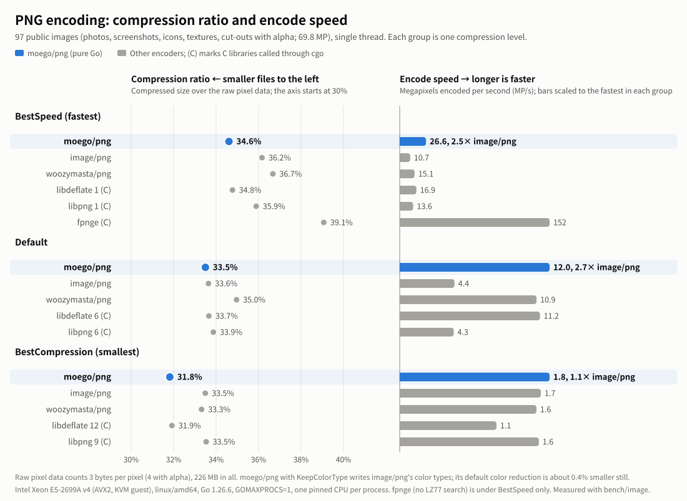

# moego/png performance on Linux AMD64

`moego/png` compared with `image/png`, the other pure-Go PNG encoders and
the C libraries libpng, libdeflate and fpnge on one Linux AMD64 machine:
size and speed at each compression level, image by image, the DEFLATE
engine on its own, memory, and how to reproduce the numbers.
[简体中文](png-benchmark-results-linux-amd64.zh_CN.md)

## Test environment

The numbers were measured on 2026-11-14 on a KVM virtual machine: Intel
Xeon E5-2699A v4 @ 2.40GHz (Broadwell-EP, AVX2, no AVX-512), linux/amd64,
Debian 13, Go 1.26.6 with the default `GOAMD64=v1`, gcc 14.2. Every timing
process was pinned to one CPU with `taskset` and ran with `GOMAXPROCS=1`.

| Name in the tables | Package and version |
|---|---|
| moego/png | this repository; `KeepColorType` unless marked "color reduction" |
| image/png | Go 1.26.6 |
| woozymasta/png | [github.com/woozymasta/png](https://github.com/woozymasta/png) v1.2.0 |
| fastpng | [github.com/gameparrot/fastpng](https://github.com/gameparrot/fastpng) d72e123a2123 |
| calamus | [github.com/timzifer/calamus](https://github.com/timzifer/calamus) v0.3.0, `Workers: 1` |
| libpng | libpng 1.6.48 with zlib 1.3.1, through cgo |
| libdeflate | libdeflate 1.23, through cgo, with a minimal PNG writer |
| fpnge | [github.com/veluca93/fpnge](https://github.com/veluca93/fpnge) 097ebccf3d3d, through cgo |

## Workloads

97 PNG images from the [QOI benchmark suite](https://qoiformat.org/benchmark/):
all 24 Kodak photos and an even sample of the other categories (photos,
game and web screenshots, icons, textures, cut-outs with alpha), 69.8
megapixels in all, 29 with alpha and 11 with at most 256 colors.
`bench/image/corpus.txt` lists them with their sha256.

Every encoder gets the same `*image.NRGBA`. The compression ratio is the
total compressed size over the raw pixel data, counted at 3 bytes per pixel
(4 for images with alpha): 225,503,785 bytes for the 97 images. Smaller is
better.

`moego/png` was measured in two settings. With `KeepColorType` it writes
the color type and bit depth that `image/png` writes, so the comparison
leaves out what color reduction gains; this is the setting in every table
unless marked. By default it also reduces the color type as far as the
pixels allow (no alpha for opaque images, gray, palettes).

## Method

- Every output is decoded with `image/png` and with libpng and compared
  with the source pixels before it is timed. All 97 images round-trip in
  every setting of every encoder in the tables.
- Each encoder setting and image is encoded once as a warm-up, then at
  least 5 times and for at least 100 ms, up to 100 times; 3 times when the
  warm-up takes over 100 ms, and only the warm-up when it takes 2 s or
  more. The time per image is the median; MP/s is the total number of
  pixels over the sum of the medians.
- Four timing processes ran at a time, each on its own CPU, with the images
  split between them by pixel count.

## Results

<p align="center">
  
</p>

"vs image/png default" is the total size over that of `image/png` at
`DefaultCompression`, 75,861,471 bytes.

| Level | Encoder | cgo | Ratio | vs image/png default | Encode MP/s |
|---|---|:-:|--:|--:|--:|
| BestSpeed | **moego/png** |  | **34.6%** | **1.029** | **26.6** |
|  | moego/png, color reduction |  | 34.4% | 1.024 | 26.8 |
|  | image/png |  | 36.2% | 1.075 | 10.7 |
|  | woozymasta/png |  | 36.7% | 1.090 | 15.1 |
|  | fastpng |  | 36.7% | 1.090 | 13.1 |
|  | calamus |  | 36.2% | 1.075 | 12.3 |
|  | libdeflate 1 | ✓ | 34.8% | 1.034 | 16.9 |
|  | libpng 1 | ✓ | 35.9% | 1.067 | 13.6 |
|  | fpnge | ✓ | 39.1% | 1.161 | 152 |
|  | fpnge fast | ✓ | 43.9% | 1.305 | 197 |
| Default | **moego/png** |  | **33.5%** | **0.996** | **12.0** |
|  | moego/png, color reduction |  | 33.4% | 0.992 | 12.0 |
|  | image/png |  | 33.6% | 1.000 | 4.38 |
|  | woozymasta/png |  | 35.0% | 1.039 | 10.9 |
|  | fastpng |  | 35.0% | 1.039 | 9.87 |
|  | calamus |  | 33.6% | 1.000 | 4.66 |
|  | libdeflate 6 | ✓ | 33.7% | 1.001 | 11.2 |
|  | libpng 6 | ✓ | 33.9% | 1.007 | 4.32 |
| BestCompression | **moego/png** |  | **31.8%** | **0.946** | **1.77** |
|  | moego/png, color reduction |  | 31.7% | 0.943 | 1.82 |
|  | image/png |  | 33.5% | 0.996 | 1.67 |
|  | woozymasta/png |  | 33.3% | 0.990 | 1.62 |
|  | fastpng |  | 33.3% | 0.990 | 1.59 |
|  | calamus |  | 33.5% | 0.995 | 1.72 |
|  | libdeflate 9 | ✓ | 33.4% | 0.991 | 5.61 |
|  | libdeflate 12 | ✓ | 31.9% | 0.949 | 1.14 |
|  | libpng 9 | ✓ | 33.5% | 0.997 | 1.65 |

At each level `moego/png` is smaller and faster than every other pure-Go
encoder, than libpng at the same level and than libdeflate 1, 6 and 12:

- BestSpeed is 2.5× as fast as `image/png` and 4.3% smaller; it is 1.77×
  as fast as the fastest other pure-Go encoder (woozymasta/png) and 5.6%
  smaller.
- Default is 2.7× as fast as `image/png` and 0.4% smaller, and 10% faster
  and 4.2% smaller than woozymasta/png.
- BestCompression is 5.0% smaller than `image/png` and 6% faster. It is
  also smaller and 1.55× as fast as libdeflate 12, the smallest of the C
  settings measured.
- libdeflate 9 is 3.2× as fast as BestCompression with files 4.8% larger.
  fpnge, which does no LZ77 match search, is 5.7× (default) and 7.4×
  (fast) as fast as BestSpeed, with files 13% and 27% larger.
- calamus also has a `fast` level (38.4%, 25.8 MP/s); BestSpeed is 10%
  smaller and a little faster.
- Color reduction makes each level about 0.4% smaller. On the 11 images
  with at most 256 colors, the default level is 0.450 of `image/png`'s
  size with color reduction and 0.670 with `KeepColorType`.

Decoding speed depends on the file, not on which encoder wrote it:
`moego/png`'s output decodes at 25–27 MP/s with `image/png` and 49–50 MP/s
with libpng, as other encoders' output does.

### Image by image

The totals hide the spread between images:

- **BestSpeed against libdeflate 1**: smaller on 82 of 97 images and the
  same size on 1 (the smallest ratio 0.61, the largest 1.01); faster on 94.
- **Default against libdeflate 6**: smaller on 60, faster on 48. 36 of the
  38 photos encode more slowly (up to 14% per image, 4–8% per photo group);
  icons, screenshots and cut-outs are 16–78% faster; the whole corpus 7%
  faster.
- **BestCompression against libdeflate 12**: smaller on 35, geometric mean
  0.980. Four 512-pixel icons are 13–56% larger and a sticker 35%; some
  cut-outs, textures and screenshots are much smaller, down to 0.55.
- **BestCompression against `image/png` best**: smaller on 89; faster on
  30. Screenshots and 512-pixel icons are 1.1–2.1× as fast (6.8× on one
  image), 64-pixel icons 0.95×, Kodak photos 0.66×, small textures slowest
  (0.2× on a 256×256 texture). The whole corpus takes 39.3 s against
  41.8 s.

## The DEFLATE engine

`moego/png` compresses with its own zlib encoder in `internal/deflate`,
written from RFC 1950 and 1951. `bench/image/cmd/deflatebench` gives every
zlib implementation the same input: the filtered rows that `image/png`
writes at `DefaultCompression`, 221.5 MB for the 97 images. Every output is
inflated and compared before it is timed, with `GOMAXPROCS=1` and four
processes on four CPUs, the images split between them.

| Engine | Level | Output bytes | vs libdeflate 6 | MB/s |
|---|---|--:|--:|--:|
| moego | 1 | 77,774,221 | 1.032 | 99.9 |
| moego | 6 | 75,323,698 | 0.999 | 41.9 |
| moego | 8 (png BestCompression) | 72,601,186 | 0.963 | 6.5 |
| moego | 9 | 71,496,904 | 0.949 | 3.1 |
| libdeflate | 1 / 6 / 9 / 12 | 77,872,196 / 75,374,880 / 74,683,060 / 71,497,475 | 1.033 / 1.000 / 0.991 / 0.949 | 153 / 62.5 / 22.9 / 3.8 |
| zlib (C) | 1 / 6 / 9 | 80,228,668 / 76,018,963 / 75,306,492 | 1.064 / 1.009 / 0.999 | 74.7 / 19.1 / 5.9 |
| compress/zlib | 1 / 6 / 9 | 80,978,518 / 75,310,547 / 74,977,667 | 1.074 / 0.999 / 0.995 | 90.3 / 19.6 / 6.1 |

At levels 1–6 the engine is 1.1–2.1× as fast as `compress/zlib`, and at
every level it is smaller than zlib; against `compress/zlib` it is smaller
at every level except 6, where it is 13,151 bytes (0.02%) larger. Level 9
is as small as libdeflate 12 at 0.82× its speed. Against libdeflate 1 and
6 it is the same size or a little smaller, at 0.65× and 0.67× their speed.

- Level 1: a 4-byte hash table that keeps the two latest positions of each
  bucket, greedy matching, and the positions inside a match added after it.
- Levels 2–7: hash chains with one step of lazy matching, scored by length
  and the bits of the distance code.
- Levels 8 and 9: a binary tree for match search and near-optimal parsing
  with costs from the previous pass's Huffman code lengths.
- Every level builds length-limited Huffman codes with package-merge,
  splits blocks by estimated cost, and compares stored, fixed and dynamic
  blocks exactly for each block. Adler-32 runs with AVX2 or NEON.

At BestSpeed and Default most of the encode time is in the engine: on the
corpus, level 1 takes about 2.2 s of BestSpeed's 2.6 s, and level 6 about
5.3 s of Default's 5.8 s.

## Memory

`bench/image/cmd/imgalloc` measures the Go heap allocated by one encode of
each image, with the output going to `io.Discard`. Cold encodes run after
two garbage collections, which empty the encoder's internal buffer pool;
warm encodes reuse buffers through `BufferPool` and count the second
encode. 97 images, `GOMAXPROCS=1`:

| Level | moego/png cold | image/png cold | moego/png, largest image | Warm, both |
|---|--:|--:|--:|--:|
| BestSpeed | 99.5 MB | 121.9 MB | 1.12 MB | 0 B, 0 allocations |
| Default | 86.7 MB | 83.8 MB | 0.99 MB | 0 B, 0 allocations |
| BestCompression | 232.9 MB | 83.8 MB | 2.62 MB | 0 B, 0 allocations |

- With a warm `BufferPool`, an encode allocates nothing for the ten
  concrete image types (`NRGBA`, `RGBA`, `NRGBA64`, `RGBA64`, `Gray`,
  `Gray16`, `Alpha`, `Paletted`, `YCbCr`, `CMYK`) at every level, with and
  without `KeepColorType`. Other image types are read through `At`, which
  allocates a `color.Color` per pixel, as in `image/png`.
- Cold, BestSpeed allocates 18% less than `image/png`, Default 3% more
  (30 KB per image on average: the 64 KiB IDAT buffer, a staging buffer
  for the filtered data and a few row buffers), and BestCompression 2.8×
  as much: the costs, paths and match lists of level 8's parse, in
  segments of 64K positions.
- Without a `BufferPool`, the encoder keeps its buffers in an internal
  `sync.Pool`, so these allocations happen on the first encode only.
  Color reduction changes the totals by at most 1.2%.

## Limitations

- One KVM virtual machine was measured; other CPUs may give different
  results. Only linux/amd64 was timed. The NEON kernels on arm64 and the
  portable code (other architectures, `-tags purego`, amd64 without AVX2)
  are tested for correctness, but their speed has not been measured.
- The corpus is 97 images of one public suite. Other images, especially
  larger photos, may compress and encode differently.
- `moego/png` writes non-interlaced PNG only, without ancillary chunks
  such as `tEXt` or `gAMA`, as `image/png` does.

## Reproducing

On Debian or Ubuntu amd64 with Go 1.26, gcc and g++, git, curl, `apt-get`,
`dpkg-deb`, `taskset` and at least 8 CPUs:

```sh
cd bench/image
./run.sh /tmp/image-run
```

`run.sh` fetches the C headers (`sysroot.sh`) and the corpus
(`fetch_corpus.sh`) next to the output directory, builds `imgbench` with
cgo, checks every encoder on every image, times the ones that pass, and
writes `summary.md`, `summary.csv` and `per-image.csv`. It runs the check
pass on all CPUs but the last four and the timing passes on the last four;
`CHECK_CPUS` and `TIMING_CPUS` choose others. Stop other work on the
machine while it times. The other measurements:

```sh
# The DEFLATE engines on image/png's filtered rows, one process per CPU.
S=/tmp/image-sysroot
CGO_CFLAGS="-O2 -I$S/usr/include" CGO_LDFLAGS="-L$S/usr/lib/x86_64-linux-gnu" \
  go build -o /tmp/deflatebench ./cmd/deflatebench
for k in 0 1 2 3; do
  taskset -c $((4 + k)) /tmp/deflatebench -corpus /tmp/image-corpus/images -list corpus.txt \
    -out /tmp/deflate -shard $k/4 -tag s$k &
done; wait
/tmp/deflatebench -sum /tmp/deflate

# Allocations, cold and warm.
GOMAXPROCS=1 taskset -c 3 go run ./cmd/imgalloc -corpus /tmp/image-corpus/images -list corpus.txt

# The charts of this page and the README.
for lang in en zh; do
  go run ./cmd/imgchart -lang $lang -summary /tmp/image-run/summary.csv \
    -images /tmp/image-run/per-image.csv -o ../../docs/images/png-ratio-speed.$lang.svg
done
```

The C libraries build with cgo and are left out of `CGO_ENABLED=0` builds;
fpnge needs `-tags fpnge` on amd64. The [benchmark module's
README](../bench/image/README.md) lists every encoder and the measurement
rules.
