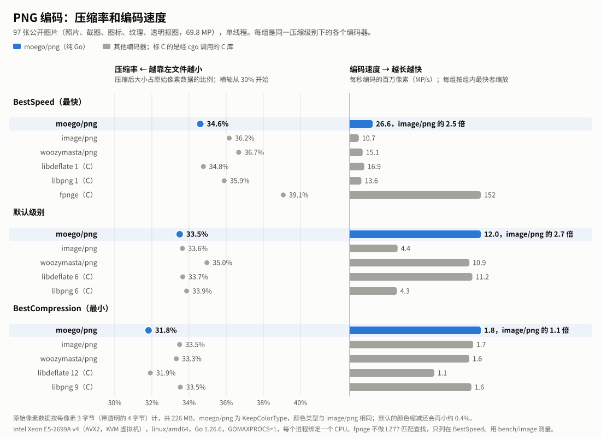

# moego/png 在 Linux AMD64 上的性能

在一台 Linux AMD64 机器上对比 `moego/png` 与 `image/png`、其他纯 Go PNG 编码器，以及 C 库 libpng、libdeflate 和 fpnge：每个压缩级别的大小和速度、逐图结果、单独对比 DEFLATE 引擎、内存，以及怎样复现这些数字。
[English](png-benchmark-results-linux-amd64.md)

## 测试环境

数据在 2026-11-14 测得，测试机是 KVM 虚拟机：Intel Xeon E5-2699A v4 @ 2.40GHz（Broadwell-EP，AVX2，没有 AVX-512），linux/amd64，Debian 13，Go 1.26.6，默认的 `GOAMD64=v1`，gcc 14.2。每个计时进程用 `taskset` 固定在一个 CPU 上，`GOMAXPROCS=1`。

| 表中的名称 | 包和版本 |
|---|---|
| moego/png | 本仓库；除标明"颜色缩减"的行外都是 `KeepColorType` |
| image/png | Go 1.26.6 |
| woozymasta/png | [github.com/woozymasta/png](https://github.com/woozymasta/png) v1.2.0 |
| fastpng | [github.com/gameparrot/fastpng](https://github.com/gameparrot/fastpng) d72e123a2123 |
| calamus | [github.com/timzifer/calamus](https://github.com/timzifer/calamus) v0.3.0，`Workers: 1` |
| libpng | libpng 1.6.48 + zlib 1.3.1，经 cgo 调用 |
| libdeflate | libdeflate 1.23，经 cgo 调用，配一个最小的 PNG 写出器 |
| fpnge | [github.com/veluca93/fpnge](https://github.com/veluca93/fpnge) 097ebccf3d3d，经 cgo 调用 |

## 测试图片

[QOI 基准图集](https://qoiformat.org/benchmark/)中的 97 张 PNG：全部 24 张 Kodak 照片，以及其他类别（照片、游戏和网页截图、图标、纹理、带透明通道的抠图）中均匀抽取的图片，共 69.8 MP，其中 29 张带透明，11 张不超过 256 色。`bench/image/corpus.txt` 列出了这些图片和它们的 sha256。

所有编码器拿到同一份 `*image.NRGBA`。压缩率是压缩后的总大小占原始像素数据的比例，原始像素数据按每像素 3 字节（带透明的图 4 字节）计，97 张图共 225,503,785 字节；越小越好。

`moego/png` 测了两种设置。`KeepColorType` 写出与 `image/png` 相同的颜色类型和位深，比较时不计入颜色缩减带来的收益；除非标明，表中都是这种设置。默认设置还会按像素尽量缩减颜色类型（不透明的图去掉 alpha、灰度、调色板）。

## 测量方法

- 每个输出都先用 `image/png` 和 libpng 各解码一遍，与原图逐像素比较，通过后才计时。表中每个编码器的每种设置，97 张图都能往返。
- 每种设置的每张图先预热编码一次，再至少编码 5 次、至少 100 ms，最多 100 次；预热超过 100 ms 时编码 3 次，达到 2 秒时只计预热这一次。每张图取中位时间；MP/s 是总像素数除以各图中位时间之和。
- 同时运行 4 个计时进程，各占一个 CPU，图片按像素数分给它们。

## 结果

<p align="center">
  
</p>

"对 image/png 默认"是总大小除以 `image/png` 在 `DefaultCompression` 下的 75,861,471 字节。

| 级别 | 编码器 | cgo | 压缩率 | 对 image/png 默认 | 编码 MP/s |
|---|---|:-:|--:|--:|--:|
| BestSpeed | **moego/png** |  | **34.6%** | **1.029** | **26.6** |
|  | moego/png（颜色缩减） |  | 34.4% | 1.024 | 26.8 |
|  | image/png |  | 36.2% | 1.075 | 10.7 |
|  | woozymasta/png |  | 36.7% | 1.090 | 15.1 |
|  | fastpng |  | 36.7% | 1.090 | 13.1 |
|  | calamus |  | 36.2% | 1.075 | 12.3 |
|  | libdeflate 1 | ✓ | 34.8% | 1.034 | 16.9 |
|  | libpng 1 | ✓ | 35.9% | 1.067 | 13.6 |
|  | fpnge | ✓ | 39.1% | 1.161 | 152 |
|  | fpnge fast | ✓ | 43.9% | 1.305 | 197 |
| 默认 | **moego/png** |  | **33.5%** | **0.996** | **12.0** |
|  | moego/png（颜色缩减） |  | 33.4% | 0.992 | 12.0 |
|  | image/png |  | 33.6% | 1.000 | 4.38 |
|  | woozymasta/png |  | 35.0% | 1.039 | 10.9 |
|  | fastpng |  | 35.0% | 1.039 | 9.87 |
|  | calamus |  | 33.6% | 1.000 | 4.66 |
|  | libdeflate 6 | ✓ | 33.7% | 1.001 | 11.2 |
|  | libpng 6 | ✓ | 33.9% | 1.007 | 4.32 |
| BestCompression | **moego/png** |  | **31.8%** | **0.946** | **1.77** |
|  | moego/png（颜色缩减） |  | 31.7% | 0.943 | 1.82 |
|  | image/png |  | 33.5% | 0.996 | 1.67 |
|  | woozymasta/png |  | 33.3% | 0.990 | 1.62 |
|  | fastpng |  | 33.3% | 0.990 | 1.59 |
|  | calamus |  | 33.5% | 0.995 | 1.72 |
|  | libdeflate 9 | ✓ | 33.4% | 0.991 | 5.61 |
|  | libdeflate 12 | ✓ | 31.9% | 0.949 | 1.14 |
|  | libpng 9 | ✓ | 33.5% | 0.997 | 1.65 |

每个级别的 `moego/png` 都比其他纯 Go 编码器、libpng 同级和 libdeflate 1、6、12 更小、更快：

- BestSpeed 是 `image/png` 的 2.5 倍速度，文件小 4.3%；是最快的其他纯 Go 编码器（woozymasta/png）的 1.77 倍速度，文件小 5.6%。
- 默认级别是 `image/png` 的 2.7 倍速度，文件小 0.4%；比 woozymasta/png 快 10%，小 4.2%。
- BestCompression 比 `image/png` 小 5.0%，快 6%；也比测过的 C 设置里最小的 libdeflate 12 更小，速度是它的 1.55 倍。
- libdeflate 9 的速度是 BestCompression 的 3.2 倍，文件大 4.8%。不做 LZ77 匹配查找的 fpnge 速度是 BestSpeed 的 5.7 倍（默认）和 7.4 倍（fast），文件大 13% 和 27%。
- calamus 另有一个 `fast` 级别（38.4%，25.8 MP/s），BestSpeed 比它小 10%，也略快。
- 颜色缩减让每个级别再小约 0.4%。在 11 张不超过 256 色的图上，默认级别开启颜色缩减时总大小是 `image/png` 的 0.450，`KeepColorType` 时是 0.670。

解码速度取决于文件内容，与编码器无关：`moego/png` 的输出用 `image/png` 解码为 25–27 MP/s，用 libpng 为 49–50 MP/s，和其他编码器的输出相同。

### 逐图

总数掩盖了图与图之间的差别：

- **BestSpeed 对 libdeflate 1**：97 张中 82 张更小，1 张一样大（逐图比值最小 0.61，最大 1.01）；94 张更快。
- **默认对 libdeflate 6**：60 张更小，48 张更快。38 张照片中 36 张更慢（逐图最多慢 14%，各照片分组合计慢 4–8%）；图标、截图和抠图快 16–78%；全图集快 7%。
- **BestCompression 对 libdeflate 12**：35 张更小，几何平均 0.980。四张 512 像素的图标大 13–56%，一张贴纸大 35%；一些抠图、纹理和截图小得多，逐图最小到 0.55。
- **BestCompression 对 `image/png` best**：89 张更小；30 张更快。截图和 512 像素图标的速度是它的 1.1–2.1 倍（一张为 6.8 倍），64 像素图标为 0.95 倍，Kodak 照片为 0.66 倍，小纹理最慢（一张 256×256 的纹理为 0.2 倍）。全图集用时 39.3 秒对 41.8 秒。

## DEFLATE 引擎

`moego/png` 用 `internal/deflate` 中自己的 zlib 编码器压缩，按 RFC 1950 和 1951 编写。`bench/image/cmd/deflatebench` 把同一份输入交给每个 zlib 实现：`image/png` 在 `DefaultCompression` 下写出的过滤后行数据，97 张图共 221.5 MB。每个输出先解压比对，再计时；`GOMAXPROCS=1`，4 个进程各占一个 CPU，图片分给它们。

| 引擎 | 级别 | 输出字节 | 对 libdeflate 6 | MB/s |
|---|---|--:|--:|--:|
| moego | 1 | 77,774,221 | 1.032 | 99.9 |
| moego | 6 | 75,323,698 | 0.999 | 41.9 |
| moego | 8（png BestCompression） | 72,601,186 | 0.963 | 6.5 |
| moego | 9 | 71,496,904 | 0.949 | 3.1 |
| libdeflate | 1 / 6 / 9 / 12 | 77,872,196 / 75,374,880 / 74,683,060 / 71,497,475 | 1.033 / 1.000 / 0.991 / 0.949 | 153 / 62.5 / 22.9 / 3.8 |
| zlib（C） | 1 / 6 / 9 | 80,228,668 / 76,018,963 / 75,306,492 | 1.064 / 1.009 / 0.999 | 74.7 / 19.1 / 5.9 |
| compress/zlib | 1 / 6 / 9 | 80,978,518 / 75,310,547 / 74,977,667 | 1.074 / 0.999 / 0.995 | 90.3 / 19.6 / 6.1 |

级别 1–6 的速度是 `compress/zlib` 的 1.1–2.1 倍。每个级别都比 zlib 小；对 `compress/zlib`，除级别 6 大 13,151 字节（0.02%）外，每个级别都更小。级别 9 和 libdeflate 12 一样小，速度是它的 0.82 倍。和 libdeflate 1、6 相比大小相同或略小，速度是它们的 0.65 和 0.67 倍。

- 级别 1：每个桶保留两个最近位置的 4 字节哈希表，贪心匹配，匹配内部的位置在匹配之后补入。
- 级别 2–7：哈希链加一步惰性匹配，按长度和距离码的位数打分。
- 级别 8、9：用二叉树查找匹配，按上一遍的 Huffman 码长计算代价，做近似最优解析。
- 所有级别都用 package-merge 构造限长 Huffman 码，按估算代价分块，并对每块精确比较存储、固定和动态三种块型。Adler-32 用 AVX2 或 NEON 计算。

BestSpeed 和默认级别的编码时间大多花在引擎上：全图集上，BestSpeed 的 2.6 秒中级别 1 约占 2.2 秒，默认级别的 5.8 秒中级别 6 约占 5.3 秒。

## 内存

`bench/image/cmd/imgalloc` 测量每张图一次编码的 Go 堆分配，输出写到 `io.Discard`。冷编码在两次 GC 之后进行，GC 会清空编码器内部的缓冲池；热编码通过 `BufferPool` 复用缓冲区，只计第二次编码。97 张图，`GOMAXPROCS=1`：

| 级别 | moego/png 冷编码 | image/png 冷编码 | moego/png 最大单图 | 热编码（两者） |
|---|--:|--:|--:|--:|
| BestSpeed | 99.5 MB | 121.9 MB | 1.12 MB | 0 B，0 次 |
| 默认 | 86.7 MB | 83.8 MB | 0.99 MB | 0 B，0 次 |
| BestCompression | 232.9 MB | 83.8 MB | 2.62 MB | 0 B，0 次 |

- `BufferPool` 热起来以后，10 种具体图像类型（`NRGBA`、`RGBA`、`NRGBA64`、`RGBA64`、`Gray`、`Gray16`、`Alpha`、`Paletted`、`YCbCr`、`CMYK`）在每个级别、开或不开 `KeepColorType` 时编码都不分配。其他图像类型通过 `At` 读取，每个像素分配一个 `color.Color`，`image/png` 也是如此。
- 冷编码时，BestSpeed 比 `image/png` 少分配 18%，默认级别多 3%（平均每张 30 KB：64 KiB 的 IDAT 缓冲、过滤后数据的暂存缓冲和几行行缓冲），BestCompression 是它的 2.8 倍：级别 8 解析时的代价、路径和匹配列表，按 64K 个位置一段分配。
- 没有 `BufferPool` 时，编码器把缓冲区放在内部的 `sync.Pool` 里，这些分配只在第一次编码时发生。颜色缩减对总数的影响最多 1.2%。

## 限制

- 只测了一台 KVM 虚拟机，其他 CPU 的结果可能不同。只在 linux/amd64 上计时。arm64 的 NEON 内核和可移植代码（其他架构、`-tags purego`、没有 AVX2 的 amd64）有正确性测试，速度没有测量。
- 图集是一套公开图集中的 97 张图。其他图片，特别是更大的照片，压缩率和速度可能不同。
- `moego/png` 只写非隔行的 PNG，不写 `tEXt`、`gAMA` 等辅助块，和 `image/png` 相同。

## 复现

在 Debian 或 Ubuntu amd64 上，需要 Go 1.26、gcc 和 g++、git、curl、`apt-get`、`dpkg-deb`、`taskset` 和至少 8 个 CPU：

```sh
cd bench/image
./run.sh /tmp/image-run
```

`run.sh` 会在输出目录旁边下载 C 头文件（`sysroot.sh`）和图集（`fetch_corpus.sh`），用 cgo 编译 `imgbench`，在每张图上检查每个编码器，对通过的计时，写出 `summary.md`、`summary.csv` 和 `per-image.csv`。检查阶段用除最后 4 个以外的所有 CPU，计时阶段用最后 4 个；`CHECK_CPUS` 和 `TIMING_CPUS` 可以另选。计时期间请停下机器上的其他工作。其他测量：

```sh
# 在 image/png 的过滤后行数据上测 DEFLATE 引擎，每个 CPU 一个进程。
S=/tmp/image-sysroot
CGO_CFLAGS="-O2 -I$S/usr/include" CGO_LDFLAGS="-L$S/usr/lib/x86_64-linux-gnu" \
  go build -o /tmp/deflatebench ./cmd/deflatebench
for k in 0 1 2 3; do
  taskset -c $((4 + k)) /tmp/deflatebench -corpus /tmp/image-corpus/images -list corpus.txt \
    -out /tmp/deflate -shard $k/4 -tag s$k &
done; wait
/tmp/deflatebench -sum /tmp/deflate

# 冷、热编码的分配。
GOMAXPROCS=1 taskset -c 3 go run ./cmd/imgalloc -corpus /tmp/image-corpus/images -list corpus.txt

# 本页和 README 中的图。
for lang in en zh; do
  go run ./cmd/imgchart -lang $lang -summary /tmp/image-run/summary.csv \
    -images /tmp/image-run/per-image.csv -o ../../docs/images/png-ratio-speed.$lang.svg
done
```

C 库要用 cgo 编译，`CGO_ENABLED=0` 的构建不包含它们；fpnge 还需要 amd64 和 `-tags fpnge`。[基准模块的 README](../bench/image/README.md) 列出了所有编码器和测量规则。
