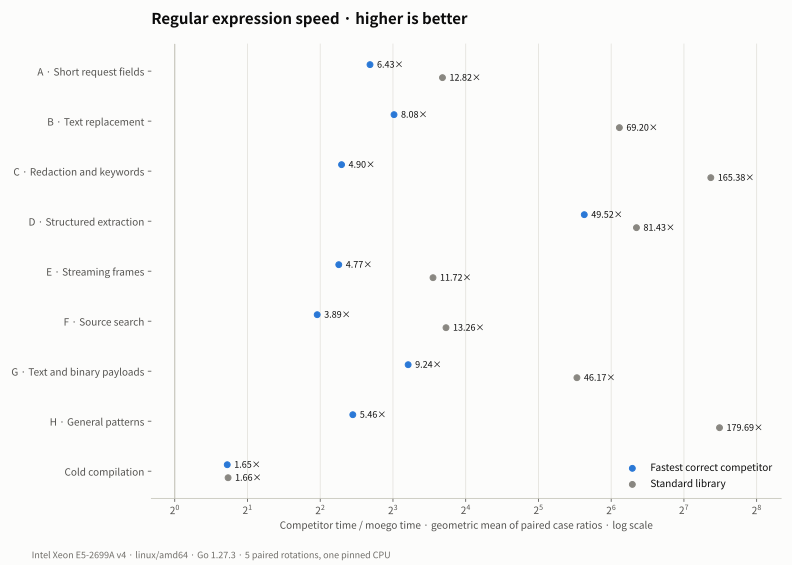
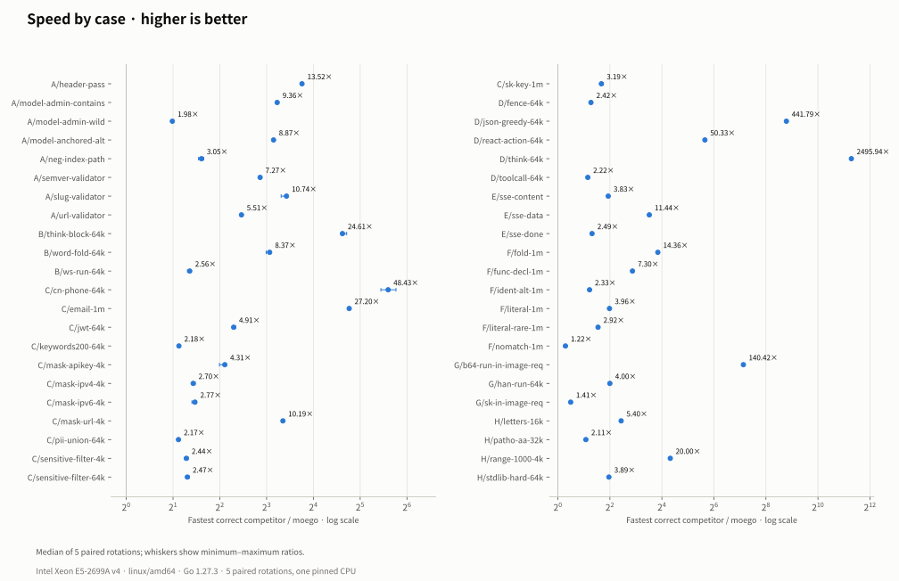

# moego/regexp performance on Linux AMD64

`moego/regexp` compared with the Go standard library, Grafana regexp,
coregex and go-re2 on one Linux AMD64 machine: 44 matching workloads in
eight classes and eight cold compilations, where the margins are thinnest,
and how to reproduce the numbers.
[简体中文](regexp-benchmark-results-linux-amd64.zh_CN.md)

## Test environment

The numbers were measured on 2026-11-07 on a KVM virtual machine: Intel
Xeon E5-2699A v4 @ 2.40GHz (Broadwell-EP, AVX2, no AVX-512), Linux 6.12,
transparent huge pages `always`, Go 1.27.3 with the default `GOAMD64=v1`.
Each process ran on one CPU pinned with `taskset`, with `GOMAXPROCS=1`,
`GOGC=100` and `GOMEMLIMIT=off`. Garbage collection stayed on, so
rebuilding matching state after a collection is part of the time. Another
benchmark ran on a different CPU of the machine at the same time; the load
average stayed between 1.3 and 2.9.

| Name | Package and version |
|---|---|
| moego | this repository |
| stdlib | `regexp`, Go 1.27.3 |
| Grafana | github.com/grafana/regexp v0.0.0-20250905093917-f7b3be9d1853 |
| coregex | github.com/coregx/coregex v0.12.30 |
| go-re2 | github.com/wasilibs/go-re2 v1.13.0 |

go-re2 runs RE2 compiled to WebAssembly. Go's allocation counters do not
see its WebAssembly memory, so its byte and allocation columns are left
out.

## Workloads

The cases come from `bench/regexp` and use deterministic synthetic inputs.
One timed operation processes every input of a case: `header-pass` checks
16 headers, and each streaming case processes 64 frames. Sizes in case
names are those of the whole input (`k` is KiB, `m` is MiB); APIs that
stop at the first match can finish earlier.

- **A · Short request fields**: model names, headers, slugs, versions and
  URLs, checked with `MatchString`, and negative indexes in JSON paths,
  extracted with submatches.
- **B · Text replacement**: whitespace runs, a case-folded word and
  `<think>` blocks in 64 KiB of text.
- **C · Redaction and keywords**: URLs, IP addresses, API keys, e-mail
  addresses, JWTs and phone numbers; a list of 200 keywords; and a
  content filter of 1000 case-insensitive Chinese and English words that
  replaces each hit with `***`, in 4 KiB and 64 KiB of chat text.
- **D · Structured extraction**: Markdown code fences, `<think>` and
  `<tool_call>` blocks, ReAct `Action:` lines and a greedy JSON object in
  64 KiB of model output.
- **E · Streaming frames**: SSE `data:` lines, `"content"` fields and
  `[DONE]`.
- **F · Source search**: literals, case-folded words, function
  declarations, an identifier alternation and a pattern with no match in
  1 MiB of synthetic Go source.
- **G · Text and binary payloads**: an API key and Base64 runs in an image
  request, and runs of Han characters.
- **H · General patterns**: `\pL+`, a pattern that is slow for the
  standard library, `(a|aa)*b` and `[a-z]{1,1000}`.

## Method

- Before timing, every result of every implementation is compared with the
  standard library. An implementation with a different result would be
  left out of that case; none was.
- Matching and compilation run in a fresh process per implementation, with
  `-benchtime 500ms`, in five repetitions. Each implementation takes every
  position in the order once.
- For each case and repetition, the time of the fastest correct
  competitor is divided by moego's. The speedup of a case is the median of
  its five ratios, and a class speedup is the geometric mean of its cases'
  speedups. Cells are medians, so dividing two cells need not give the
  speedup exactly.
- Matching measures compiled expressions after a warmup call. Cold
  compilation turns moego's compile cache off.

## Speed by class

<p align="center">
  
</p>

| Class | Cases | vs fastest correct competitor | vs stdlib |
|---|--:|--:|--:|
| A · Short request fields | 8 | 6.43× | 12.82× |
| B · Text replacement | 3 | 8.08× | 69.20× |
| C · Redaction and keywords | 12 | 4.90× | 165.38× |
| D · Structured extraction | 5 | 49.52× | 81.43× |
| E · Streaming frames | 3 | 4.77× | 11.72× |
| F · Source search | 6 | 3.89× | 13.26× |
| G · Text and binary payloads | 3 | 9.24× | 46.17× |
| H · General patterns | 4 | 5.46× | 179.69× |
| A–G | 40 | 7.25× | 43.39× |
| Cold compilation | 8 | 1.65× | 1.66× |

moego is faster than the fastest correct competitor in every repetition
of all 44 matching cases. The smallest per-repetition lead is 1.20×, on
`F/nomatch-1m`.

<p align="center">
  
</p>

## Matching time and allocations

Cells read time / bytes allocated / allocations per operation. In all 44
cases, moego allocates no more bytes and makes no more allocations per
operation than stdlib, Grafana and coregex.

### A · Short request fields

| Case | moego | stdlib | Grafana | coregex | go-re2 | vs fastest correct (rounds) | vs stdlib |
|---|--:|--:|--:|--:|--:|---|--:|
| `header-pass` | **87.9 ns / 0 / 0** | 1.2 µs / 0 / 0 | 1.19 µs / 0 / 0 | 1.97 µs / 0 / 0 | 3.34 µs / — / — | **13.5×** (13.45–13.55) | 13.6× |
| `model-admin-contains` | **312 ns / 0 / 0** | 6.48 µs / 0 / 0 | 6.41 µs / 0 / 0 | 5.87 µs / 0 / 0 | 2.92 µs / — / — | **9.36×** (9.30–9.44) | 20.8× |
| `model-admin-wild` | **36.9 ns / 0 / 0** | 1.52 µs / 0 / 0 | 1.46 µs / 0 / 0 | 73 ns / 0 / 0 | 1.87 µs / — / — | **1.98×** (1.98–1.98) | 41.2× |
| `model-anchored-alt` | **168 ns / 0 / 0** | 1.5 µs / 0 / 0 | 1.5 µs / 0 / 0 | 1.92 µs / 0 / 0 | 2.35 µs / — / — | **8.87×** (8.87–8.90) | 8.87× |
| `neg-index-path` | **461 ns / 192 / 3** | 1.41 µs / 264 / 9 | 1.49 µs / 816 / 6 | 7.05 µs / 816 / 27 | 4.35 µs / — / — | **3.05×** (2.92–3.15) | 3.05× |
| `semver-validator` | **53.5 ns / 0 / 0** | 539 ns / 0 / 0 | 530 ns / 0 / 0 | 989 ns / 0 / 0 | 389 ns / — / — | **7.27×** (7.26–7.41) | 10.1× |
| `slug-validator` | **36.2 ns / 0 / 0** | 605 ns / 0 / 0 | 598 ns / 0 / 0 | 788 ns / 0 / 0 | 389 ns / — / — | **10.7×** (9.93–10.82) | 16.7× |
| `url-validator` | **96.2 ns / 0 / 0** | 1.32 µs / 0 / 0 | 1.32 µs / 0 / 0 | 18.7 µs / 0 / 0 | 531 ns / — / — | **5.51×** (5.51–5.52) | 13.8× |

### B · Text replacement

| Case | moego | stdlib | Grafana | coregex | go-re2 | vs fastest correct (rounds) | vs stdlib |
|---|--:|--:|--:|--:|--:|---|--:|
| `think-block-64k` | **10.8 µs / 49,152 / 1** | 1.4 ms / 98,322 / 3 | 1.4 ms / 98,322 / 3 | 2.16 ms / 180,224 / 3 | 267 µs / — / — | **24.6×** (24.36–26.20) | 129× |
| `word-fold-64k` | **26.1 µs / 73,729 / 1** | 2.23 ms / 352,745 / 18 | 2.24 ms / 352,745 / 18 | 217 µs / 302,414 / 238 | 483 µs / — / — | **8.37×** (7.95–8.52) | 87.2× |
| `ws-run-64k` | **140 µs / 65,537 / 1** | 4.15 ms / 350,993 / 24 | 4.15 ms / 350,993 / 24 | 359 µs / 196,608 / 3 | 5.24 ms / — / — | **2.56×** (2.48–2.61) | 29.4× |

### C · Redaction and keywords

| Case | moego | stdlib | Grafana | coregex | go-re2 | vs fastest correct (rounds) | vs stdlib |
|---|--:|--:|--:|--:|--:|---|--:|
| `cn-phone-64k` | **6.85 µs / 160 / 1** | 1.74 ms / 248 / 8 | 1.76 ms / 304 / 5 | 1.93 ms / 4,256 / 3 | 331 µs / — / — | **48.4×** (43.50–54.38) | 254× |
| `email-1m` | **50.7 µs / 3,200 / 2** | 49.5 ms / 4,328 / 63 | 48.9 ms / 4,672 / 59 | 1.38 ms / 6,400 / 3 | 5.46 ms / — / — | **27.2×** (26.78–27.39) | 976× |
| `jwt-64k` | **2.56 µs / 160 / 1** | 101 µs / 232 / 7 | 101 µs / 288 / 4 | 12.6 µs / 4,224 / 3 | 160 µs / — / — | **4.91×** (4.86–5.06) | 39.5× |
| `keywords200-64k` | **159 µs / 0 / 0** | 520 ms / 0 / 0 | 504 ms / 0 / 0 | 617 ms / 4,096 / 1 | 346 µs / — / — | **2.18×** (2.18–2.19) | 3,285× |
| `mask-apikey-4k` | **11.9 µs / 5,024 / 2** | 250 µs / 16,384 / 27 | 244 µs / 16,384 / 27 | 668 µs / 19,392 / 148 | 49.1 µs / — / — | **4.31×** (3.98–4.34) | 21.1× |
| `mask-ipv4-4k` | **14.2 µs / 4,864 / 1** | 163 µs / 22,672 / 11 | 148 µs / 22,672 / 11 | 490 µs / 61,307 / 1,814 | 38.1 µs / — / — | **2.70×** (2.67–2.78) | 11.4× |
| `mask-ipv6-4k` | **1.52 µs / 4,096 / 1** | 7.11 µs / 12,896 / 7 | 7.08 µs / 12,896 / 7 | 4.2 µs / 12,288 / 3 | 14.7 µs / — / — | **2.77×** (2.65–2.82) | 4.66× |
| `mask-url-4k` | **4.08 µs / 3,456 / 1** | 143 µs / 16,544 / 10 | 138 µs / 16,544 / 10 | 338 µs / 11,672 / 4 | 41.5 µs / — / — | **10.2×** (9.96–10.25) | 35.1× |
| `pii-union-64k` | **158 µs / 624 / 2** | 8.48 ms / 1,000 / 21 | 8.59 ms / 960 / 17 | 11.6 ms / 4,720 / 3 | 342 µs / — / — | **2.17×** (2.15–2.17) | 53.6× |
| `sensitive-filter-4k` | **11.4 µs / 4,096 / 1** | 204 ms / 12,176 / 5 | 209 ms / 12,176 / 5 | 261 ms / 12,288 / 3 | 28.1 µs / — / — | **2.44×** (2.39–2.50) | 18,077× |
| `sensitive-filter-64k` | **195 µs / 65,537 / 1** | 3.21 s / 344,720 / 15 | 3.2 s / 344,720 / 15 | 4.14 s / 196,608 / 3 | 482 µs / — / — | **2.47×** (2.43–2.54) | 16,330× |
| `sk-key-1m` | **43 µs / 2,304 / 2** | 895 µs / 4,248 / 58 | 897 µs / 4,592 / 54 | 137 µs / 6,272 / 3 | 1.46 ms / — / — | **3.19×** (3.16–3.36) | 20.8× |

### D · Structured extraction

| Case | moego | stdlib | Grafana | coregex | go-re2 | vs fastest correct (rounds) | vs stdlib |
|---|--:|--:|--:|--:|--:|---|--:|
| `fence-64k` | **33.5 µs / 528 / 2** | 82.3 µs / 744 / 12 | 80.8 µs / 576 / 8 | 2.91 ms / 2,496 / 52 | 397 µs / — / — | **2.42×** (2.37–2.44) | 2.46× |
| `json-greedy-64k` | **1.25 µs / 16 / 1** | 1.75 ms / 16 / 1 | 1.77 ms / 16 / 1 | 4.34 ms / 168 / 6 | 553 µs / — / — | **442×** (440.53–442.43) | 1,397× |
| `react-action-64k` | **6.91 µs / 560 / 2** | 1.27 ms / 1,096 / 16 | 1.27 ms / 560 / 11 | 1.85 ms / 2,832 / 64 | 348 µs / — / — | **50.3×** (50.15–50.70) | 184× |
| `think-64k` | **561 ns / 32 / 1** | 1.4 ms / 32 / 1 | 1.42 ms / 32 / 1 | 3.41 ms / 240 / 7 | 2.66 ms / — / — | **2,496×** (2484.78–2532.12) | 2,496× |
| `toolcall-64k` | **32.9 µs / 400 / 2** | 74.5 µs / 616 / 12 | 73 µs / 464 / 8 | 2.76 ms / 1,920 / 45 | 401 µs / — / — | **2.22×** (2.22–2.25) | 2.27× |

### E · Streaming frames

| Case | moego | stdlib | Grafana | coregex | go-re2 | vs fastest correct (rounds) | vs stdlib |
|---|--:|--:|--:|--:|--:|---|--:|
| `sse-content` | **16.5 µs / 2,048 / 64** | 63.2 µs / 2,048 / 64 | 63.3 µs / 2,048 / 64 | 1.06 ms / 15,360 / 448 | 106 µs / — / — | **3.83×** (3.82–3.86) | 3.84× |
| `sse-data` | **6.09 µs / 2,048 / 64** | 220 µs / 2,048 / 64 | 217 µs / 2,048 / 64 | 69.1 µs / 10,240 / 320 | 99.3 µs / — / — | **11.4×** (11.12–11.52) | 36.0× |
| `sse-done` | **290 ns / 0 / 0** | 3.37 µs / 0 / 0 | 3.2 µs / 0 / 0 | 719 ns / 0 / 0 | 11.5 µs / — / — | **2.49×** (2.44–2.49) | 11.6× |

### F · Source search

| Case | moego | stdlib | Grafana | coregex | go-re2 | vs fastest correct (rounds) | vs stdlib |
|---|--:|--:|--:|--:|--:|---|--:|
| `fold-1m` | **395 µs / 323,968 / 11** | 46.5 ms / 836,654 / 7,636 | 48.3 ms / 836,998 / 7,632 | 5.68 ms / 812,288 / 12 | 6.18 ms / — / — | **14.4×** (14.24–14.58) | 118× |
| `func-decl-1m` | **629 µs / 159,744 / 6** | 28.5 ms / 413,182 / 3,696 | 28.5 ms / 413,526 / 3,692 | 4.59 ms / 410,880 / 10 | 7.78 ms / — / — | **7.30×** (7.16–7.35) | 45.2× |
| `ident-alt-1m` | **2.64 ms / 53,248 / 3** | 68.6 ms / 120,552 / 1,276 | 69.1 ms / 120,896 / 1,272 | 7.89 ms / 977,908 / 16,411 | 6.12 ms / — / — | **2.33×** (2.31–2.33) | 26.0× |
| `literal-1m` | **386 µs / 159,744 / 6** | 4.1 ms / 413,187 / 3,696 | 4.11 ms / 413,530 / 3,692 | 1.52 ms / 410,880 / 10 | 4.46 ms / — / — | **3.96×** (3.88–3.99) | 10.6× |
| `literal-rare-1m` | **49.7 µs / 4,480 / 2** | 150 µs / 9,112 / 107 | 152 µs / 9,456 / 103 | 145 µs / 8,576 / 3 | 619 µs / — / — | **2.92×** (2.87–2.99) | 3.01× |
| `nomatch-1m` | **34 µs / 0 / 0** | 41.7 µs / 0 / 0 | 41.9 µs / 0 / 0 | 44.1 µs / 4,096 / 1 | 489 µs / — / — | **1.22×** (1.20–1.24) | 1.22× |

### G · Text and binary payloads

| Case | moego | stdlib | Grafana | coregex | go-re2 | vs fastest correct (rounds) | vs stdlib |
|---|--:|--:|--:|--:|--:|---|--:|
| `b64-run-in-image-req` | **156 µs / 48 / 1** | 190 ms / 56 / 3 | 189 ms / 256 / 2 | 261 ms / 4,136 / 3 | 21.8 ms / — / — | **140×** (139.13–140.60) | 1,218× |
| `han-run-64k` | **387 µs / 105,088 / 5** | 2.96 ms / 194,941 / 2,342 | 3.02 ms / 195,284 / 2,338 | 84.3 ms / 214,272 / 8 | 1.55 ms / — / — | **4.00×** (3.92–4.06) | 7.64× |
| `sk-in-image-req` | **73.2 µs / 0 / 0** | 774 µs / 0 / 0 | 777 µs / 0 / 0 | 103 µs / 4,096 / 1 | 1.87 ms / — / — | **1.41×** (1.37–1.45) | 10.6× |

### H · General patterns

| Case | moego | stdlib | Grafana | coregex | go-re2 | vs fastest correct (rounds) | vs stdlib |
|---|--:|--:|--:|--:|--:|---|--:|
| `letters-16k` | **172 µs / 86,016 / 4** | 943 µs / 190,189 / 2,045 | 985 µs / 190,533 / 2,041 | 904 ms / 135,322,640 / 15,373 | 1.18 ms / — / — | **5.40×** (5.35–5.55) | 5.40× |
| `patho-aa-32k` | **77.1 µs / 0 / 0** | 2.91 ms / 0 / 0 | 2.92 ms / 0 / 0 | 176 µs / 96 / 2 | 163 µs / — / — | **2.11×** (2.11–2.11) | 37.7× |
| `range-1000-4k` | **13.6 µs / 21,760 / 3** | 305 µs / 39,784 / 490 | 308 µs / 40,129 / 486 | 10.3 ms / 42,688 / 7 | 271 µs / — / — | **20.0×** (19.60–20.49) | 22.2× |
| `stdlib-hard-64k` | **12 ns / 0 / 0** | 2.75 ms / 0 / 0 | 2.76 ms / 0 / 0 | 46.5 ns / 0 / 0 | 3.25 µs / — / — | **3.89×** (3.88–3.90) | 230,437× |
### Content filter

The two `sensitive-filter` cases replace every hit of 1000
case-insensitive words with `***`. On 4 KiB moego takes 11.4 µs, go-re2
28.1 µs (2.44×) and stdlib 204 ms. On 64 KiB moego takes 195 µs, go-re2
482 µs (2.47×) and stdlib 3.21 s.

## Cold compilation

Cells read time / bytes allocated / allocations per compile.

| Pattern | moego | stdlib | Grafana | coregex | go-re2 | vs fastest correct (rounds) | vs stdlib |
|---|--:|--:|--:|--:|--:|---|--:|
| `email` | **3.6 µs / 1,948 / 26** | 4.88 µs / 3,528 / 37 | 4.87 µs / 3,528 / 37 | 24.1 µs / 23,472 / 166 | 25.2 µs / — / — | **1.35×** (1.34–1.36) | 1.36× |
| `host-mask` | **3.32 µs / 1,192 / 16** | 4.62 µs / 3,736 / 22 | 4.62 µs / 3,736 / 22 | 60.5 µs / 71,376 / 668 | 26.9 µs / — / — | **1.39×** (1.34–1.40) | 1.39× |
| `letters` | **11.9 µs / 21,816 / 16** | 12.1 µs / 21,976 / 21 | 12.1 µs / 21,976 / 21 | 3.27 ms / 3,182,888 / 7,403 | 1.68 ms / — / — | **1.02×** (1.01–1.04) | 1.02× |
| `model-alt` | **4.92 µs / 2,648 / 36** | 10.2 µs / 7,896 / 89 | 10.1 µs / 7,896 / 89 | 52.2 µs / 40,296 / 173 | 28 µs / — / — | **2.04×** (2.01–2.07) | 2.07× |
| `slug` | **1.77 µs / 1,192 / 15** | 3.6 µs / 2,640 / 36 | 3.56 µs / 2,640 / 36 | 9.89 µs / 8,776 / 61 | 13.6 µs / — / — | **1.97×** (1.96–2.04) | 2.03× |
| `sse-content` | **4.57 µs / 2,264 / 30** | 6.3 µs / 4,832 / 38 | 6.32 µs / 4,832 / 38 | 227 µs / 109,928 / 347 | 33.6 µs / — / — | **1.38×** (1.37–1.39) | 1.38× |
| `think` | **3.49 µs / 1,720 / 22** | 4.97 µs / 4,088 / 28 | 4.99 µs / 4,088 / 28 | 46.9 µs / 55,464 / 114 | 20.5 µs / — / — | **1.42×** (1.42–1.43) | 1.42× |
| `url-validator` | **29.9 µs / 15,608 / 153** | 109 µs / 132,336 / 597 | 109 µs / 132,336 / 597 | 432 µs / 436,896 / 2,062 | 486 µs / — / — | **3.65×** (3.58–3.66) | 3.65× |

moego allocates fewer bytes per compile than stdlib, Grafana and coregex
for every pattern. go-re2 shows 112 B because its compiled program lives in
WebAssembly memory.

The 1000-word pattern of the content filter, compiled cold in five rotated
repetitions: moego 1.12 ms (1.09–1.15 ms) with 268 KiB in 2,731
allocations; stdlib 2.09 ms with 1.58 MiB in 2,751; Grafana 2.09 ms;
coregex 6.41 ms with 10.5 MiB; go-re2 8.35 ms. The first compile in a
fresh process takes moego 1.02 ms and keeps 150 KiB of heap, against
1.49 ms and 403 KiB for stdlib.

## Where the margins are thinnest

- **`compile/letters` (1.02×, 1.01–1.04).** `\pL+` expands to several
  hundred Unicode ranges. moego parses with `regexp/syntax`, as stdlib
  does, and the two compile in about the same time.
- **`F/nomatch-1m` (1.22×).** A pattern whose literal prefix `ZZZ` never
  occurs in 1 MiB; the standard library also searches for that prefix
  directly.
- **`G/sk-in-image-req` (1.41×) and `A/model-admin-wild` (1.98×)**, both
  over coregex.

## Limitations

- One KVM virtual machine was measured, with another benchmark running on
  a different CPU. The results apply to this machine only; other CPUs,
  with other cache sizes and memory bandwidth, may give different results.
- Only linux/amd64 was measured. On arm64 moego uses NEON, and with
  `-tags purego` portable Go code; their correctness is tested, their speed
  is not measured here.
- The inputs are synthetic and reproducible. They are not a sample of
  production traffic.

## Reproducing

From the repository root, with Go 1.27 and Python 3, on Linux:

```sh
cd bench/regexp
go test -count=1 ./...
go test -count=1 -v -run '^(TestCompetitors|TestClassInputs)$' . > /tmp/correctness.txt
go test -c -o /tmp/regexp.test

taskset -c 2 python3 measure.py speed --binary /tmp/regexp.test --output /tmp/timing \
  --repetitions 5 --benchtime 500ms
python3 report.py /tmp/timing --correctness /tmp/correctness.txt --output /tmp/summary

# The 1000-word pattern, cold, five rotated repetitions.
ims=(Stdlib Grafana Coregex GoRE2 Moego)
for r in 1 2 3 4 5; do
  for k in 0 1 2 3 4; do
    im=${ims[$(( (k + r - 1) % 5 ))]}
    GOMAXPROCS=1 taskset -c 2 /tmp/regexp.test -test.run '^$' -test.benchmem -test.benchtime 500ms \
      -test.cpu 1 -test.bench "^BenchmarkCompileSensitive\$/.*/^$im\$"
    RXCOMPILEONCE=$im GOMAXPROCS=1 taskset -c 2 /tmp/regexp.test -test.run '^TestCompileOnce$'
  done
done > /tmp/compile1000.txt

pip install -r requirements-plot.txt
for lang in en zh; do
  python3 plot.py /tmp/summary.json ../../docs/images/regexp-linux-amd64-speed.$lang.svg \
    --metric speed --language $lang
  python3 plot.py /tmp/summary.json ../../docs/images/regexp-linux-amd64-cases.$lang.svg \
    --metric cases --language $lang
done
```

Replace the 2 in `taskset -c 2` with an idle CPU, and stop other
benchmarks and builds while measuring. `measure.py` runs every process with
`GOMAXPROCS=1`, `GOGC=100` and `GOMEMLIMIT=off` and refuses to overwrite an
existing output directory. `--caption` adds the machine and toolchain line
under a chart. The [benchmark module](../bench/regexp/README.md) also
measures peak memory at equal load.
