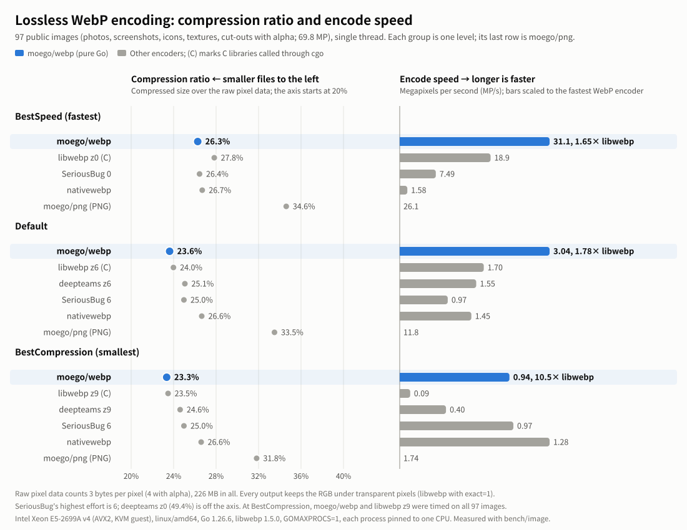

# moego/webp performance on Linux AMD64

`moego/webp` compared with libwebp and the other pure-Go WebP encoders on
one Linux AMD64 machine: lossless size and speed at each level, a second
image set, image by image, how much smaller lossless WebP can get, decoding,
memory, and how to reproduce the numbers.
[简体中文](webp-benchmark-results-linux-amd64.zh_CN.md)

## Test environment

The numbers were measured on 2026-11-16 on a KVM virtual machine: Intel
Xeon E5-2699A v4 @ 2.40GHz (Broadwell-EP, AVX2, no AVX-512), linux/amd64,
Debian 13, Go 1.26.6 with the default `GOAMD64=v1`, gcc 14.2. Every timing
process was pinned to one CPU with `taskset` and ran with `GOMAXPROCS=1`.

| Name in the tables | Package and version |
|---|---|
| moego/webp | this repository |
| libwebp | libwebp 1.5.0 through cgo, lossless, `exact=1`, `thread_level=0`; z0, z6 and z9 are `-z` levels |
| deepteams | [github.com/deepteams/webp](https://github.com/deepteams/webp) v1.2.9, a Go port of libwebp, `Exact: true` |
| SeriousBug | [github.com/SeriousBug/webp-go-pure](https://github.com/SeriousBug/webp-go-pure) v1.2.0; its highest lossless effort is 6 |
| nativewebp | [github.com/HugoSmits86/nativewebp](https://github.com/HugoSmits86/nativewebp) v1.3.0 |
| KarpelesLab/gowebp | [github.com/KarpelesLab/gowebp](https://github.com/KarpelesLab/gowebp) v0.1.1, one lossless setting |
| calamus | [github.com/timzifer/calamus](https://github.com/timzifer/calamus) v0.3.0, `Workers: 1` |
| gen2brain/webp | [github.com/gen2brain/webp](https://github.com/gen2brain/webp) v0.6.4, libwebp compiled to WASM and translated to Go |

## Workloads

The 97 images of the [PNG results](png-benchmark-results-linux-amd64.md#workloads):
photos, screenshots, icons, textures and cut-outs with alpha from the
[QOI benchmark suite](https://qoiformat.org/benchmark/), 69.8 megapixels,
225,503,785 bytes of raw pixel data at 3 bytes per pixel (4 with alpha).

A second set of 51 other images from the same suite, none of them in the
first, checks that the results hold beyond it: 45.8 megapixels, taken
evenly from each category (`bench/image/holdout.txt`).

## Method

- Every output is decoded with `golang.org/x/image/webp` and with libwebp
  and compared with the source pixels, including the color under fully
  transparent pixels, before it is timed. Every encoder in the tables
  round-trips all images.
- Each encoder setting and image is encoded once as a warm-up, then at
  least 5 times and for at least 100 ms, up to 100 times; 3 times when the
  warm-up takes over 100 ms, and only the warm-up when it takes 2 s or
  more. The time per image is the median; MP/s is the total number of
  pixels over the sum of the medians. Four timing processes ran at a time,
  each on its own CPU.
- libwebp z9 takes over 10 s per megapixel. In the main table it was
  timed on every fourth image (25 images); libwebp z9 and `moego/webp`
  BestCompression were also timed against each other on all 97 images,
  which gives the BestCompression comparison below. There, 76 of libwebp
  z9's images and 8 of BestCompression's took 2 s or more and were timed
  once.

## Results

<p align="center">
  
</p>

"vs libwebp z6" is the total size over that of libwebp z6, libwebp's
default, 54,084,316 bytes. All 291 outputs of `moego/webp` decode to the
source pixels with both decoders.

| Level | Encoder | cgo | Ratio | vs libwebp z6 | Encode MP/s |
|---|---|:-:|--:|--:|--:|
| BestSpeed | **moego/webp** |  | **26.27%** | **1.095** | **31.1** |
|  | libwebp z0 | ✓ | 27.83% | 1.160 | 18.9 |
|  | SeriousBug effort 0 |  | 26.44% | 1.102 | 7.49 |
|  | deepteams z0 |  | 49.40% | 2.060 | 13.0 |
|  | nativewebp BestSpeed |  | 26.69% | 1.113 | 1.58 |
| Default | **moego/webp** |  | **23.62%** | **0.985** | **3.04** |
|  | libwebp z6 | ✓ | 23.98% | 1.000 | 1.70 |
|  | deepteams z6 |  | 25.06% | 1.045 | 1.55 |
|  | SeriousBug effort 6 |  | 24.97% | 1.041 | 0.97 |
|  | nativewebp |  | 26.65% | 1.111 | 1.45 |
|  | KarpelesLab/gowebp |  | 26.72% | 1.114 | 1.39 |
|  | calamus |  | 26.32% | 1.098 | 2.68 |
| BestCompression | **moego/webp** |  | **23.35%** | **0.974** | **0.92** |
|  | libwebp z9 | ✓ | 23.47% | 0.979 | 0.085 (25 images) |
|  | deepteams z9 |  | 24.61% | 1.026 | 0.40 |
|  | nativewebp BestCompression |  | 26.60% | 1.109 | 1.28 |

gen2brain/webp, which embeds libwebp 1.6.0, writes files within 0.04% of
libwebp's total size at 0.28–0.30× its speed (5.27 MP/s at z0, 0.51 MP/s
at z6). mayahiro/go-webp (32.1–55.3%) and eringen/gowebper (67.9% at
level 0, on the 92 images it round-trips) write much larger files and are
left out of the table.

Against libwebp at the same level:

| Level | Size | Speed |
|---|---|---|
| BestSpeed (vs z0) | 5.6% smaller | 1.65× (31.1 vs 18.9 MP/s) |
| Default (vs z6) | 1.5% smaller | 1.78× (3.04 vs 1.70 MP/s) |
| BestCompression (vs z9) | 0.5% smaller | 10.5× (0.940 vs 0.090 MP/s, all 97 images) |

A separate second timing of BestSpeed and Default against libwebp z0 and
z6 on the same CPUs gave 1.69× and 1.74×.

`moego/webp` is also smaller than every other pure-Go encoder at each
level: Default by 5.7% against deepteams z6 and 5.4% against SeriousBug's
highest effort; BestCompression by 5.1% against deepteams z9; BestSpeed by
0.7% against SeriousBug effort 0, at 4.2× its speed.

### Second image set

The 51 other images, measured the same way:

| Level | moego/webp | libwebp | Size | Speed |
|---|--:|--:|--:|--:|
| BestSpeed | 16.34%, 37.7 MP/s | z0 18.59%, 21.3 MP/s | 12.1% smaller | 1.77× |
| Default | 14.37%, 3.51 MP/s | z6 14.60%, 2.29 MP/s | 1.6% smaller | 1.53× |
| BestCompression | 14.17%, 1.04 MP/s | z9 14.25% | 0.5% smaller | libwebp z9 not timed on this set |

Ratios are over this set's own raw pixel data, 150,463,576 bytes. All 153
outputs of `moego/webp` decode to the source pixels with both decoders.

### Compared with PNG

On the same images, `moego/webp` is 24–30% smaller than `moego/png` at the
same level:

| Level | moego/png | moego/webp | Size ratio |
|---|--:|--:|--:|
| BestSpeed | 34.61%, 26.1 MP/s | 26.27%, 31.1 MP/s | 0.759 |
| Default | 33.50%, 11.8 MP/s | 23.62%, 3.04 MP/s | 0.705 |
| BestCompression | 31.82%, 1.74 MP/s | 23.35%, 0.92 MP/s | 0.734 |

BestSpeed is 17% smaller than `moego/png`'s smallest level and faster than
its fastest. At each level every one of the 97 images is smaller in WebP
than in `moego/png` with `KeepColorType`; against `moego/png` with color
reduction, 92, 96 and 97 of them are.
Browsers and libwebp read WebP directly; Go's standard library has no WebP
decoder, so Go programs read it with `golang.org/x/image/webp`.

### Image by image

The totals hide the spread between images (all 97 images timed for
BestCompression):

- **BestSpeed against libwebp z0**: smaller on 81 (geometric mean 0.873,
  down to 0.12), faster on 83 (median 1.45×). The largest gap is a sticker
  with soft semi-transparent shadows, 2.1× larger: BestSpeed picks among 4
  predictors per block and skips the color transform. Of the 14 slower
  images, 6 are 64×64 icons (0.5–0.7 ms against libwebp z0's 0.35 ms, mostly
  fixed cost); the other 8 are 1–16% slower.
- **Default against libwebp z6**: smaller on 67, faster on 82 (median
  1.84×). The largest gaps are a 512-pixel icon with 258 colors (70%
  larger; two colors over the palette limit), the same sticker (48%) and a
  game screenshot (32%). The 15 slower images all have at most 609 colors
  (game textures, cut-outs, screenshots); the slowest is a 256×512 texture
  with 170 colors, 21 ms against 2.8 ms.
- **BestCompression against libwebp z9**: smaller on 56, geometric mean
  1.006; faster on all 97, at least 1.9× and 14× at the median. Photos and
  screenshots are about 1% smaller each and make up the smaller total.

Size by group, relative to libwebp z6 (smaller is better):

| Group | Images | moego/webp BestSpeed | libwebp z0 | moego/webp Default | deepteams z6 | SeriousBug 6 | moego/webp BestCompression | libwebp z9 | moego/png BestCompression |
|---|--:|--:|--:|--:|--:|--:|--:|--:|--:|
| Photos | 42 | 1.062 | 1.095 | **0.980** | 1.035 | 1.018 | **0.971** | 0.980 | 1.299 |
| Screenshots | 13 | 1.218 | 1.414 | **0.979** | 1.089 | 1.122 | **0.956** | 0.966 | 1.358 |
| Icons | 14 | 1.343 | 1.720 | 1.042 | 1.131 | 1.163 | 0.977 | 0.940 | 1.555 |
| Cut-outs (alpha) | 10 | 1.139 | 1.175 | 1.020 | 1.026 | 1.071 | 1.009 | 0.989 | 1.399 |
| Textures | 18 | 1.085 | 1.216 | 1.002 | 1.068 | 1.051 | 0.994 | 0.978 | 1.429 |
| At most 256 colors | 11 | 1.130 | 1.249 | 1.009 | 1.067 | 1.182 | 0.979 | 0.964 | 1.469 |

Photos include the Kodak, Tecnick and Wikipedia images and photo textures;
textures are the other textures and plant sprites; the last group overlaps
the others. Photos and screenshots are 84% of libwebp's bytes, and there
`moego/webp` Default and BestCompression are 1–2% smaller than libwebp. On
icons, cut-outs and images with few colors, Default is 0.9–4.2% larger than
libwebp z6 and BestCompression 1.6–3.9% larger than libwebp z9 (textures
1.6%). BestSpeed is 3–22% smaller than libwebp z0 in every group.

## How much smaller lossless WebP gets

Lossless WebP (VP8L) leaves little room on these images:

- **Picking the smallest file of every WebP encoder for each image**
  (`moego/webp` at three levels, libwebp z0, z3, z6 and z9,
  gen2brain/webp, deepteams, SeriousBug, nativewebp and the others, all
  keeping the color under transparent pixels) adds up to 52,385,644
  bytes, 1.04% less than libwebp z9.
- **Encoding every candidate transform plan** at BestCompression and
  keeping the smallest file, instead of only the plan the estimate picks,
  makes the corpus 0.18% smaller and takes 3.9× the time.
- **A much wider search in the entropy coder** (hash chains 256 deep,
  matches up to 4096 pixels, five shortest-path passes, every entropy
  image block size from 2² to 2⁸) makes it 0.03% larger.

The last two come from the tuning tests in `webp/tune_test.go` and
`internal/vp8l/tune_test.go`; [Reproducing](#reproducing) has the commands.

JPEG XL lossless (libjxl 0.11.2, `cjxl -d 0`, one thread, one run per image
including process start-up) on the same images; the e1, e7 and e9 files
decode with djxl to the source pixels:

| JPEG XL effort | Ratio | vs libwebp z9 | Encode MP/s |
|---|--:|--:|--:|
| e1 | 28.05% | 1.195 | 15.6 |
| e3 | 24.24% | 1.033 | 3.35 |
| e7 (default) | 22.12% | 0.942 | 0.49 |
| e9 | 21.74% | 0.926 | 0.11 |

JPEG XL e7 and e9 are 5.8% and 7.4% smaller than libwebp z9, and 5.3% and
6.9% smaller than `moego/webp` BestCompression, at one half to one ninth of
its speed. `moego/webp` writes WebP only.

## How it works

`moego/webp` is written from RFC 9649.

- It reads the pixels (with fast paths for ten concrete image types),
  counts colors and checks alpha in one pass, and lists the transform plans
  that fit the image: a color table for at most 256 colors (sorted by value,
  by luma or as a chain of near colors, with 2, 4 or 8 pixels packed for at
  most 16 colors, and optionally prediction on the indexes for 17–256);
  subtract green; one of 14 predictors per block; and color transform
  coefficients per block. Default ranks 2–5 plans and BestCompression 4–6
  plans with an entropy model that includes an LZ77 estimate, and encodes
  only the best. BestSpeed uses a color table, or subtract green with one
  of 4 predictors per block.
- The predictor and color transform searches use fixed-point integer costs
  from per-block histograms of one residual image. The last plan estimated
  stays transformed and is encoded directly when it wins.
- The entropy coder (`internal/vp8l`) finds matches with hash chains plus
  runs of one color and copies of the row above, up to 4096 pixels, with
  distances mapped to the 120 two-dimensional neighborhood codes. Default
  and BestCompression run two or three shortest-path passes priced with the
  previous pass's code lengths. The entropy image clusters block histograms
  by the bits merging saves, and Huffman codes are length-limited with
  package-merge.
- Whether a pixel hits the color cache depends only on the pixels, so each
  image gets one table of the smallest cache each pixel hits in (one byte
  per pixel); choosing the cache size, parsing, the entropy image and the
  writer all read it.
- Residuals, subtract and add green and the color transform run with AVX2
  on amd64 and NEON on arm64. The per-pixel cost lookups, the color
  transform search and the NRGBA to ARGB conversion have AVX2 kernels only.
  Portable Go code runs elsewhere and with `-tags purego`.

## Decoding

The encoder decides how many prefix code groups a file has and how often
it uses the color cache, which affects decoding speed. Total decode time of
libwebp's output over that of `moego/webp`'s, on all images (above 1 means
`moego/webp`'s output decodes faster):

| Level | x/image/webp | libwebp |
|---|--:|--:|
| BestSpeed (vs libwebp z0) | 1.21 | 1.19 |
| Default (vs libwebp z6) | 1.01 | 0.97 |
| BestCompression (vs libwebp z9, all 97 images) | 0.94 | 0.92 |

`moego/webp`'s output decodes at 22.3–23.0 MP/s with `x/image/webp` and
47.0–55.4 MP/s with libwebp.

## Memory

`bench/image/cmd/imgalloc` measures the Go heap allocated by one encode of
each image, with the output going to `io.Discard`. Cold encodes run after
two garbage collections, which empty the encoder's internal buffer pool;
warm encodes reuse buffers through `BufferPool` and count the second
encode. deepteams/webp has no reusable buffers. 97 images,
`GOMAXPROCS=1`:

| Level | moego/webp cold | deepteams cold | moego/webp, largest image | moego/webp warm |
|---|--:|--:|--:|--:|
| BestSpeed (vs z0) | 491 MB | 5,153 MB | 34.8 MB | 0 B, 0 allocations |
| Default (vs z6) | 1,337 MB | 5,934 MB | 111.6 MB | 0 B, 0 allocations |
| BestCompression (vs z9) | 1,369 MB | 8,130 MB | 86.8 MB | 0 B, 0 allocations |

- Cold encodes allocate 10–23% of what deepteams allocates at the same
  level. Most of it is the ARGB pixels (4 bytes per pixel), match lists, the
  color cache table (1 byte per pixel) and histograms, all sized by the
  image; the largest image of the corpus is 6.8 megapixels.
- With a warm `BufferPool`, an encode allocates nothing for the ten
  concrete image types. Without one, the encoder keeps its buffers in an
  internal `sync.Pool`, and keeps them there for images of up to 8 Mi pixels.
- A cold WebP encode allocates 4.9–15× what `moego/png` does (99.5, 86.7
  and 232.9 MB): PNG encodes row by row, while WebP's transforms and entropy
  image look at the whole image.

## Limitations

- One KVM virtual machine was measured; other CPUs may give different
  results. Only linux/amd64 was timed. The NEON kernels on arm64 and the
  portable code (other architectures, `-tags purego`, amd64 without AVX2)
  are tested for correctness, but their speed has not been measured.
- Very small images have a fixed cost: a 64×64 icon takes 0.5–0.7 ms at
  BestSpeed against libwebp z0's 0.35 ms.
- Default can be slower than libwebp z6 on textures and cut-outs with few
  colors: 15 of 97 images, up to 7× (21 ms against 2.8 ms).
- On icons, cut-outs, textures and images with at most 256 colors,
  BestCompression is 1.6–3.9% larger than libwebp z9, and Default is 2–4%
  larger than libwebp z6 on icons and cut-outs. The smaller totals come
  from photos and screenshots, most of the bytes.
- `moego/webp` writes lossless VP8L only: no lossy VP8, animation, ICC or
  EXIF.
- Cold allocations grow with the image, up to about 112 MB for one image
  of the corpus at Default; reuse buffers when encoding many images.

## Reproducing

On Debian or Ubuntu amd64 with Go 1.26, gcc and g++, git, curl, `apt-get`,
`dpkg-deb`, `taskset` and at least 8 CPUs:

```sh
cd bench/image
./run.sh /tmp/image-run
```

`run.sh` fetches the C headers (`sysroot.sh`) and the corpus
(`fetch_corpus.sh`) next to the output directory, builds `imgbench` with
cgo, checks every encoder on every image with both decoders, times the ones
that pass, and writes `summary.md`, `summary.csv` and `per-image.csv`. Stop
other work on the machine while it times. The other measurements use the
`imgbench` it builds:

```sh
B="/tmp/image-run/bin/imgbench -corpus /tmp/image-corpus/images -list corpus.txt"

# libwebp z9 and BestCompression on all 97 images, one process per CPU.
for k in 0 1 2 3; do
  taskset -c $((4 + k)) $B -out /tmp/z9 -checked /tmp/image-run/check -shard $k/4 -tag s$k \
    -encoders 'libwebp/z9,moego-webp/best' &
done; wait

# The second image set.
LIST=holdout.txt ./fetch_corpus.sh /tmp/image-holdout
H="/tmp/image-run/bin/imgbench -corpus /tmp/image-holdout/images -list holdout.txt"
$H -out /tmp/holdout/check -check -encoders 'moego-webp/*,libwebp/z0,libwebp/z6-default,libwebp/z9'
for k in 0 1 2 3; do
  taskset -c $((4 + k)) $H -out /tmp/holdout/timing -checked /tmp/holdout/check -shard $k/4 -tag s$k \
    -encoders 'moego-webp/*,libwebp/z0,libwebp/z6-default' &
done; wait

# Allocations, cold and warm.
GOMAXPROCS=1 taskset -c 3 go run ./cmd/imgalloc -corpus /tmp/image-corpus/images -list corpus.txt

# How much smaller lossless WebP gets: BestCompression as it is and with every
# candidate plan encoded, then its files' main images coded again by the
# entropy coder, as it is and with a much wider search.
(cd ../.. && go test -c -o /tmp/webp.test ./webp && go test -c -o /tmp/vp8l.test ./internal/vp8l)
T="MOEGO_WEBP_TUNE=1 MOEGO_WEBP_CORPUS=/tmp/image-corpus/images MOEGO_WEBP_LIST=corpus.txt MOEGO_WEBP_PLANS=best"
env $T GOMAXPROCS=1 taskset -c 4 /tmp/webp.test -test.run '^TestTunePlans$' -test.v
env $T MOEGO_WEBP_TRIALS=12 MOEGO_WEBP_SLACK=100 GOMAXPROCS=1 taskset -c 5 /tmp/webp.test -test.run '^TestTunePlans$' -test.v
mkdir -p /tmp/best
$B -out /tmp/best-check -check -encoders moego-webp/best -save /tmp/best
MOEGO_VP8L_FILES=/tmp/best MOEGO_VP8L_LEVELS=9 /tmp/vp8l.test -test.run '^TestTune$' -test.v
MOEGO_VP8L_FILES=/tmp/best MOEGO_VP8L_LEVELS=9 MOEGO_VP8L_EFFORT=9:256:4096:5:0:256 \
  MOEGO_VP8L_META=9:2.3.4.5.6.7.8:6:8:256 /tmp/vp8l.test -test.run '^TestTune$' -test.v

# The charts of this page and the README.
for lang in en zh; do
  go run ./cmd/imgchart -lang $lang -format webp -summary /tmp/image-run/summary.csv \
    -images /tmp/image-run/per-image.csv -timing /tmp/z9 \
    -o ../../docs/images/webp-ratio-speed.$lang.svg
done
```

`go run ./cmd/imgsum -out DIR -check CHECKDIR -timing TIMINGDIR` turns any
of these directories into tables. The [benchmark module's
README](../bench/image/README.md) lists every encoder and the measurement
rules.
