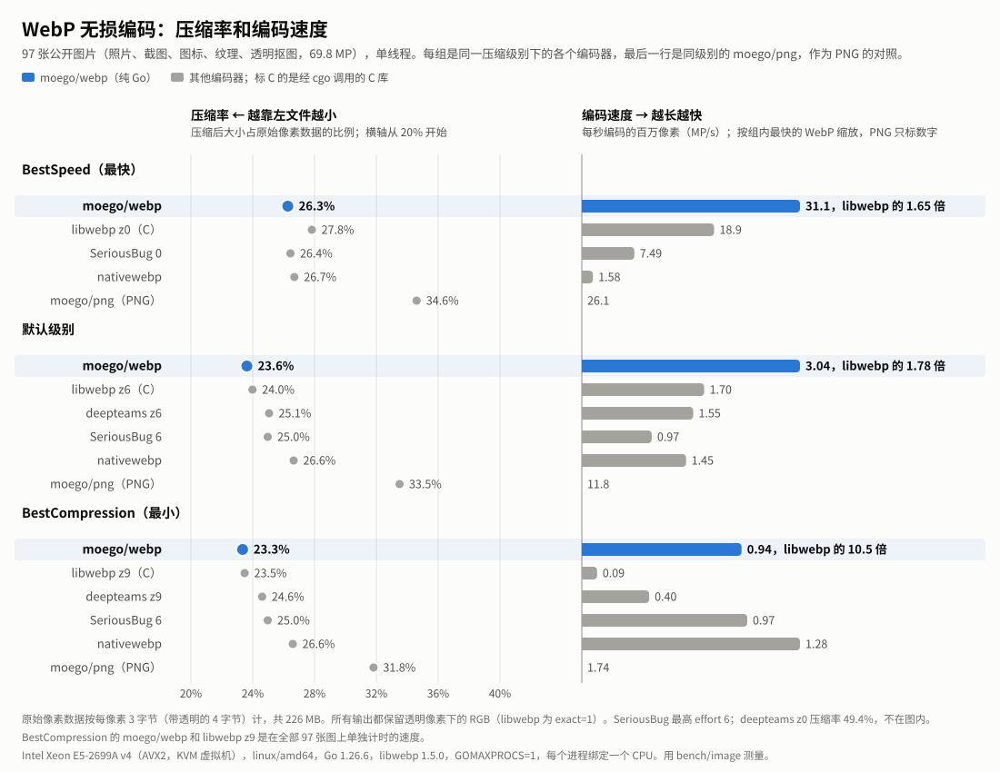

# moego/webp 在 Linux AMD64 上的性能

在一台 Linux AMD64 机器上对比 `moego/webp` 与 libwebp 和其他纯 Go WebP 编码器：每个级别的无损大小和速度、另一组图片、逐图结果、无损 WebP 还能小多少、解码、内存，以及怎样复现这些数字。
[English](webp-benchmark-results-linux-amd64.md)

## 测试环境

数据在 2026-11-16 测得，测试机是 KVM 虚拟机：Intel Xeon E5-2699A v4 @ 2.40GHz（Broadwell-EP，AVX2，没有 AVX-512），linux/amd64，Debian 13，Go 1.26.6，默认的 `GOAMD64=v1`，gcc 14.2。每个计时进程用 `taskset` 固定在一个 CPU 上，`GOMAXPROCS=1`。

| 表中的名称 | 包和版本 |
|---|---|
| moego/webp | 本仓库 |
| libwebp | libwebp 1.5.0，经 cgo 调用，无损，`exact=1`，`thread_level=0`；z0、z6、z9 是 `-z` 级别 |
| deepteams | [github.com/deepteams/webp](https://github.com/deepteams/webp) v1.2.9，libwebp 的 Go 移植，`Exact: true` |
| SeriousBug | [github.com/SeriousBug/webp-go-pure](https://github.com/SeriousBug/webp-go-pure) v1.2.0，无损最高 effort 为 6 |
| nativewebp | [github.com/HugoSmits86/nativewebp](https://github.com/HugoSmits86/nativewebp) v1.3.0 |
| KarpelesLab/gowebp | [github.com/KarpelesLab/gowebp](https://github.com/KarpelesLab/gowebp) v0.1.1，无损只有一档 |
| calamus | [github.com/timzifer/calamus](https://github.com/timzifer/calamus) v0.3.0，`Workers: 1` |
| gen2brain/webp | [github.com/gen2brain/webp](https://github.com/gen2brain/webp) v0.6.4，libwebp 编译成 WASM 再转换成 Go |

## 测试图片

与 [PNG 的结果](png-benchmark-results-linux-amd64.zh_CN.md#测试图片)相同的 97 张图：[QOI 基准图集](https://qoiformat.org/benchmark/)中的照片、截图、图标、纹理和带透明通道的抠图，共 69.8 MP，原始像素数据按每像素 3 字节（带透明的 4 字节）计为 225,503,785 字节。

另有同一图集中的 51 张其他图片，与前一组没有重叠，用来确认结果不只适用于前一组：共 45.8 MP，从每个类别均匀抽取（`bench/image/holdout.txt`）。

## 测量方法

- 每个输出都先用 `golang.org/x/image/webp` 和 libwebp 各解码一遍，与原图逐像素比较（包括完全透明像素下的颜色），通过后才计时。表中每个编码器都能让所有图片往返。
- 每种设置的每张图先预热编码一次，再至少编码 5 次、至少 100 ms，最多 100 次；预热超过 100 ms 时编码 3 次，达到 2 秒时只计预热这一次。每张图取中位时间；MP/s 是总像素数除以各图中位时间之和。同时运行 4 个计时进程，各占一个 CPU。
- libwebp z9 每百万像素要 10 秒以上。主表中它只在每 4 张图取 1 张计时（25 张）；另外在全部 97 张图上对 libwebp z9 和 `moego/webp` BestCompression 单独计时，下文 BestCompression 的对比用的是这次的结果。这次计时中，libwebp z9 有 76 张图、BestCompression 有 8 张图编码一次就超过 2 秒，只计了一次。

## 结果

<p align="center">
  
</p>

"对 libwebp z6"是总大小除以 libwebp 默认级别 z6 的 54,084,316 字节。`moego/webp` 的 291 个输出用两个解码器解码，都与原图一致。

| 级别 | 编码器 | cgo | 压缩率 | 对 libwebp z6 | 编码 MP/s |
|---|---|:-:|--:|--:|--:|
| BestSpeed | **moego/webp** |  | **26.27%** | **1.095** | **31.1** |
|  | libwebp z0 | ✓ | 27.83% | 1.160 | 18.9 |
|  | SeriousBug effort 0 |  | 26.44% | 1.102 | 7.49 |
|  | deepteams z0 |  | 49.40% | 2.060 | 13.0 |
|  | nativewebp BestSpeed |  | 26.69% | 1.113 | 1.58 |
| 默认 | **moego/webp** |  | **23.62%** | **0.985** | **3.04** |
|  | libwebp z6 | ✓ | 23.98% | 1.000 | 1.70 |
|  | deepteams z6 |  | 25.06% | 1.045 | 1.55 |
|  | SeriousBug effort 6 |  | 24.97% | 1.041 | 0.97 |
|  | nativewebp |  | 26.65% | 1.111 | 1.45 |
|  | KarpelesLab/gowebp |  | 26.72% | 1.114 | 1.39 |
|  | calamus |  | 26.32% | 1.098 | 2.68 |
| BestCompression | **moego/webp** |  | **23.35%** | **0.974** | **0.92** |
|  | libwebp z9 | ✓ | 23.47% | 0.979 | 0.085（25 张） |
|  | deepteams z9 |  | 24.61% | 1.026 | 0.40 |
|  | nativewebp BestCompression |  | 26.60% | 1.109 | 1.28 |

gen2brain/webp 内含 libwebp 1.6.0，写出的文件总大小与 libwebp 相差不到 0.04%，速度是它的 0.28–0.30 倍（z0 为 5.27 MP/s，z6 为 0.51 MP/s）。mayahiro/go-webp（32.1–55.3%）和 eringen/gowebper（level 0 在它能往返的 92 张图上为 67.9%）的文件大得多，没有列入表中。

与 libwebp 同级别相比：

| 级别 | 大小 | 速度 |
|---|---|---|
| BestSpeed（对 z0） | 小 5.6% | 1.65 倍（31.1 对 18.9 MP/s） |
| 默认（对 z6） | 小 1.5% | 1.78 倍（3.04 对 1.70 MP/s） |
| BestCompression（对 z9） | 小 0.5% | 10.5 倍（0.940 对 0.090 MP/s，全部 97 张） |

在同样的 CPU 上另外对 BestSpeed 和默认级别与 libwebp z0、z6 计时了一次，倍数为 1.69 倍和 1.74 倍。

每个级别的 `moego/webp` 也都比其他纯 Go 编码器小：默认级别比 deepteams z6 小 5.7%，比 SeriousBug 的最高 effort 小 5.4%；BestCompression 比 deepteams z9 小 5.1%；BestSpeed 比 SeriousBug effort 0 小 0.7%，速度是它的 4.2 倍。

### 另一组图片

51 张其他图片，测量方法相同：

| 级别 | moego/webp | libwebp | 大小 | 速度 |
|---|--:|--:|--:|--:|
| BestSpeed | 16.34%，37.7 MP/s | z0 18.59%，21.3 MP/s | 小 12.1% | 1.77 倍 |
| 默认 | 14.37%，3.51 MP/s | z6 14.60%，2.29 MP/s | 小 1.6% | 1.53 倍 |
| BestCompression | 14.17%，1.04 MP/s | z9 14.25% | 小 0.5% | 这组图上没有对 libwebp z9 计时 |

压缩率按这组图自己的原始像素数据（150,463,576 字节）计。`moego/webp` 的 153 个输出用两个解码器解码，都与原图一致。

### 和 PNG 比较

同样的图片上，`moego/webp` 比同级别的 `moego/png` 小 24–30%：

| 级别 | moego/png | moego/webp | 大小之比 |
|---|--:|--:|--:|
| BestSpeed | 34.61%，26.1 MP/s | 26.27%，31.1 MP/s | 0.759 |
| 默认 | 33.50%，11.8 MP/s | 23.62%，3.04 MP/s | 0.705 |
| BestCompression | 31.82%，1.74 MP/s | 23.35%，0.92 MP/s | 0.734 |

BestSpeed 比 `moego/png` 最小的一级还小 17%，也比它最快的一级快。和 `KeepColorType` 的 `moego/png` 相比，每个级别的 97 张图逐张都是 WebP 更小；和开启颜色缩减的 `moego/png` 相比，分别有 92、96 和 97 张更小。浏览器和 libwebp 能直接读 WebP；Go 标准库没有 WebP 解码器，Go 程序用 `golang.org/x/image/webp` 读取。

### 逐图

总数掩盖了图与图之间的差别（BestCompression 是全部 97 张计时的结果）：

- **BestSpeed 对 libwebp z0**：81 张更小（几何平均 0.873，最小到 0.12），83 张更快（中位数 1.45 倍）。差距最大的是一张带半透明柔和阴影的贴纸，大 2.1 倍：BestSpeed 每块只在 4 种预测里选，也不做颜色变换。慢的 14 张里有 6 张是 64×64 的图标（0.5–0.7 ms，libwebp z0 为 0.35 ms，主要是固定开销），其余 8 张慢 1–16%。
- **默认对 libwebp z6**：67 张更小，82 张更快（中位数 1.84 倍）。差距最大的是一张 258 色的 512 像素图标（大 70%，比调色板上限多两色）、同一张贴纸（大 48%）和一张游戏截图（大 32%）。慢的 15 张都不超过 609 色（游戏贴图、抠图、截图），最慢的是一张 256×512、170 色的贴图，21 ms 对 2.8 ms。
- **BestCompression 对 libwebp z9**：56 张更小，几何平均 1.006；97 张都更快，最少 1.9 倍，中位数 14 倍。照片和截图各小约 1%，总大小更小来自这两组。

分组的大小（对 libwebp z6，越小越好）：

| 分组 | 张数 | moego/webp BestSpeed | libwebp z0 | moego/webp 默认 | deepteams z6 | SeriousBug 6 | moego/webp BestCompression | libwebp z9 | moego/png BestCompression |
|---|--:|--:|--:|--:|--:|--:|--:|--:|--:|
| 照片 | 42 | 1.062 | 1.095 | **0.980** | 1.035 | 1.018 | **0.971** | 0.980 | 1.299 |
| 截图 | 13 | 1.218 | 1.414 | **0.979** | 1.089 | 1.122 | **0.956** | 0.966 | 1.358 |
| 图标 | 14 | 1.343 | 1.720 | 1.042 | 1.131 | 1.163 | 0.977 | 0.940 | 1.555 |
| 抠图（透明） | 10 | 1.139 | 1.175 | 1.020 | 1.026 | 1.071 | 1.009 | 0.989 | 1.399 |
| 纹理 | 18 | 1.085 | 1.216 | 1.002 | 1.068 | 1.051 | 0.994 | 0.978 | 1.429 |
| 不超过 256 色 | 11 | 1.130 | 1.249 | 1.009 | 1.067 | 1.182 | 0.979 | 0.964 | 1.469 |

照片包括 Kodak、Tecnick、Wikipedia 和照片纹理；纹理是其他纹理和植物贴图；最后一组与其他分组重叠。照片和截图占 libwebp 输出字节的 84%，`moego/webp` 的默认级别和 BestCompression 在这两组比 libwebp 小 1–2%。在图标、抠图和少色图上，默认级别比 libwebp z6 大 0.9–4.2%，BestCompression 比 libwebp z9 大 1.6–3.9%（纹理大 1.6%）。BestSpeed 在每个分组都比 libwebp z0 小 3–22%。

## 无损 WebP 还能小多少

在这些图上，无损 WebP（VP8L）剩下的空间很小：

- **每张图取所有 WebP 编码器里最小的文件**（`moego/webp` 三个级别、libwebp z0、z3、z6 和 z9、gen2brain/webp、deepteams、SeriousBug、nativewebp 等，都保留透明像素下的颜色），合计 52,385,644 字节，比 libwebp z9 只小 1.04%。
- **BestCompression 把每个候选变换方案都完整编码一遍**，取最小的文件，而不是只编码估算最好的方案：全图集小 0.18%，时间是 3.9 倍。
- **熵编码做大得多的搜索**（哈希链深度 256、匹配最长 4096 像素、5 遍最短路径解析、熵图块大小 2² 到 2⁸ 全试），结果反而大 0.03%。

后两项来自 `webp/tune_test.go` 和 `internal/vp8l/tune_test.go` 中的调参测试，命令见[复现](#复现)。

同样的图上的 JPEG XL 无损（libjxl 0.11.2，`cjxl -d 0`，单线程，每张图运行一次，包括进程启动）；e1、e7、e9 的文件用 djxl 解码，与原图一致：

| JPEG XL effort | 压缩率 | 对 libwebp z9 | 编码 MP/s |
|---|--:|--:|--:|
| e1 | 28.05% | 1.195 | 15.6 |
| e3 | 24.24% | 1.033 | 3.35 |
| e7（默认） | 22.12% | 0.942 | 0.49 |
| e9 | 21.74% | 0.926 | 0.11 |

JPEG XL e7 和 e9 比 libwebp z9 小 5.8% 和 7.4%，比 `moego/webp` BestCompression 小 5.3% 和 6.9%，速度是它的二分之一到九分之一。`moego/webp` 只写 WebP。

## 做法

`moego/webp` 按 RFC 9649 编写。

- 读像素（10 种具体图像类型有快路径），一遍统计颜色数并检查透明度，然后列出适合这张图的变换方案：调色板（不超过 256 色，按数值、亮度或相近颜色串联排序；不超过 16 色时 2、4 或 8 个像素打包；17–256 色可再在索引上做预测）；减绿；每块在 14 种预测中选一种；每块拟合颜色变换系数。默认级别在 2–5 个方案中、BestCompression 在 4–6 个方案中，用一个含 LZ77 估算的熵模型排序，只编码最好的一个。BestSpeed 用调色板，或者减绿加每块在 4 种预测中选一种。
- 预测和颜色变换的搜索用定点整数代价，从同一份残差的分块直方图中取。最后估算的方案保持变换后的状态，它胜出时直接编码。
- 熵编码（`internal/vp8l`）用哈希链加同色游程和上一行复制查找匹配，最长 4096 像素，距离映射到 120 个二维邻域码。默认级别和 BestCompression 做两到三遍最短路径解析，按上一遍的码长计价。熵图按合并能省下的比特数把块直方图聚类，Huffman 码用 package-merge 构造限长码。
- 一个像素是否命中颜色缓存只取决于像素本身，所以每张图先算一张表，记下每个像素在多大的缓存中命中（每像素 1 字节）；选缓存大小、解析、熵图和写出都读这张表。
- 残差、减绿和加绿、颜色变换在 amd64 上用 AVX2，在 arm64 上用 NEON。逐像素代价查表、颜色变换的搜索和 NRGBA 转 ARGB 只有 AVX2 版本。其他情况和 `-tags purego` 用可移植的 Go 代码。

## 解码

编码器决定文件里有多少组前缀码、颜色缓存用得多少，这会影响解码速度。下表是所有图片上 libwebp 输出的总解码时间除以 `moego/webp` 输出的总解码时间（大于 1 表示 `moego/webp` 的输出解码更快）：

| 级别 | x/image/webp | libwebp |
|---|--:|--:|
| BestSpeed（对 libwebp z0） | 1.21 | 1.19 |
| 默认（对 libwebp z6） | 1.01 | 0.97 |
| BestCompression（对 libwebp z9，全部 97 张） | 0.94 | 0.92 |

`moego/webp` 的输出用 `x/image/webp` 解码为 22.3–23.0 MP/s，用 libwebp 为 47.0–55.4 MP/s。

## 内存

`bench/image/cmd/imgalloc` 测量每张图一次编码的 Go 堆分配，输出写到 `io.Discard`。冷编码在两次 GC 之后进行，GC 会清空编码器内部的缓冲池；热编码通过 `BufferPool` 复用缓冲区，只计第二次编码。deepteams/webp 没有可复用的缓冲区。97 张图，`GOMAXPROCS=1`：

| 级别 | moego/webp 冷编码 | deepteams 冷编码 | moego/webp 最大单图 | moego/webp 热编码 |
|---|--:|--:|--:|--:|
| BestSpeed（对 z0） | 491 MB | 5,153 MB | 34.8 MB | 0 B，0 次 |
| 默认（对 z6） | 1,337 MB | 5,934 MB | 111.6 MB | 0 B，0 次 |
| BestCompression（对 z9） | 1,369 MB | 8,130 MB | 86.8 MB | 0 B，0 次 |

- 冷编码的分配是 deepteams 同级别的 10–23%，主要是 ARGB 像素（每像素 4 字节）、匹配列表、颜色缓存表（每像素 1 字节）和直方图，都随图片大小增长；图集中最大的图是 6.8 MP。
- `BufferPool` 热起来以后，10 种具体图像类型编码都不分配。没有 `BufferPool` 时，编码器把缓冲区放在内部的 `sync.Pool` 里，不超过 8 Mi 像素的缓冲区会保留下来。
- WebP 冷编码的分配是 `moego/png` 的 4.9–15 倍（后者为 99.5、86.7 和 232.9 MB）：PNG 逐行编码，WebP 的变换和熵图要看整张图。

## 限制

- 只测了一台 KVM 虚拟机，其他 CPU 的结果可能不同。只在 linux/amd64 上计时。arm64 的 NEON 内核和可移植代码（其他架构、`-tags purego`、没有 AVX2 的 amd64）有正确性测试，速度没有测量。
- 很小的图有固定开销：64×64 的图标在 BestSpeed 下要 0.5–0.7 ms，libwebp z0 为 0.35 ms。
- 默认级别在色数少的纹理和抠图上可能比 libwebp z6 慢：97 张中 15 张，最多 7 倍（21 ms 对 2.8 ms）。
- 在图标、抠图、纹理和不超过 256 色的图上，BestCompression 比 libwebp z9 大 1.6–3.9%，默认级别在图标和抠图上比 libwebp z6 大 2–4%。总大小更小来自占大部分字节的照片和截图。
- `moego/webp` 只写无损 VP8L：不写有损 VP8、动画、ICC 或 EXIF。
- 冷编码的分配随图片增大，图集中单张图在默认级别最多约 112 MB；编码大量图片时请复用缓冲区。

## 复现

在 Debian 或 Ubuntu amd64 上，需要 Go 1.26、gcc 和 g++、git、curl、`apt-get`、`dpkg-deb`、`taskset` 和至少 8 个 CPU：

```sh
cd bench/image
./run.sh /tmp/image-run
```

`run.sh` 会在输出目录旁边下载 C 头文件（`sysroot.sh`）和图集（`fetch_corpus.sh`），用 cgo 编译 `imgbench`，在每张图上用两个解码器检查每个编码器，对通过的计时，写出 `summary.md`、`summary.csv` 和 `per-image.csv`。计时期间请停下机器上的其他工作。其他测量使用它编译出的 `imgbench`：

```sh
B="/tmp/image-run/bin/imgbench -corpus /tmp/image-corpus/images -list corpus.txt"

# 在全部 97 张图上对 libwebp z9 和 BestCompression 计时，每个 CPU 一个进程。
for k in 0 1 2 3; do
  taskset -c $((4 + k)) $B -out /tmp/z9 -checked /tmp/image-run/check -shard $k/4 -tag s$k \
    -encoders 'libwebp/z9,moego-webp/best' &
done; wait

# 另一组图片。
LIST=holdout.txt ./fetch_corpus.sh /tmp/image-holdout
H="/tmp/image-run/bin/imgbench -corpus /tmp/image-holdout/images -list holdout.txt"
$H -out /tmp/holdout/check -check -encoders 'moego-webp/*,libwebp/z0,libwebp/z6-default,libwebp/z9'
for k in 0 1 2 3; do
  taskset -c $((4 + k)) $H -out /tmp/holdout/timing -checked /tmp/holdout/check -shard $k/4 -tag s$k \
    -encoders 'moego-webp/*,libwebp/z0,libwebp/z6-default' &
done; wait

# 冷、热编码的分配。
GOMAXPROCS=1 taskset -c 3 go run ./cmd/imgalloc -corpus /tmp/image-corpus/images -list corpus.txt

# 无损 WebP 还能小多少：BestCompression 本身和把每个候选方案都编码一遍的结果，
# 再把它的文件主图交给熵编码重新编码，分别用原设置和大得多的搜索。
(cd ../.. && go test -c -o /tmp/webp.test ./webp && go test -c -o /tmp/vp8l.test ./internal/vp8l)
T="MOEGO_WEBP_TUNE=1 MOEGO_WEBP_CORPUS=/tmp/image-corpus/images MOEGO_WEBP_LIST=corpus.txt MOEGO_WEBP_PLANS=best"
env $T GOMAXPROCS=1 taskset -c 4 /tmp/webp.test -test.run '^TestTunePlans$' -test.v
env $T MOEGO_WEBP_TRIALS=12 MOEGO_WEBP_SLACK=100 GOMAXPROCS=1 taskset -c 5 /tmp/webp.test -test.run '^TestTunePlans$' -test.v
mkdir -p /tmp/best
$B -out /tmp/best-check -check -encoders moego-webp/best -save /tmp/best
MOEGO_VP8L_FILES=/tmp/best MOEGO_VP8L_LEVELS=9 /tmp/vp8l.test -test.run '^TestTune$' -test.v
MOEGO_VP8L_FILES=/tmp/best MOEGO_VP8L_LEVELS=9 MOEGO_VP8L_EFFORT=9:256:4096:5:0:256 \
  MOEGO_VP8L_META=9:2.3.4.5.6.7.8:6:8:256 /tmp/vp8l.test -test.run '^TestTune$' -test.v

# 本页和 README 中的图。
for lang in en zh; do
  go run ./cmd/imgchart -lang $lang -format webp -summary /tmp/image-run/summary.csv \
    -images /tmp/image-run/per-image.csv -timing /tmp/z9 \
    -o ../../docs/images/webp-ratio-speed.$lang.svg
done
```

`go run ./cmd/imgsum -out DIR -check CHECKDIR -timing TIMINGDIR` 可以把这些目录整理成表格。[基准模块的 README](../bench/image/README.md) 列出了所有编码器和测量规则。
